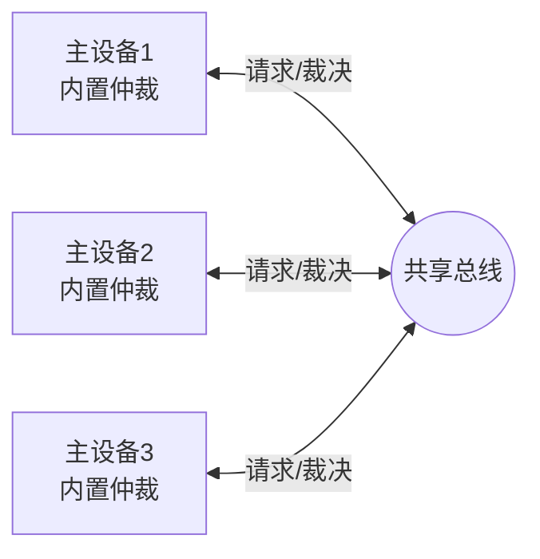

# 分布式总线仲裁

> [!IMPORTANT]
> 按照总线仲裁电路的==位置不同==，总线仲裁分为集中式仲裁和分布式仲裁两种方式。

## 为什么需要仲裁

总线上挂载了多个主设备（如 CPU、DMA 控制器），当两个及以上主设备同时请求使用总线时，必须有一套机制决定“谁先上”。这套机制就是**总线仲裁**。

如果只用一根公共的“忙”信号线或一个中央仲裁器来管理所有设备，随着设备数量增加，中央仲裁器会成为性能瓶颈和单点故障源。能不能把决策权“下放”给各个设备？这就引出了分布式仲裁。

## 它是什么与怎么做

分布式仲裁没有独立的中央仲裁器，==仲裁逻辑分散在各个主设备内部==。每个主设备都有自己的仲裁电路，通过总线上的共享信号线协同完成裁决。

常见的实现方式有两种：

- **独立请求线法**：每个设备有唯一的优先级编码，各自发出请求并监听其他设备的请求，自行比较优先级。
- **菊花链（串行）法**：允许信号依次穿过各设备，设备根据自身状态决定是否截获令牌或放行。

每个设备都在本地执行如下判断：

$$ \text{若 } P_{\text{自身}} > \max(P_{\text{其他请求者}}) \text{，则获得总线控制权} $$

其中 $P$ 表示设备的优先级。

## 与集中式仲裁的区别

| 对比维度 | 集中式仲裁 | 分布式仲裁 |
| :--- | :--- | :--- |
| ==仲裁电路位置== | 集中在中央仲裁器 | 分散在各主设备中 |
| 典型方式 | 链式查询、计数器定时查询、独立请求 | 独立请求线、自举分布式 |
| 可靠性 | 中央仲裁器是单点故障源 | 无中心节点，可靠性高 |
| 扩展性 | 增加设备需改动中央仲裁器 | 增加设备较容易 |
| 硬件开销 | 设备端简单，中央复杂 | 每个设备都需要仲裁逻辑 |

> [!NOTE]
> 区分两者的唯一根本标准是==仲裁电路的位置==，而不是连线的拓扑形状。

## 算对了的例子

回顾真题填空 127：

> 按照总线仲裁电路的 A 位置不同，总线仲裁有 B 集中式仲裁和 C 分布式仲裁两种方式。

**解析步骤：**
1. 题目问分类依据：集中式和分布式的本质区别在哪？在于仲裁电路放在哪——是集中在一个芯片里，还是分散到各个设备里。因此 A 填“**位置**”。
2. 既然按位置分，那两种对立的类别自然是 B 填“**集中式**”，C 填“**分布式**”。

## 常见的坑

> [!WARNING]
> 不要把“分布式仲裁”等同于“没有控制线”。分布式仲裁依然需要利用总线上的请求线或状态线进行信息交互，只是**做决定的大脑**搬到了各个设备内部。

> [!CAUTION]
> 考试中常将“独立请求方式”作为干扰项。在集中式仲裁中也有“独立请求方式”（每个设备单独向中央仲裁器发请求）。判断归属时，只看==最终是谁在做裁决==：中央仲裁器拍板就是集中式；各设备自己比对后拍板就是分布式。

> [!TIP]
> 记忆口诀：“集中看中央，分布靠大家；区别在哪里？电路放哪啦！”
