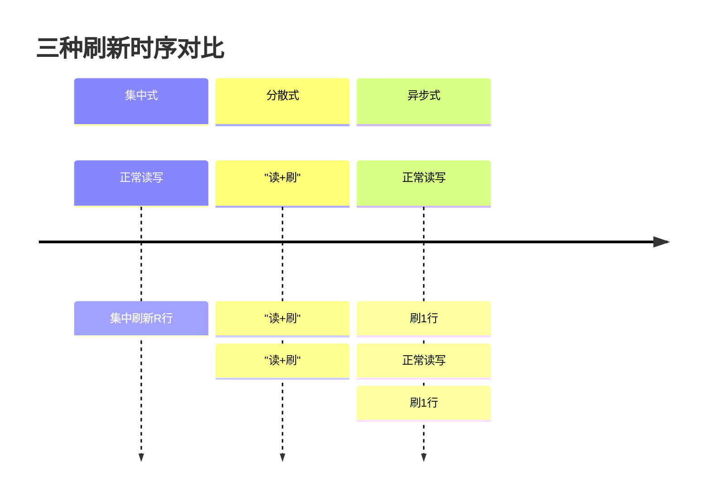

# DRAM的刷新方式（集中式刷新、分散式刷新）

DRAM 利用电容存储电荷来表示“0”或“1”。但电容会自然漏电，如果不定期补充电荷，数据就会丢失。因此，==DRAM 必须周期性刷新==，而 SRAM、PROM、FLASH 均不需要（选择题常考）。

> [!IMPORTANT]
> 刷新的本质是对 DRAM 矩阵的**每一行**依次进行一次读/写操作（读出后重写），使电容电荷恢复。

## 三种刷新方式怎么做

设 DRAM 芯片矩阵为 $R$ 行，单个读/写周期为 $t_C$，最大刷新间隔（死时间上限）为 $T$（通常 $2\mathrm{ms}$）。

- **集中式刷新**：在 $T$ 内，前一段正常读写，最后留出一段连续时间集中刷完所有 $R$ 行。总刷新时间 $= R \times t_C$。缺点：集中刷新期间 CPU 无法访存，存在较长的“死时间”。
- **分散式刷新**：把每个存取周期一分为二，前半段正常读写，后半段刷新一行。系统周期变为 $2t_C$。缺点：无死时间，但系统速度降为一半，且刷新过于频繁。
- **异步刷新**：将 $R$ 行均匀分散到 $T$ 时间内，每隔 $T/R$ 时间刷新一行。每次只占用一个 $t_C$ 作为死时间。这是实际中最常用的折中方案。

> [!NOTE]
> 无论哪种方式，对全部单元刷新一遍所需的==总刷新时间相同==，均为 $R \times t_C$（填空题考点）。区别仅在于这段时间如何分布。

## 与 SRAM 的区别

| 特性 | DRAM | SRAM |
| :--- | :--- | :--- |
| 存储元件 | 电容 | 触发器 |
| 是否需要刷新 | ==需要== | 不需要 |
| 集成度 | 高 | 低 |
| 速度 | 较慢 | 较快 |

## 计算实例

用 $16\mathrm{K} \times 1$ 位的 DRAM 芯片构成 $64\mathrm{K} \times 8$ 位存储器。芯片读/写周期 $t_C = 0.5\mu s$，CPU 在 $1\mu s$ 内至少访存一次。问：采用哪种刷新方式合理？两次刷新最大间隔是多少？全部刷新一遍的实际刷新时间是多少？

**分析过程：**

1. **选方式**：CPU 每 $1\mu s$ 至少访存一次。若用分散式，系统周期变 $2 \times 0.5 = 1\mu s$，勉强满足但无余量；若用集中式，死时间太长必然冲突。故==异步刷新最合理==。
2. **最大间隔**：DRAM 标准规定两次刷新最大时间间隔为 $2\mathrm{ms}$。
3. **算行数**：$16\mathrm{K} = 16384 = 128 \times 128$，即芯片矩阵为 $128$ 行。注意：扩展后的总容量虽为 $64\mathrm{K}$，但刷新是针对单片内部结构进行的，只需刷 $128$ 行。
4. **算实际时间**：每隔 $2\mathrm{ms} / 128 = 15.625\mu s$ 产生一次刷新请求（可取 $15\mu s$）。刷新一行耗时 $t_C = 0.5\mu s$，刷完 $128$ 行的实际总时间为：
$$128 \times 0.5\mu s = 64\mu s$$

> [!WARNING]
> 常见坑：计算行数时，误用扩展后的总地址数去开方。记住，==刷新针对的是单片 DRAM 内部的物理矩阵行数==，与外部字向/位向扩展无关。

> [!TIP]
> 解题口诀：先定行数 $R$（按单片矩阵算），再除时间 $T$（得刷新间隔），最后乘周期 $t_C$（得总刷新时间）。
