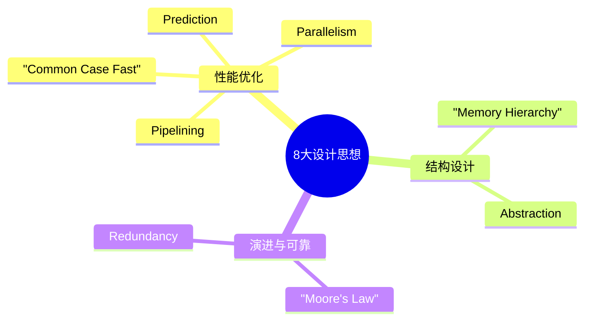

# 计算机设计的8个伟大思想（如Common Case Fast、Pipelining等）

## 计算机设计的8个伟大思想

为什么计算机硬件更新换代极快，但核心设计哲学却几十年不变？因为无论工艺如何进步，设计师始终在解决“性能”与“成本/复杂度”的矛盾。这8个伟大思想不仅是第1章绪论的理论基石，更是理解后续流水线、存储层次、RISC架构的==底层逻辑==。

> [!IMPORTANT]
> 8大思想并非孤立存在，而是相互支撑的设计权衡体系。考试中常结合RISC、流水线等具体技术考查其应用，需理解“为什么这么做”而非死记名称。

### 核心思想解析与关联

| 思想 | 核心含义 | 典型应用 | 易混淆点 |
| :--- | :--- | :--- | :--- |
| Make Common Case Fast | 加速高频事件 | 缓存、分支预测 | 不是优化所有情况 |
| Parallelism | 并行处理提升吞吐 | 多核、SIMD、流水线 | 不等于单纯提高主频 |
| Pipelining | 重叠执行多条指令 | CPU指令流水线 | 依赖数据冒险会停顿 |
| Prediction | 猜测以提前执行 | 分支预测、预取 | 误预测代价需可控 |
| Hierarchy of Memories | 存储分层平衡速度容量 | Cache-主存-辅存 | 局部性原理是基础 |
| Abstraction | 隐藏底层简化设计 | ISA、OS接口 | 抽象有性能开销 |
| Use Moore's Law | 利用晶体管增长红利 | 集成度提升、多核 | 功耗墙限制单核频率 |
| Dependability via Redundancy | 冗余保障可靠性 | RAID、ECC内存 | 冗余≠无故障 |

### 从真题看思想落地

回顾课件中的填空题52：“RISC CPU具有三个基本要素：简单指令系统、大量通用寄存器、==指令流水线优化==。”这正是多个思想的融合体现：

- **Make Common Case Fast**：RISC精简指令集，让高频简单指令在一个周期内完成；
- **Pipelining + Parallelism**：简单规整的指令格式使流水线各级耗时均衡，减少气泡；
- **Abstraction**：对程序员暴露简洁ISA，复杂操作由编译器分解为简单指令序列。

> [!TIP]
> 记忆口诀：“快并流预层抽摩冗”。对应：加速常见、并行、流水、预测、层次、抽象、摩尔、冗余。答题时先还原全称再展开。

### 常见误区警示

> [!WARNING]
> “Make Common Case Fast”≠“只优化常见情况”。罕见路径仍需正确执行，只是不优先投入硬件资源。例如分支预测失败后必须有恢复机制，否则程序出错。

> [!CAUTION]
> 不要将“Parallelism”等同于“多核”。流水线本质是==时间并行==（填空124考点），而多核是空间并行。现代CPU往往两者结合（时间+空间并行），答题时需区分语境。

### 一个算对的例子

题干问“RISC机器基本概念中不正确的句子”，选项C“RISC机器有复杂的指令系统”明显错误——这直接违背了Make Common Case Fast和Abstraction思想。而B“RISC机器一定是流水CPU”正确，因为若无流水线，简单指令的优势无法转化为实际性能提升，==RISC与流水线是共生关系==。此题正是检验你是否理解思想与技术实现的绑定逻辑。
