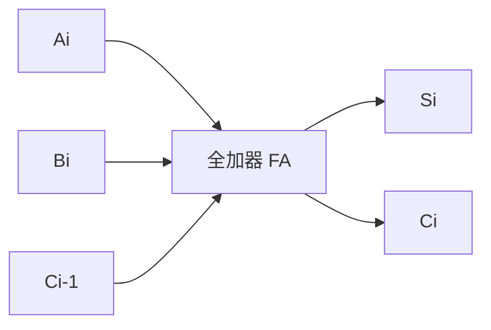

# 定点加减法运算与基本的二进制加法/减法器（全加器逻辑电路）

## 定点加减法与全加器

计算机内部只有加法器，没有减法器。那么，$A - B$ 是如何完成的？答案藏在补码的定义里：==减法变加法==。只要将 $[A-B]_{\text{补}}$ 转化为 $[A]_{\text{补}} + [-B]_{\text{补}}$，就能复用同一套硬件电路。而支撑这一运算的最小单元，就是**全加器（Full Adder）**。

### 全加器逻辑电路

全加器负责计算两个本位二进制数 $A_i, B_i$ 及低位进位 $C_{i-1}$ 的和 $S_i$ 与向高位的进位 $C_i$。其核心逻辑表达式为：

$$
S_i = A_i \oplus B_i \oplus C_{i-1}
$$

$$
C_i = (A_i \land B_i) \lor ((A_i \oplus B_i) \land C_{i-1})
$$

多个全加器级联即构成串行进位加法器。但在实际运算器中，为提高速度常采用并行进位（CLA）结构。无论内部如何优化，对外接口始终遵循补码加减法规则。

### 补码加减运算规则

运算时符号位与数值位同等参与运算，结果仍为补码形式。

| 运算类型 | 机器级操作 | 关键点 |
| :--- | :--- | :--- |
| $A+B$ | $[A]_{\text{补}} + [B]_{\text{补}}$ | 直接相加，模 $2^n$ 丢弃最高进位 |
| $A-B$ | $[A]_{\text{补}} + [-B]_{\text{补}}$ | ==求 $[-B]_{\text{补}}$：连同符号位取反末位加1== |

> [!IMPORTANT]
> 补码加减法的核心优势是==统一了加减运算==，且符号位可直接参与运算，无需单独处理正负号。

### 溢出判断：双符号位法

单符号位无法区分“正常进位”与“溢出”。南邮课程重点考查**双符号位（变形补码）** 判溢：将符号位扩展为两位（正数 `00`，负数 `11`），运算后根据高位符号位判断：

-   `00` / `11`：结果正确，无溢出
-   `01`：==正溢出==（上溢），结果大于最大正数
-   `10`：==负溢出==（下溢），结果小于最小负数

> [!WARNING]
> 双符号位中，==只有高位符号位代表真正的符号==，低位仅用于判溢。若两符号位不同，必溢出；相同则未溢出。此规则仅适用于加减法，不适用于乘除。

### 真题实战演练

以历年真题为例：设字长8位（含1位符号位），$A=0.1110101$，$B=0.1101011$，求 $A-B$ 并判溢。

1.  **写补码**：$[A]_{\text{补}} = 0.1110101$
2.  **求 $[-B]_{\text{补}}$**：$B$ 的补码按位取反末位加1 → $[-B]_{\text{补}} = 1.0010101$
3.  **相加**：
    $$
    \begin{array}{r@{\quad}l}
      0.1110101 & ([A]_{\text{补}}) \\
    +\ 1.0010101 & ([-B]_{\text{补}}) \\
    \hline
      0.0001010 & (\text{丢弃最高进位})
    \end{array}
    $$
4.  **判溢**：采用双符号位视角，结果符号位为 `00`，两符号位相同，==无溢出==。
5.  **还原真值**：结果为正，$A-B = +0.0001010$。

> [!TIP]
> 做 $A-B$ 题时，务必先写出 $[-B]_{\text{补}}$ 再相加，切忌直接用 $[B]_{\text{补}}$ 做减法。考试中 $[-B]_{\text{补}}$ 写对即可得关键步骤分。
