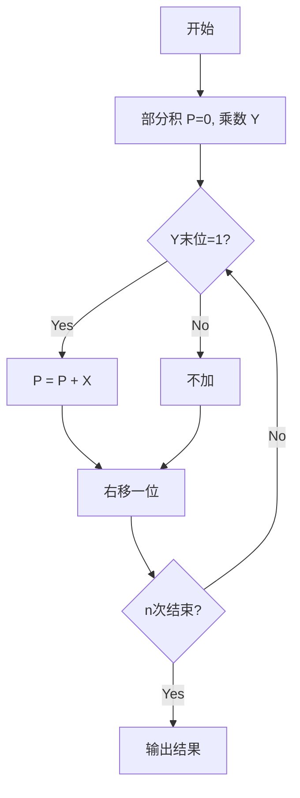

# 定点乘除法运算（一位原码乘法器原理图、一位除法器及机器算法）

## 定点乘除法运算核心解析

在计算机中，ALU 通常只具备加法器。如何实现乘除？本质是将复杂的乘除转化为**移位**和**加减**的序列操作。南邮《计组》重点考察原码一位乘、补码一位乘（Booth）及补码除法（加减交替法）。

### 原码一位乘法：符号与数值分离

原码运算最直观：**符号位单独异或，数值部分绝对值相乘**。

> [!IMPORTANT]
> ==核心结论==：若数值部分长度为 $n$，则需进行 **$n$ 次加法**（最坏情况）和 **$n$ 次移位**。
> *注意：每次迭代包含“判断-加法-移位”，共循环 $n$ 次。*

**常见坑**：很多学生误以为需要 $n+1$ 次移位。实际上，最后一次移位后直接得到结果，无需额外移位。参考考题选择 D。

### 补码一位乘法（Booth 算法）：统一符号处理

原码需单独处理符号，而 Booth 算法允许**符号位参与运算**，直接得到补码形式的积。

其核心在于观察乘数 $Y$ 的当前位 $y_i$ 和低位 $y_{i+1}$（初始 $y_{n+1}=0$）：
- $00$ 或 $11$：仅右移。
- $01$：加 $[X]_{\text{补}}$，再右移。
- $10$：加 $[-X]_{\text{补}}$，再右移。

> [!TIP]
> 记忆口诀：**“01加X，10减X，00/11只移”**。
> 注意：Booth 算法需进行 $n+1$ 次迭代（最后一步只加不移，或根据教材版本略有差异，南邮通常强调 $n$ 次移位，但判断次数为 $n+1$ 次以处理最后一位）。

### 补码除法：加减交替法

除法比乘法复杂，因为涉及“商”的判断和余数的恢复。**加减交替法（不恢复余数法）**是考点重中之重。

规则如下（设被除数/余数为 $R$，除数为 $Y$）：
1. **同号**：商 $1$，下一步 $2R - Y$。
2. **异号**：商 $0$，下一步 $2R + Y$。
3. **重复** $n$ 次。
4. **校正**：若最后余数符号与被除数不同，需修正余数；商的符号由第一步判断决定（或直接由补码规则生成）。

> [!WARNING]
> ==易错点==：
> 1. **移位方向**：乘法是**右移**（累积低位），除法是**左移**（扩大余数以便够减）。
> 2. **商的获取**：补码除法中，商也是补码形式。若题目要求原码商，需转换。
> 3. **第一步特殊**：有些教材要求第一步先做减法判断溢出，南邮考题中通常直接进入交替逻辑，注意 $R_0$ 与 $Y$ 的符号比较。

### 典型例题复盘

以计算题 $x = -0.10100, y = 0.11101$ 为例，用补码加减交替法求 $x \div y$：

1.  **初始化**：$[x]_{\text{补}}=1.01100, [y]_{\text{补}}=0.11101, [-y]_{\text{补}}=1.00011$。
2.  **判号**：$R_0$ (负) 与 $y$ (正) 异号 $\rightarrow$ 商 $0$，执行 $2R_0 + y$。
3.  **迭代**：
    -   $R_1$ 仍为负 $\rightarrow$ 商 $0$，执行 $2R_1 + y$。
    -   $R_2$ 变正 $\rightarrow$ 商 $1$，执行 $2R_2 - y$。
    -   ...依次类推直到 $n$ 位。
4.  **结果**：最终商 $Q$ 和余数 $R$ 需结合符号位确定。

| 特性 | 原码一位乘 | Booth 乘法 | 加减交替除法 |
| :--- | :--- | :--- | :--- |
| **符号处理** | 单独异或 | 参与运算 | 参与运算 |
| **移位方向** | 右移 | 右移 | **左移** |
| **操作核心** | 加/不移 | 加/减/不移 | 加/减 |
| **迭代次数** | $n$ 次 | $n+1$ 次判断 | $n$ 次 |

> [!NOTE]
> 复习时请亲手推导一遍 $x=-0.1011, y=-0.1101$ 的 Booth 乘法过程，重点关注附加位 $y_{n+1}$ 的变化及最后一步的处理。
