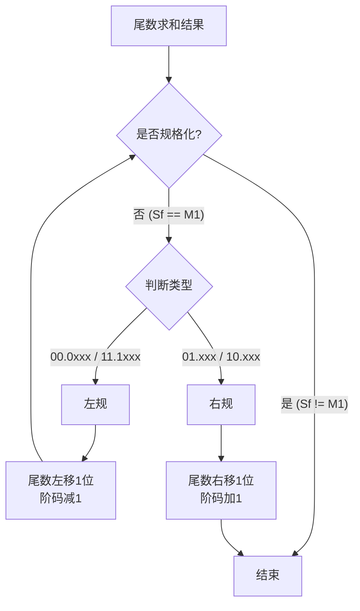

# 浮点数的规格化处理与规格化浮点数的真值

## 什么是规格化？

浮点数 $N = M \times 2^E$ 中，尾数 $M$ 的绝对值若太小（如 $0.001...$），有效数字会丢失；若太大则溢出。**规格化**就是通过调整阶码 $E$ 和尾数 $M$，使尾数满足特定范围，从而保证**精度最高**且表示唯一。

对于基数为 2 的浮点数：
- **原码规格化**：尾数最高位必须为 1，即 $1/2 \le |M| < 1$。
- **补码规格化**：==符号位与最高数值位相反==。
  - 正数：$0.1xx...x$
  - 负数：$1.0xx...x$

> [!IMPORTANT]
> 补码规格化判据：**数符 $S_f$ $\neq$ 尾数最高位 $M_1$**。
> 即：`00.1...` 或 `11.0...` 是规格化的；`00.0...` 或 `11.1...` 需左规。

## 为什么要规格化？

1. **保证精度**：将有效数字尽可能留在高位，避免前导零占用尾数位。
2. **表示唯一**：防止同一个数有多种表示形式（如 $0.5 \times 2^1$ 和 $0.25 \times 2^2$），便于比较大小。

## 怎么做：左规与右规

在浮点加减运算后，若结果不满足规格化条件，需进行移位操作：

- **左规**：当尾数出现 `00.0...` 或 `11.1...` 时，尾数左移，阶码减 1，直到满足规格化。
- **右规**：当尾数溢出（双符号位为 `01` 或 `10`）时，尾数右移 1 位，阶码加 1。

> [!TIP]
> **口诀**：左规提精（左移增精度），右规防溢（右移保范围）。
> **注意**：左规可能多次，右规通常只需一次。

## 常见坑与辨析

| 概念 | 原码规格化 | 补码规格化 |
| :--- | :--- | :--- |
| **判据** | 最高数值位为 1 | **符号位 $\neq$ 最高数值位** |
| **正数形式** | $0.1xx...$ | $0.1xx...$ |
| **负数形式** | $1.1xx...$ | $1.0xx...$ |
| **特例** | 无 | $-1/2$ 表示为 $1.100...0$ **非**规格化，需视为 $1.000...0$ (即 -1) 或特殊处理 |

> [!WARNING]
> **易错点**：补码中 $-1/2$ 的原码是 $1.100...$，但补码是 $1.100...$ 吗？
> $-0.5$ 的补码是 $1.100...0$。此时符号位 1，最高位 1，相同，**不满足**规格化定义（$S_f \neq M_1$）。
> 但在某些教材中，规定 $-1/2$ 视为规格化边界，或要求左规成 $1.00...$ (即 -1, 阶码+1)。南邮教材通常严格遵循 **$S_f \neq M_1$**，因此 $1.10...0$ 需左规。

## 典型例题解析

**题目**：计算 $X+Y$，其中 $X=2^{-011}\times0.1011000$，$Y=2^{-010}\times(-0.011100)$。阶码 3 位数值+2 位阶符（补码），尾数 6 位数值+2 位数符（补码）。

**步骤 1：转换补码**
- $E_x = -3 \rightarrow [E_x]_{\text{补}} = 11101$
- $M_x = +0.101100 \rightarrow [M_x]_{\text{补}} = 00.101100$
- $E_y = -2 \rightarrow [E_y]_{\text{补}} = 11110$
- $M_y = -0.011100 \rightarrow [M_y]_{\text{补}} = 11.100100$

**步骤 2：对阶**
$\Delta E = E_y - E_x = 1$。$X$ 阶小，尾数右移 1 位，阶码加 1。
$[M_x']_{\text{补}} = 00.010110$，$E_x' = -2$。

**步骤 3：尾数相加**
$$ 00.010110 + 11.100100 = 11.111010 $$

**步骤 4：规格化**
结果 $11.111010$，符号位 $11$，最高数值位 $1$，相同 $\rightarrow$ **非规格化**。
- **左规 1**：左移 1 位 $\rightarrow 11.110100$，阶码 $-2-1=-3$。仍非规格化。
- **左规 2**：再左移 1 位 $\rightarrow 11.101000$，阶码 $-3-1=-4$。
- 检查：符号 $11$，最高位 $0$，不同 $\rightarrow$ **规格化完成**。

**最终结果**：
阶码 $-4$ ($11100$)，尾数 $11.101000$。
真值：$2^{-4} \times (-0.011000)_2$。
