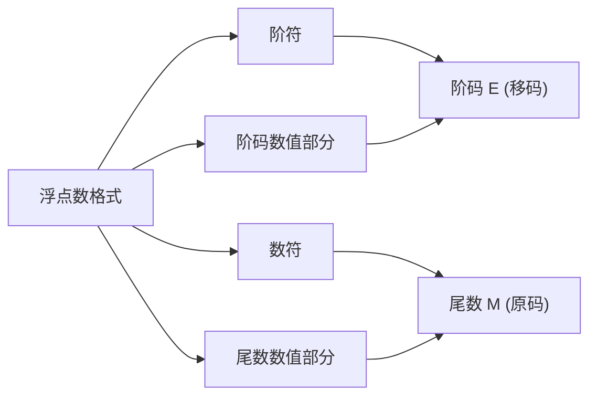

# 浮点数的表示方法（阶码、尾数及其符号位组成）

## 浮点数的表示方法

计算机处理的数据，小数点位置固定不变会导致表示范围极为有限。比如用定点小数，绝对值最大都不到 1。为了同时表示极大值和极小值，浮点数应运而生——它让小数点的位置可以“浮动”。

### 一个浮点数由哪几部分构成

任何一个二进制浮点数都可以写成类似科学计数法的形式：

$$N = M \times 2^E$$

一个机器浮点数由三部分组成：

- **阶码 E**：用定点整数表示，指明小数点在数据中的位置，决定了 ==浮点数的表示范围==。
- **尾数 M**：用定点小数表示，决定了 ==浮点数的表示精度==。
- **数符**：即尾数的符号位，通常放在尾数的最高位。

在 IEEE 754 标准中，尾数用 ==原码== 表示，阶码用 ==移码== 表示，基值固定为 2。这样做的目的是简化硬件比较、方便对阶。

### 为什么要规格化

同一个浮点数可能有多种写法：$0.00101 \times 2^5$ 和 $1.01000 \times 2^2$ 表示的是同一个值。如果不加以统一，运算和存储都会乱套。

> [!IMPORTANT]
> 规格化的核心要求：尾数最高数值位必须为有效位，不能是前导零。

- 原码规格化尾数形式：$\pm 0.1\text{xxx}\ldots$
- 补码规格化尾数形式：符号位与小数点后第一位数值 ==相异==（即 $00.1\text{xxx}$ 或 $11.0\text{xxx}$）。

不满足时，通过**尾数左移/右移**并**同步修改阶码**来完成规格化处理。

### 补码规格化的判别易错点

很多同学误以为补码规格化看的是“阶符与数符”。这是一个常见陷阱：

> [!WARNING]
> 补码浮点数判断规格化，看的是**数符与尾数小数点后第一位数字**是否相异，与阶符无关！

题目反复考这个点：数符为 0，小数点后第一位为 1；或数符为 1，小数点后第一位为 0，才是规格化数。

### 浮点数的表示范围

设阶码数值部分 m 位，尾数数值部分 n 位，基数为 2，规格化表示的四个边界值如下：

| 类别 | 表达式 | 含义 |
| :--- | :--- | :--- |
| 最大正数 | $(1-2^{-n}) \times 2^{2^m-1}$ | 阶码最大，尾数全 1 |
| 非 0 最小正数 | $2^{-n} \times 2^{-(2^{m-1}-1)}$ | 阶码最小，尾数最低位为 1 |
| 最大负数 | $-2^{-n} \times 2^{-(2^{m-1}-1)}$ | 绝对值最小的负数 |
| 最小负数 | $-(1-2^{-n}) \times 2^{2^m-1}$ | 绝对值最大的负数 |

> [!TIP]
> 记忆口诀：“范围靠阶码，精度靠尾数”。阶码越大范围越宽，尾数越长精度越高。

### 算对一个例子

题目：按补码浮点运算求 $X+Y$，其中 $X = 2^{-011} \times 0.101100$，$Y = 2^{-010} \times (-0.011100)$。

1. **对阶**：求阶差 $\Delta E = E_Y - E_X = -2 - (-3) = 1$。小阶向大阶看齐，$M_X$ 右移 1 位，阶码 +1。
2. **尾数相加**：$M_X' + M_Y = 00.010110 + 11.100100 = 11.111010$。
3. **规格化**：结果 $11.111010$，数符（1）与小数点后第一位（1）相同，不满足规格化。左规三次后得 $11.101000$，阶码变为 $-4$。
4. **最终结果**：$2^{-4} \times (-0.011000)$。

整个过程中，对阶、尾数运算、规格化三步环环相扣，任何一步的疏忽都会导致最终结果偏移。
