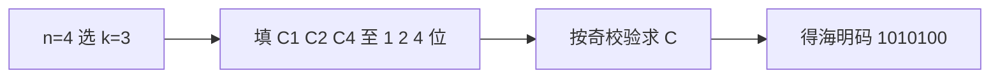

# 海明码（Hamming码，含SEC编码与解码）

## 它是什么与为什么需要

在数据的存储与传输中，奇偶校验码只能发现一位错、且不能定位位置。若想**自动纠正一位错并发现两位错**，就要用海明码（Hamming 码）。南邮课件中称其为 **SEC 码**（Single Error Correcting，单错纠正）。它在 $n$ 位信息位中加入 $k$ 位校验位，满足：

$$2^k \geqslant n+k+1$$

校验位放在序号为 $2^i$ 的位置（第 1、2、4、8… 位），其余放信息位。

## 怎么做：编码

以课件题为例：信息码 **1100**（即 $n=4$）。先问一句：要几位校验位？由 $2^k \geqslant 4+k+1$ 得 $k=3$，共 7 位。

| 序号 | 1 | 2 | 3 | 4 | 5 | 6 | 7 |
|---|---|---|---|---|---|---|---|
| 名称 | $C_1$ | $C_2$ | 1 | $C_4$ | 1 | 0 | 0 |

按 **奇校验** 配 $C$（小组内含 $C$ 本身应有奇数个 1）：

- $C_1$ 管 1,3,5,7：已有 3,5,7 为 $1,1,0$ → 异或得 $0$，取反得 $C_1=1$
- $C_2$ 管 2,3,6,7：3,6,7 为 $1,0,0$ → 异或 $1$，取反得 $C_2=0$
- $C_4$ 管 4,5,6,7：5,6,7 为 $1,0,0$ → 异或 $1$，取反得 $C_4=0$

所以海明码为 **$1010100$**（第 1~7 位）。

> [!TIP]
> 南邮考试常写：先算监督关系异或值，再**按奇/偶原则决定取反或不取反**。偶校验时异或结果就是 $C$，无需取反。

## 怎么做：解码与纠错

已知收到的（配偶原则）为 **1100100**。重算校验组：

- $P_1 = 1\oplus3\oplus5\oplus7 = 1\oplus0\oplus1\oplus0 = 0$
- $P_2 = 2\oplus3\oplus6\oplus7 = 1\oplus0\oplus0\oplus0 = 1$
- $P_4 = 4\oplus5\oplus6\oplus7 = 0\oplus1\oplus0\oplus0 = 1$

拼成 $P_4P_2P_1 = 110_2 = 6$，说明 ==第 6 位出错，将其翻转==；实际信息是位置 3,5,6,7 对应的 **0110**。

## 区别与坑

| 概念 | 能力 | 校验位位置 |
|---|---|---|
| 奇偶校验 | 仅检一位错 | 末尾 1 位 |
| 海明码 SEC | 纠一位错 | $2^i$ 序号位 |
| 循环纠错码 | 多用于外存 | 按模 2 除法定 |

> [!WARNING]
> 最常错的是：把 $P_4P_2P_1$ 写成 $P_1P_2P_4$ 的顺序。==必须按 $C_4 C_2 C_1$ 拼二进制==，否则定位位数全反。
>
> [!CAUTION]
> 配偶时 $P$ 组异或结果非零即错；若 $P=0$ 也可能发生**两位错**，SEC 码默认只能纠一位，别硬说一定无错。

> [!IMPORTANT]
> ==核心结论==：海明码用 $k$ 个 $2^i$ 位校验实现一位纠错；解码时对监督组重算 $P$，拼接值得出错位号。
