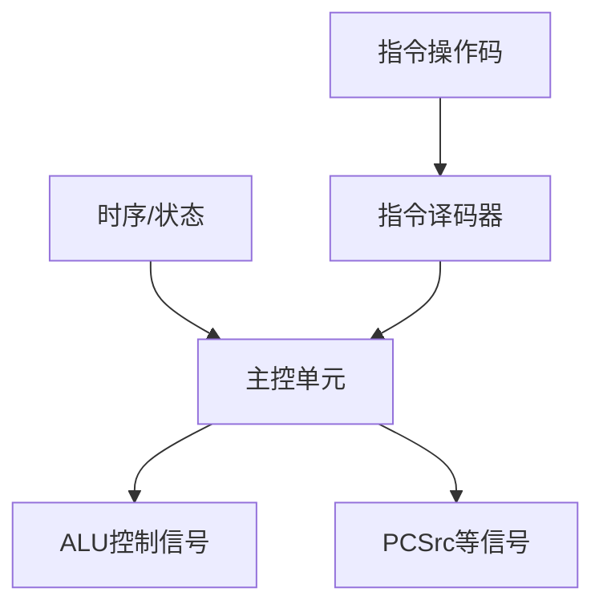

# 组合逻辑（硬连线）控制方式的特点与两级控制模式

控制器是 CPU 的“指挥中心”，负责从主存取出指令、完成操作码译码，并产生有关的操作控制信号来解释执行该指令。那么，这些密密麻麻的控制信号究竟是怎么“变”出来的？

主要有两条路线：==组合逻辑（硬连线）控制方式==与微程序控制方式。

## 什么是组合逻辑控制

组合逻辑控制的基本原理，是把每一个微操作控制信号都看作若干输入变量的布尔函数。具体来说，某一微操作控制信号是 ==指令操作码译码输出、时序信号和状态条件信号的逻辑函数==。

换句话说，只要当前处于哪个节拍、正在执行哪条指令、标志位是什么状态确定了，通过一堆门电路就能直接算出该亮哪个控制信号。因为信号在时钟周期内由纯硬件电路转换生成，所以也叫**硬布线（hardwired）**或**硬连线控制器**。

> [!IMPORTANT]
> RISC 架构由于指令规整、译码简单，通常采用组合逻辑方式来实现控制器。

## 两级控制模式怎么做

面对几十上百个控制信号，如果全部混在一起写逻辑式会极其混乱。因此设计时常采用**两级控制模式**，将任务拆分：

1. **第一级（派生控制）**：结合 `aluop` 编码及真值表，专门设计 ALU 控制相关的组合逻辑，派生出 ALU 控制信号。
2. **第二级（主控逻辑）**：继续设计 `PCSrc` 等其余控制器的组合逻辑，最终合并化简，完成整个主控单元的组合逻辑设计。

## 设计步骤与实例

南邮历年考试中常考组合逻辑的设计步骤，可以总结为三步走：

> [!TIP]
> 记忆口诀：**列表 → 写式 → 画图**。
> 1. 列出操作时间表（整理输入输出真值表）；
> 2. 写出微操作命令的最简表达式（用布尔代数化简）；
> 3. 画出逻辑图（用门电路、触发器等器件实现）。

**实例演示**：假设要根据指令的 `OP` / `func` 字段断定是否发生分支（即产生 `Branch` 信号），依据教材中类似“表 3-44”的真值表：

| OP | func | Branch |
|:--:|:----:|:------:|
| 0  | 0    | 0      |
| 0  | 1    | 1      |
| 1  | 0    | 1      |
| 1  | 1    | 0      |

由真值表可直接写出逻辑式：$Branch = \overline{OP} \cdot func + OP \cdot \overline{func}$。利用布尔代数识别出这是异或关系，化简为 $Branch = OP \oplus func$。最后用一个异或门即可画出逻辑图，完成该部分的组合逻辑设计。

## 与微程序控制的对比

为什么有了速度极快的组合逻辑，还需要微程序？两者在设计思想和适用场景上有本质区别：

| 比较维度 | 组合逻辑（硬连线） | 微程序控制 |
| :--- | :--- | :--- |
| **核心思想** | 基于组合逻辑电路 | 用存储逻辑代替硬连线逻辑 |
| **结构特点** | 不规整、繁琐 | 结构规整，利于设计自动化 |
| **速度** | ==快==（纯硬件门延迟） | 慢（需访问控制存储器） |
| **可维护性** | 差，改指令要重新布线 | 好，具备灵活性，改微代码即可 |

> [!NOTE]
> 填空题高频考点：微程序设计技术是利用**软件**方法设计**操作控制**的一门技术，具有规整性、可维护性、**灵活性**等优点。

## 常见易错坑

> [!WARNING]
> - **别把“硬布线流程图”画成微程序流程图**：硬布线器设计时，先画出的是**指令周期**流程图，再利用**布尔代数**写出综合逻辑表达式，最后用**门电路、触发器或可编程逻辑**实现。
> - **两级控制不要漏**：不要把 ALU 控制和主控单元混为一谈，要先根据真值表分别写出各输出码位（如 $\mu A[7] \sim \mu A[0]$）的逻辑式，再合并化简。
