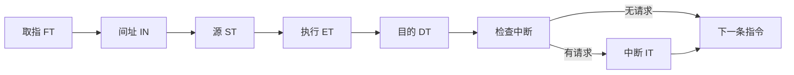
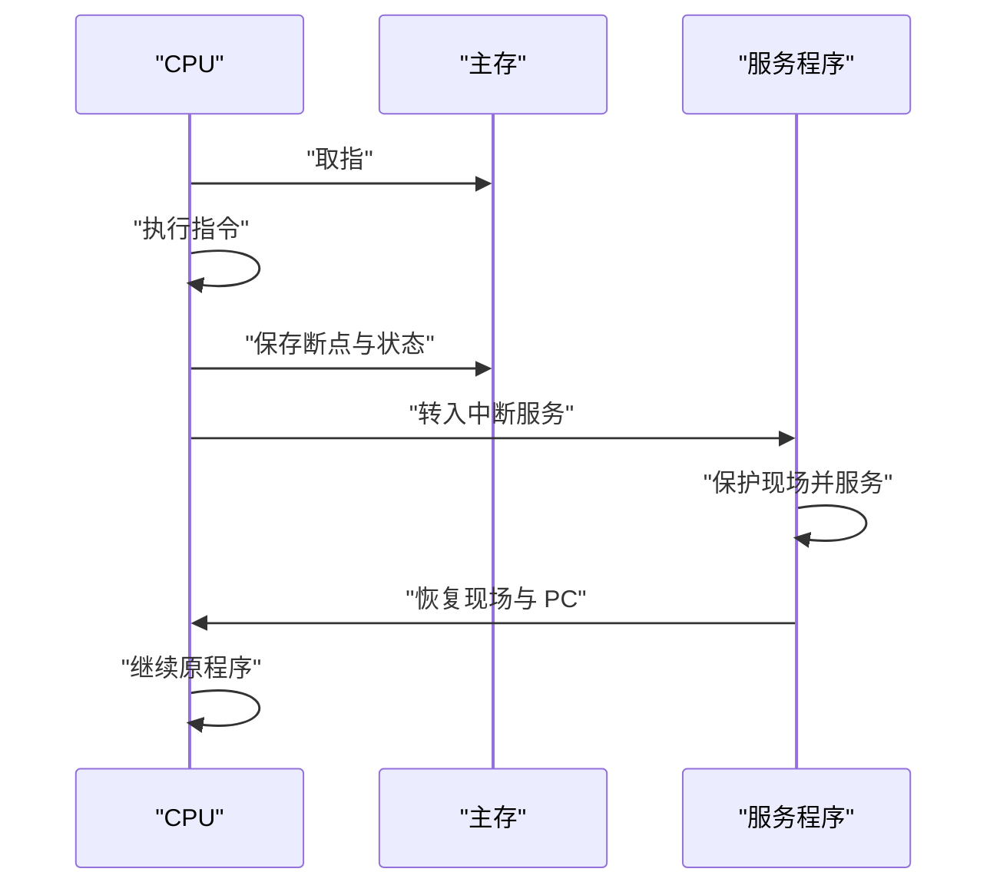
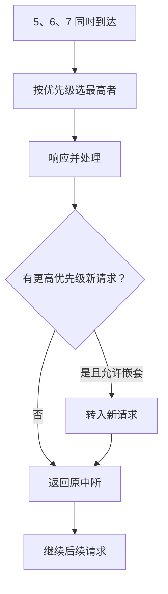

# 公操作与指令周期（取指、间址、执行、中断周期）

## 什么是公操作与指令周期

一条机器指令的执行，可拆成若干相对独立的阶段，每个阶段完成一组固定或相对固定的操作，这些阶段通常称为**指令周期**。其中：

- **取指周期（FT）**：所有指令都要经过，负责从内存取出指令；
- **源周期（ST）**：需要读取源操作数时进入；
- **目的周期（DT）**：需要把结果写回目的位置时进入；
- **执行周期（ET）**：完成指令规定的运算、传送或控制；
- **间址周期（IN）**：指令地址字段给出的是间接地址时，先取得有效地址；
- **中断周期（IT）**：CPU响应中断时，保存断点和程序状态，转向中断服务程序。



实际指令不一定经过所有阶段。例如 `MOV R0,R1` 以寄存器传送为主，通常只需取指和执行；而 `MOV (R0),(R1)` 还可能涉及地址形成与存储器读写。

## 公操作是什么

**公操作**是每条指令执行过程中共同具有、可以复用的操作。典型公操作是：

1. **取指令**：根据 `PC` 的内容访问存储器，将指令送入 `IR`；
2. **更新 PC**：使 `PC` 指向下一条指令；
3. **形成有效地址**：需要时计算或读取操作数地址；
4. **取操作数或写回结果**；
5. **检查并响应中断**。

> [!IMPORTANT]
> 各条指令的共同操作是“取指令（取指）”，而不是笼统地选择“取操作数”或“取地址”。

取指周期的典型微操作可写为：

$$
M \rightarrow IR,\qquad PC \leftarrow PC+1
$$

这里 $M$ 表示主存，$IR$ 表示指令寄存器。若按字节编址且指令长度为多个字节，实际机器还可能进行多次 $PC$ 加法。

## 四个关键周期

| 周期 | 主要任务 | 是否所有指令都需要 |
|---|---|---|
| 取指周期 FT | 从 $M$ 取指令到 $IR$，更新 $PC$ | 是 |
| 间址周期 IN | 取得间接地址，形成有效地址 | 仅间接寻址时 |
| 执行周期 ET | 完成运算、传送或控制动作 | 是，具体动作因指令而异 |
| 中断周期 IT | 保存断点，转入中断服务程序 | 有中断且获准时 |

> [!TIP]
> 记忆顺序：**先取指，再定址；取源、执行、写回；最后查中断。**

### 间址周期

若指令采用间接寻址，指令中给出的不是最终数据地址，而是“存放有效地址的单元地址”。间址周期先从该单元取出有效地址，再由它访问真正的操作数。

> [!WARNING]
> 间址周期不是“再取一次指令”，而是“取得操作数的有效地址”。

### 执行周期

取指后，CPU根据操作码决定执行什么。例如加法要把源操作数与累加器内容相加；传送指令要把源内容送到目的位置；转移指令要修改 $PC$。

> [!IMPORTANT]
> 执行周期的具体内容由操作码决定，不能把所有指令的执行动作都理解为同一种运算。

## 指令执行步骤示例

### `MOV R0,R1`

含义为：

$$
R0 \leftarrow R1
$$

1. **FT**：由 $PC$ 给出指令地址，$M\rightarrow IR$，更新 $PC$；
2. **ET**：识别操作码和寄存器字段；
3. 将 $R1$ 送入数据通路；
4. 将结果写入 $R0$；
5. 若无中断请求，继续取下一条指令。

### `MOV (R0),(R1)`

按多数指令系统的约定，表示：

$$
M[R0] \leftarrow M[R1]
$$

1. **FT**：取指令，$M\rightarrow IR$，更新 $PC$；
2. **ET**：读出 $R0$、$R1$，形成两个存储操作数地址；
3. 访问 $M[R1]$，读出源操作数；
4. 访问 $M[R0]$，写入结果；
5. 检查中断，进入下一条指令或中断周期。

## 中断响应与恢复

当指令执行结束且中断请求满足响应条件时，CPU进入**中断周期 IT**，通常执行：

$$
\begin{aligned}
&保存断点：M[SP]\leftarrow PC\\
&PC\leftarrow 中断服务程序入口地址
\end{aligned}
$$

同时还可能保存程序状态字、处理器状态寄存器等内容，并清除或屏蔽部分可屏蔽中断请求。中断服务程序结束时，通常执行中断返回指令，恢复 $PC$ 和状态寄存器，从断点继续执行原程序。



> [!NOTE]
> “保存断点”由硬件在中断周期完成；“保护通用寄存器现场”通常由中断服务程序完成，二者不要混为一谈。

## 中断请求的处理顺序

若 $5、6、7$ 级请求同时到达，应依据题目给出的**优先级规则**处理，而不是简单按到达顺序处理。请求 $8$ 在 $6$ 尚未处理完时到达，若允许嵌套中断，则可能在处理 $6$ 期间转入 $8$；处理 $8$ 时请求 $2$ 又到达，还要判断 $2$ 的优先级及当前是否开放相应中断。



> [!CAUTION]
> 中断响应顺序取决于优先级、屏蔽字和是否允许中断嵌套，不能仅凭编号大小判断。

## 流水线中的数据相关

若后一条指令需要前一条指令尚未产生的结果，就存在**数据相关**。例如：

```text
ADD R1,R2,R3
SUB R4,R1,R5
```

第二条指令要使用第一条刚生成的 $R1$。在顺序执行中必须等待前条完成；在流水线中则可能采用**转发（旁路）**直接把结果送给后续指令，或通过**停顿（阻塞）**等待结果就绪。

> [!IMPORTANT]
> 数据相关会限制流水线并行度，但本身不一定构成程序错误；编译器重排、转发和停顿都可以处理这种依赖。

常见易错点是：把“取操作数”当成公操作、把间址周期理解成再次取指、忽视中断返回时需要恢复现场，以及认为所有中断一定按编号从小到大处理。
