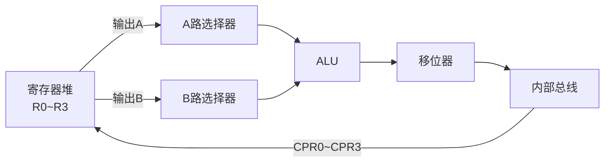

# 指令流程与微命令（操作时间表、通路选择控制）

## 指令流程与微命令

指令的执行，本质上是一串**微操作**在时钟节拍下有序完成的过程。每个微操作都需要一个**微命令**来触发相应的硬件动作。那么问题来了：一条指令从取指到执行完毕，这些微命令到底什么时候发出、发哪些、由谁来决定？

### 微命令与操作时间表

**微命令**是控制数据通路中某个部件完成一次基本动作的控制信号，例如打开某个三态门、让 ALU 做加法、给某个寄存器发写入脉冲。**微操作**则是被控制部件实际执行的动作，两者是一一对应的。

> [!IMPORTANT]
> ==微命令是控制信号，微操作是硬件动作。== 考试中常考“微命令 vs 微操作”的辨析：前者是“因”，后者是“果”。

一条指令的完整执行过程可以按时钟周期拆分为若干**机器周期**：

| 周期 | 含义 | 典型动作 |
|:---:|:---:|:---|
| 取指周期 FT | 取出指令 | PC→MAR，读存储器，IR←MDR |
| 源周期 ST | 取源操作数 | 根据寻址方式计算有效地址并取数 |
| 目的周期 DT | 取目标操作数 | 双操作数指令若目的操作数在存储器中，需先取出 |
| 执行周期 ET | 执行运算 | ALU 运算、移位、结果写回 |
| 中断周期 IT | 响应中断 | 保存断点、关中断、转中断服务程序 |

> [!NOTE]
> 选择题中的“**DT 周期**”即 **目的周期**，用于**取目标操作数**，不是取指周期，也不是源周期。双操作数指令（如 `ADD [addr], R0`）若目的操作数在内存中且需要先读出，就必须有 DT。

**操作时间表**就是一张“周期 × 节拍 → 微命令”的对应表，它精确描述了每个时钟节拍内哪些微命令有效。设计控制器时，时间表是微程序编写的直接依据。

### 通路选择控制：数据怎么“走”

以寄存器堆为核心的典型数据通路如下：

数据从源寄存器到目的寄存器的**路径选择**靠三类微命令完成：

- **选择器控制**：A 路选择器选哪个寄存器作为 ALU 的 A 输入，B 路选择器选哪个作为 B 输入。
- **ALU 功能控制**：决定做加法、逻辑或，还是**直通**（输出等于某一输入）。
- **结果分配控制**：决定总线上的数据写入哪个寄存器（CPR0~CPR3）。

### 例题：R0 → R1 怎么走

**问**：实现 R0 传送给 R1，以下哪组信号正确？

- A. A路选R0，ALU选A直通，移位直传，**CPR2**
- B. **B路**选R0，ALU选B直通，移位直传，CPR1
- C. A路选R0，ALU选**B路直通**，移位直传，CPR1

**想清楚三个问题**：

1. **数据从哪出来？** R0 必须被某个选择器选中。
2. **ALU 怎么传？** 直通——让输出等于输入，不能做加法“破坏”数据。
3. **往哪写？** 目标 R1 对应 **CPR1**，CPR2 是写 R2。

> [!WARNING]
> 选项 A 虽然数据路径没错，但**结果写到了 R2**（CPR2），所以错误。选项 B 中若 R0 只接到 A 路选择器，则 B 路选 R0 根本取不到数据，同样是错的。

正确答案是 **C**：数据从 R0 经 A 路选出，ALU 设为直通（`B 路直通`在部分教材中表示“A 输入直接透传到输出”，或 B 路为 0 配合实现），移位器直传，最后 **CPR1** 有效把结果写入 R1。

### 例题：R2 = R1 + R0

> [!TIP]
> 加法需要**两个操作数分别进 A、B 两路**，哪个进 A、哪个进 B 取决于硬件连线，只要加法和写入正确即可。

| 方案 | A路 | B路 | ALU | 结果 |
|:---:|:---:|:---:|:---:|:---:|
| A | R0 | R1 | 加法 | CPR2 ✓ |
| B | R1 | R0 | 加法 | CPR2 ✓ |
| C | R0 | **R1（左句却写A选R1）** | — | ✗ |

选项 C 说“A路选R0，**A 路选 R1**”——同一个选择器不可能同时选中两个输入，==这是典型的逻辑冲突==，直接排除。

### 常见坑

1. **结果分配写错寄存器**：数据路径全对，CPR 编号与目标寄存器不匹配，功亏一篑。
2. **“直通”不等于“不操作”**：ALU 直通仍需要显式的功能选择微命令，不能“什么都不发”。
3. **同一选择器双选**：一个多路选择器在一个时刻只能选一个输入，出现“A 选 X，A 选 Y”就是硬错误。
4. **混淆 DT 与 ST**：ST 取**源操作数**，DT 取**目的操作数**，只有目的操作数在内存中且需要先读时才需要 DT。
