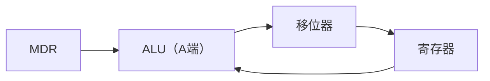

# 指令执行步骤与信息传送途径（地址信息、数据信息、转移地址）

## 指令执行步骤

一条机器指令在 CPU 内的执行，通常分解为若干**机器周期**。南邮《计算机组成与结构》中常用的划分是：

| 周期 | 含义 | 主要任务 |
|------|------|----------|
| **FT** | 取指周期（Fetch） | 按 PC 从主存取指令到 IR，并修改 PC |
| **ST** | 源周期（Source） | 取源操作数 |
| **DT** | 目的周期（Destination） | 取目的操作数（若目的操作数在内存中） |
| **ET** | 执行周期（Execute） | 完成运算或数据传送 |

> [!IMPORTANT]
> 考试中常问“FT 周期为什么”“ST 周期为什么”——答案分别是 **取指周期** 和 **源周期（取源操作数）**。不要与 DT、ET 混淆。

为什么需要这样划分？因为 CPU 内部的寄存器、ALU、总线在同一时刻只能完成有限的数据传送，==每条指令的执行本质就是一组有序的数据通路控制==。

并非所有指令都需要 DT。例如 `MOV R0, R1` 的源和目的都在寄存器中，不需要访存取操作数；而 `MOV (R0), (R1)` 的源和目的都是**间接寻址**，两个操作数都需经主存，因此要多一个 DT。

### 例子一：MOV R0, R1 的执行步骤

这条指令把寄存器 R0 的内容送入 R1，不涉及内存操作数。执行步骤为：

1. **FT**：`PC → MAR`，主存读出指令 → `MDR → IR`；同时 `PC+1 → PC`。
2. **ST**：`R0 → A`（源操作数送入 ALU 输入端）。
3. **ET**：`A → 移位器 → R1`（完成传送）。

> [!TIP]
> 由于源和目的都在寄存器堆内部，**没有 DT 周期**。这是与 `MOV (R0), (R1)` 的关键区别。

### 例子二：MOV (R0), (R1) 的执行步骤

两者都用寄存器间接寻址，操作数在主存中。执行步骤：

1. **FT**：`PC → MAR`，指令 → `MDR → IR`，`PC+1 → PC`。
2. **ST**：`R0 → MAR`，主存读出的源操作数 → `MDR → A`。
3. **DT**：`R1 → MAR`（准备目的地址）。
4. **ET**：`A → 移位器 → MDR`，`MDR → 主存` 写入 R1 指向的单元。

> [!WARNING]
> 常见坑：以为 DT 是“把目的操作数读进来”。实际上对于**写内存**的指令，DT 周期是在准备目的地址（第 3 步），真正的写入发生在 ET。题目若问“DT 周期做什么”，要结合指令判断，不能一律回答“取目的操作数”。

## 信息传送途径

指令执行中的信息可分为三类：**地址信息**、**数据信息**、**转移地址**。

### 地址信息

取指令或取操作数时，先要把地址送到 **MAR**。例如：

- 取指：`PC → MAR`
- 取源操作数（间接寻址）：`R0 → MAR`
- 取/存目的操作数：`R1 → MAR`

地址经过 MAR 后驱动主存，选中对应单元。

### 数据信息

数据信息是实际被传送或运算的内容，一般路径为：

- 读内存时：主存 → `MDR` → `A`（或其他寄存器）。
- 写内存时：寄存器 → `A` → 移位器 → `MDR` → 主存。

### 转移地址

执行转移指令时，要把**目标地址**送入 PC，而不是简单做 `PC+1`。常见路径：

- 寄存器寻址转移：`R0 → PC`
- 直接寻址转移：指令中的地址码字段 → `PC`

例如题目中选择题 5 的选项 C：

> `PC-A-ALU-移位器-MAR，M-MDR-IR，PC-A-ALU-移位器-PC；R0-A-ALU-移位器-R1`

这里完整描述了 **取指**（PC 送地址、读指令入 IR、更新 PC）和 **执行**（R0 送 R1）的数据通路动作，所以它是完整操作。

> [!NOTE]
> 三种信息的本质区别在于“送到哪里”：地址信息送 **MAR**，数据信息送 **MDR/ALU/寄存器**，转移地址送 **PC**。选择题常把路径写出来让你判断是否缺步，抓住目标寄存器即可快速判断。
