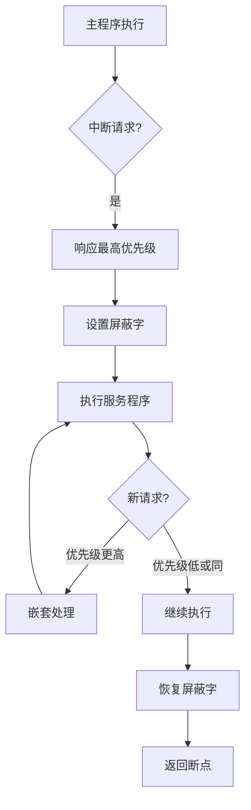

# 中断屏蔽字设计与中断处理优先级排队

## 中断屏蔽字与中断处理优先级

中断屏蔽字是中断系统实现优先级控制的核心机制，它通过软件设置来动态改变中断处理的实际次序。理解这一机制需要区分两个关键概念：**中断响应优先级**由硬件排队电路决定，是固定不变的；而**中断处理优先级**则通过屏蔽字灵活调整，决定了CPU实际为哪个中断源服务的顺序。

### 屏蔽字的设计原理

每个中断源对应一个屏蔽字，其位数等于中断源总数。屏蔽字中第 $i$ 位为1表示**屏蔽**第 $i$ 个中断源，为0表示**允许**其中断请求。设计规则如下：

- **自身必须屏蔽**：任何中断源的屏蔽字中，对应自身的位必须为1，防止同优先级中断嵌套
- **高优先级不屏蔽**：若希望中断源 $X$ 的处理优先级高于 $Y$，则 $X$ 的屏蔽字中对应 $Y$ 的位必须为0（允许 $Y$ 打断 $X$ 是不合理的，因此实际设计中 $X$ 的屏蔽字应屏蔽 $Y$）
- **低优先级要屏蔽**：处理优先级高的中断源，其屏蔽字应屏蔽所有处理优先级低于它的中断源

> [!IMPORTANT]
> 屏蔽字中1的个数越多，该中断源的处理优先级通常越高。处理优先级最高的中断源，其屏蔽字全为1；处理优先级最低的，其屏蔽字仅自身位为1。

### 处理次序的确定方法

给定屏蔽字表后，确定新的处理次序只需两步：

1. **统计1的个数**：计算每个屏蔽字中1的数量，数量越多优先级越高
2. **验证屏蔽关系**：检查高优先级中断源的屏蔽字是否屏蔽了所有低优先级中断源

以四个中断源A、B、C、D为例，硬件响应次序为A→B→C→D，屏蔽字如下：

| 中断源 | 屏蔽字（A B C D） | 1的个数 | 处理优先级 |
|:---:|:---:|:---:|:---:|
| A | 1 1 0 0 | 2 | 第三 |
| B | 0 1 0 0 | 1 | 第四 |
| C | 1 1 1 0 | 3 | 第二 |
| D | 1 1 1 1 | 4 | 第一 |

因此新的处理次序为 **D→C→A→B**。注意D的屏蔽字全为1，表示它屏蔽所有中断源，具有最高处理优先级；B的屏蔽字仅自身为1，处理优先级最低。

### CPU执行轨迹的分析

当多个中断源在不同时间提出请求时，CPU的执行轨迹取决于**处理优先级**而非响应优先级。分析步骤如下：

关键原则：**只有处理优先级更高的中断源才能打断当前服务程序**。若当前正在执行D的服务程序（处理优先级最高），则A、B、C的请求都必须等待D执行完毕。

### 典型例题解析

**题目**：四个中断源A、B、C、D，硬件响应次序A→B→C→D，屏蔽字如上表所示。若各中断服务程序执行时间均为20μs，请求时刻为：$t=0$时A与D同时请求，$t=10\mu s$时B请求，$t=30\mu s$时C请求。画出CPU执行轨迹。

**解答**：

1. **$t=0$**：A与D同时请求，硬件响应次序A优先，但D的处理优先级最高。CPU先响应A，进入A的服务程序并设置A的屏蔽字（1100）。由于A的屏蔽字未屏蔽D（D位为0），D的请求立即被响应，CPU转去执行D的服务程序。

2. **$t=0\sim20\mu s$**：执行D的服务程序。期间B在$t=10\mu s$请求，但D的屏蔽字全为1，屏蔽所有中断，B等待。

3. **$t=20\mu s$**：D执行完毕，返回A的服务程序。此时A的屏蔽字为1100，屏蔽A、B，允许C、D。B被屏蔽，继续执行A。

4. **$t=20\sim40\mu s$**：执行A的服务程序。$t=30\mu s$时C请求，A的屏蔽字允许C（C位为0），且C的处理优先级高于A，故CPU暂停A，转去执行C。

5. **$t=40\sim60\mu s$**：执行C的服务程序。C的屏蔽字为1110，屏蔽A、B、C，允许D。D无新请求，C顺利执行完毕。

6. **$t=60\mu s$**：C返回，继续执行A剩余部分（A已执行20μs，还需0μs？需重新计算时间轴）。

**修正时间轴**：A在$t=0$被响应但未执行即被D打断，D执行20μs后，A从$t=20$开始执行，执行10μs后（$t=30$）被C打断，C执行20μs至$t=50$，返回A继续执行剩余10μs至$t=60$，最后执行B（$t=60\sim80\mu s$）。

> [!WARNING]
> 常见错误：认为硬件响应次序A优先，就先完整执行A的服务程序。实际上A刚被响应，D就因处理优先级更高而立即嵌套，A的服务程序被推迟。

### 与相近概念的区别

| 概念 | 决定因素 | 是否可变 | 作用阶段 |
|:---|:---|:---|:---|
| 中断响应优先级 | 硬件排队电路 | 固定 | 同时请求时先响应谁 |
| 中断处理优先级 | 屏蔽字设置 | 软件可调 | 服务程序能否被嵌套 |
| 中断屏蔽 | 屏蔽字各位 | 动态 | 是否允许中断请求 |

> [!TIP]
> 记忆口诀：**响应看硬件，处理看屏蔽；屏蔽字中1越多，处理优先级越高；自身必须屏蔽，高优先级全屏蔽低优先级。**

### 常见易错点

1. **混淆响应与处理**：硬件响应次序固定，但处理次序可通过屏蔽字改变。即使A的响应优先级最高，若其屏蔽字未屏蔽D，D仍可嵌套执行。

2. **屏蔽字方向错误**：屏蔽字中1表示屏蔽，0表示允许。设计时容易将"允许"与"屏蔽"混淆。

3. **忽略自身屏蔽**：任何中断源的屏蔽字必须将自身位置1，否则会导致无限嵌套。

4. **轨迹图时间计算**：被嵌套的服务程序，其执行时间应分段计算，总执行时间仍为20μs，但可能被拆分为多个时间段。

通过合理设计屏蔽字，可以在不改变硬件的前提下灵活调整中断处理策略，满足不同应用场景对实时性的需求。
