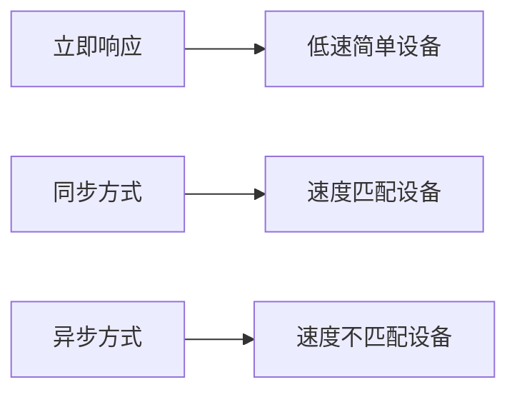

# 外围设备概述与分类

## 外围设备概述与分类

在计算机系统中，CPU 和主存构成了核心处理单元，但如果没有外围设备（外设），计算机就无法感知外部世界或持久化保存结果。那么，面对种类繁多的外设，我们该如何建立清晰的认知框架？关键在于掌握其==分类维度==与==I/O 交互机制==。

### 外设的分类维度

外设通常按功能分为输入、输出、外存及人机交互设备。但在《计算机组成与结构》考试中，更侧重以下两个技术维度的分类：

- **按存储介质分**：磁表面存储器（如硬磁盘）、半导体存储器（SSD）、光存储器（CD/DVD）。
- **按存取方式分**：随机存取（RAM/SSD）、顺序存取（磁带）、直接存取（磁盘）。

> [!IMPORTANT]
> 硬磁盘的两种关键分类必须区分：按磁头工作方式分为==固定磁头==与==活动磁头==；按盘片可换性分为==可换盘组==与==固定盘组==。选择题常在此处设置干扰项。

### I/O 编址与联络方式

外设分类决定了其物理特性，而如何与 CPU “对话”则决定了系统架构。为什么访问某些外设可以用 `MOV` 指令，而另一些必须用 `IN/OUT`？这取决于编址方式。

| 编址方式 | 地址空间 | 专用 I/O 指令 | 访外设速度 |
| :--- | :--- | :--- | :--- |
| 统一编址 | 占用内存空间 | ==不需要== | 较慢 |
| 独立编址 | 独立 I/O 空间 | 需要 (IN/OUT) | 较快 |

CPU 与外设的速度差异巨大，因此需要不同的联络方式来协调数据传输：

> [!TIP]
> 记忆口诀：==统一编址无专令，独立编址有专令==。异步方式靠“请求-应答”握手信号解决速度不匹配问题，是考试简答题高频考点。

### DMA 与中断的本质区别

当外设需要进行大批量数据传送时，程序中断方式效率太低。此时引入 DMA（直接存储器存取），它与中断有何本质不同？

> [!WARNING]
> DMA 每传送一个数据占用的是==一个存取周期==，而非指令周期或机器周期。这是南邮历年真题中的经典陷阱。

DMA 与主存交换数据有三种方法：停止 CPU 访问、周期挪用、交替访问。其中==周期挪用==最常用，它利用 CPU 不访存的空闲周期进行 DMA 传送，对 CPU 影响最小。

### 真题解析示例

以课件中的选择题为证：“当采用（）对设备进行编址情况下，不需要专门的 I/O 指令组。”

**分析过程**：统一编址法将 I/O 端口映射到内存地址空间，CPU 视其为普通内存单元，故可直接使用 `MOV` 等访存指令完成 I/O 操作，无需 `IN/OUT` 等专用指令。独立编址法则因地址空间隔离，必须依赖专用 I/O 指令。

**答案**：A. 统一编址法

> [!CAUTION]
> 复习外设分类时，切勿只背名称而忽略技术特征。例如“直接存取”不等于“随机存取”，磁盘是直接存取（需寻道+旋转延迟），而 SSD 才是真随机存取。混淆二者会导致存储器分类多选题失分。
