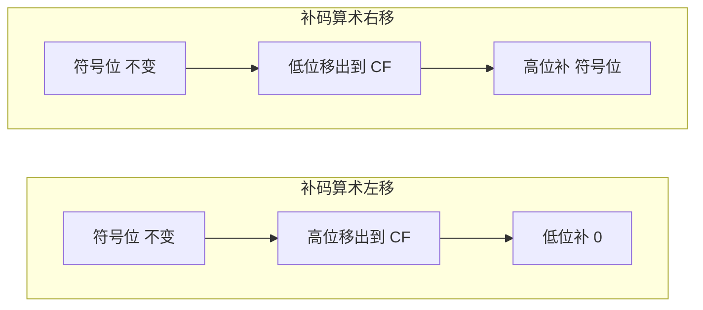

# 逻辑操作与移位操作（按位与、按位或、取反、有符号拓展）

## 逻辑操作与移位操作

指令系统里除了大家熟悉的加减乘除，还有一类操作直接面向二进制位，称为**位操作**。为什么需要它们？因为计算机在控制硬件、表示状态、优化计算时，经常需要精确操控某个或某几个比特位，而不是整个数据字。

### 逻辑运算：按位操作

逻辑运算指令对两个操作数的每一位独立进行布尔运算，位与位之间互不影响——==没有进位，也没有借位。==

- **按位与 AND**：两位都为 1 时结果位才为 1，否则为 0。常用于**掩码（Mask）**操作：想让某些位清零，就让掩码的对应位为 0；想保留某些位，就让掩码对应位为 1。
- **按位或 OR**：两位中任一位为 1，结果位就为 1。常用于将指定位置 1。
- **按位异或 XOR**：两位不同时结果为 1，相同时为 0。一个巧妙的性质：==任何数与自身异或得 0，与 0 异或得自身==。常用于寄存器清零、图形学中的反转叠加、简单的加密/校验。
- **取反 NOT**：单操作数指令，将每一位 0 变 1、1 变 0，得到**反码（ones' complement）**。

> [!IMPORTANT]
> 逻辑运算不会影响标志位，或者按南邮课程中的典型设定，**只影响 ZF（零标志）和 SF（符号标志）**，而**使 CF（进位标志）和 OF（溢出标志）清零**。

### 移位操作：左移与右移

移位指令将操作数的所有位向左或向右移动。你可能会想：左移一位不就是乘以 2，右移一位不就是除以 2 吗？——这个直觉只对了一部分，需要看**操作数的编码**（无符号数? 补码有符号数?）和**移位类型**。

#### 逻辑移位（无符号数）
- **逻辑左移 SHL**：高位移出到 CF，低位补 0。无符号数左移一位 = 乘 2，可能产生溢出。
- **逻辑右移 SHR**：低位移出到 CF，高位补 0。无符号数右移一位 = 除以 2 并向下取整。

#### 算术移位（有符号补码）
移位前后，数的符号不能变。所以规则不同：

> [!WARNING]
> **补码算术右移时，高位补的是符号位，而不是 0！** 这正是前面那道选择题的考点——正数右移高位补 0，负数右移高位补 1，保证移位后仍是补码表示的同一个负数除以 2。

| 类型 | 操作 | 填充位 |
| :--- | :--- | :--- |
| 逻辑左移 / 算术左移 | 左移一位 | 低位补 **0** |
| 逻辑右移 | 右移一位 | 高位补 **0** |
| 算术右移 | 右移一位 | 高位补 **符号位** |

### 综合算例：混合运算的优先级

填空第 102 题正好把按位运算和不同进制捏在了一起：

计算 $\{(26)_{16} \vee (63)_{16}\} \oplus (135)_8$ 的值。

- **统一进制**：先全部转二进制或十六进制。
  - $(26)_{16} = 0010\,0110_2$
  - $(63)_{16} = 0110\,0011_2$
  - $(135)_8$：$1_8=001$，$3_8=011$，$5_8=101$，即 $001\,011\,101_2 = 0101\,1101_2 = (5D)_{16}$
- **第一步，按位或** $\vee$：
  $0010\,0110_2 \vee 0110\,0011_2 = 0110\,0111_2 = (67)_{16}$
- **第二步，按位异或** $\oplus$：
  $0110\,0111_2 \oplus 0101\,1101_2 = 0011\,1010_2 = (3A)_{16}$
- **转十进制**：$(3A)_{16} = 3\times16 + 10 = 58$

> [!TIP]
> 混合进制的位运算题，**先统统转成二进制**，逐位计算后再转回。注意区分逻辑或 $\vee$ 和逻辑与 $\land$ 的符号，南邮课件里常用 $\vee$ 表示按位或，$\oplus$ 表示按位异或。
