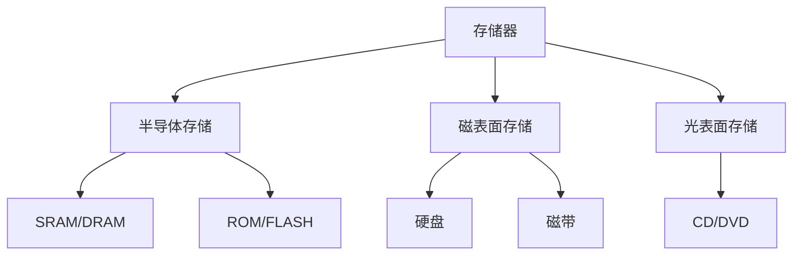

# 存储器的分类（按存取方式、存储介质等）

存储器是计算机存放**程序和数据**的部件。在层次化存储系统里，寄存器、Cache、内存（主存）、外存各司其职：越靠近 CPU 速度越快、容量越小、每位成本越高。==不同层次的存储器，差异主要体现在**存取方式**和**存储介质**两个维度==。要回答“某存储器属于哪一类”，先想清楚这两条主线即可。

## 按存储介质分类

按存储介质（材料）分，常见三类：

| 类别 | 典型器件 | 用途 |
|---|---|---|
| ==半导体存储== | SRAM、DRAM、ROM、FLASH、EEPROM | Cache、主存、U 盘、SSD |
| 磁表面存储 | 硬盘、磁带 | 外存（辅存） |
| 光表面存储 | CD、DVD、蓝光 | 外存 |

> [!WARNING]
> “光表面”是介质分类的标准答案之一，别因为日常少见就漏选；而“Flash”只是半导体存储的一个子类，**不能**与半导体并列。

从应用看，同属半导体的 EEPROM 与 FLASH 都是电擦除，区别在于 ==EEPROM 可按字节擦除，FLASH 按块（或整片）擦除==。

## 按存取方式分类

按存取方式分，三类必须记牢：

| 类别 | 存取特点 | 典型例子 |
|---|---|---|
| ==随机存取（RAM）== | 任一单元存取时间相同、与地址无关 | 内存（SRAM、DRAM） |
| ==顺序存取（SAM）== | 按物理顺序查找，存取时间与位置有关 | 磁带 |
| ==直接存取（DAM）== | 先直接定位到区域，再在区域内顺序查找 | 硬盘、光盘 |

> [!TIP]
> 记忆：==“内存随机、磁带顺序、硬盘直接”==。“直接存取”介于随机与顺序之间——硬盘寻道后仍需在磁道上转圈找扇区，所以不是纯随机。

> [!NOTE]
> 只读存储器 ROM、PROM、EPROM、EEPROM 按“读写特性”分类，与上面两套标准是**正交**的，别混为一谈。

## 时间参数辨析

- **存取时间**：从存储器收到读/写命令，到读出（或写入）信息所需的时间。
- **存取周期**：连续访问中一次完整存取操作所需的总时间。

$$\text{存取周期} = \text{存取时间} + \text{恢复时间}$$

==存取周期 ≥ 存取时间==，两者常被混答，务必区分。

## 常见题型示例

> [!IMPORTANT]
> 按介质分选 **A 半导体、B 磁表面**（“光表面”若出现也选）；按存取方式分选 **A 随机存储器、B 顺序存储器、C 直接存储器**，全选。

另需掌握：DRAM 结构一般做 ==主存==；需要**定期刷新**的是 ==DRAM==（SRAM 不需刷新，靠双稳态触发器保持）。

> [!CAUTION]
> 层次化存储系统通常指 Cache、内存、外存；**寄存器在 CPU 内部**，一般不划入“存储系统”层次，问“不属于多层次存储系统”时常选寄存器。
