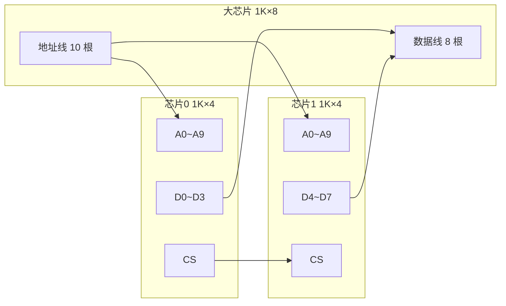
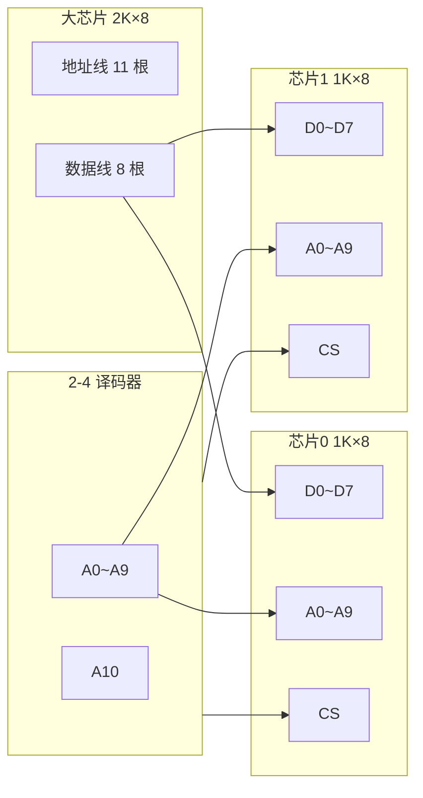

# 存储器容量的扩充（位扩展法/字长位数扩展、字扩展法）

## 存储器容量的扩充

存储器芯片的容量是固定的，但计算机系统需要的存储器往往更大。当一片芯片不够用时，就需要把多片芯片组合起来，构成一个容量更大的存储器。这就是存储器扩展要解决的问题。

先抓住一个关键公式：

$$
\text{所需芯片数} = \frac{\text{目标存储容量}}{\text{单芯片容量}} = \frac{目标字数 \times 目标字长}{芯片字数 \times 芯片字长}
$$

比如目标容量 $32\mathrm{K} \times 8$，用 $1\mathrm{K} \times 4$ 的芯片：

$$
\frac{32\mathrm{K} \times 8}{1\mathrm{K} \times 4} = 32 \times 2 = 64 \text{ 片}
$$

数量算出来了，但这些芯片**怎么连**？这就要看扩展的类型。

---

## 位扩展法

**是什么**：当芯片的**字数够用**，但**字长不够**时，用多片芯片**并联**来加宽数据线。

**为什么需要**：比如目标存储器是 $1\mathrm{K} \times 8$，但手头只有 $1\mathrm{K} \times 4$ 的芯片——字数都是 $1\mathrm{K}$，但每片只能提供 4 位数据，需要两片拼成 8 位。

**怎么做**：

> [!IMPORTANT]
> 位扩展的核心：==各芯片的地址线同名相连，片选线接在一起（同时选中），数据线各自引出拼成大芯片的数据线==。

**常见的坑**：位扩展中所有芯片**必须同时被选中**，所以它们的片选端接的是同一个片选信号。如果给每片单独接片选，就变成字扩展了。

---

## 字扩展法

**是什么**：当芯片的**字长够用**，但**字数不够**时，用多片芯片**串联地址空间**来增加字数。

**为什么需要**：比如目标存储器是 $2\mathrm{K} \times 8$，手头只有 $1\mathrm{K} \times 8$ 的芯片——数据线都是 8 位，但地址空间只有 $1\mathrm{K}$，需要两片各管一半的地址范围。

**怎么做**：

> [!TIP]
> 记忆口诀：==字扩展时，数据线同名相连，低位地址线同名相连，高位地址线送译码器产生片选==。位扩展是“数据线分家”，字扩展是“片选线分家”。

**字扩展的关键步骤**：

| 步骤 | 操作 |
|---|---|
| ① 算数量 | 目标字数 ÷ 芯片字数 |
| ② 连数据线 | 各芯片 $D_0 \sim D_7$ 同名相连，直接引出 |
| ③ 连低位地址 | 各芯片地址线同名相连，接大芯片低位 |
| ④ 多余地址线 | 大芯片多出的高位地址线接译码器输入 |
| ⑤ 译码输出 | 译码器输出端接各芯片 $\overline{CS}$ |

---

## 字位同时扩展

实际中往往两种扩展**同时出现**。比如用 $1\mathrm{K} \times 4$ 芯片组成 $4\mathrm{K} \times 8$ 存储器：

- 先**位扩展**：每两片 $1\mathrm{K} \times 4$ 拼成一组 $1\mathrm{K} \times 8$；
- 再**字扩展**：四组 $1\mathrm{K} \times 8$ 拼成 $4\mathrm{K} \times 8$。

$$
\text{总片数} = \underbrace{\frac{8}{4}}_{位扩展} \times \underbrace{\frac{4\mathrm{K}}{1\mathrm{K}}}_{字扩展} = 2 \times 4 = 8 \text{ 片}
$$

> [!WARNING]
> 最常见的错误是只算片数不区分扩展方式，导致连线时**地址线、数据线、片选线三者关系混乱**。解题时先判断：数据线不够 → 位扩展；地址空间不够 → 字扩展；两者都不够 → 先位扩再字扩。

---

## 一个完整的算例

用 $1\mathrm{K} \times 4$ 芯片组成 $4\mathrm{K} \times 8$ 存储器，问需要多少片？地址线、数据线各多少根？

**解**：

片数：$\dfrac{4\mathrm{K} \times 8}{1\mathrm{K} \times 4} = 4 \times 2 = 8$ 片。

大芯片地址线：$4\mathrm{K} = 2^{12}$，需 **12 根**地址线。

大芯片数据线：字长 8 位，需 **8 根**数据线。

小芯片地址线：$1\mathrm{K} = 2^{10}$，每片 **10 根**地址线。

小芯片数据线：**4 根**。

连线方式：每两片做位扩展（地址线同名相连、片选端并接、数据线分低 4 位和高 4 位），拼成 $1\mathrm{K} \times 8$ 组；四组再做字扩展（数据线同名相连、低位地址 $A_0 \sim A_9$ 同名相连、高位地址 $A_{10} \sim A_{11}$ 经 2-4 译码器产生四组片选信号）。

> [!NOTE]
> 位扩展“加宽数据线”，字扩展“伸长地址线”。在画图时先画位扩展组，再把每组看成一个更大的“芯片”去做字扩展，思路就不会乱。
