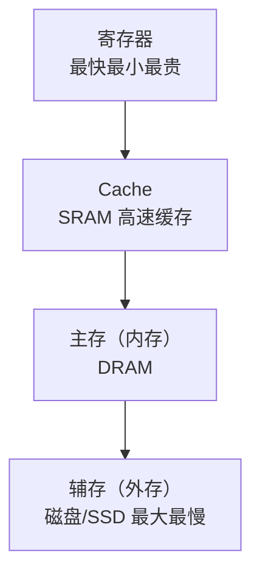
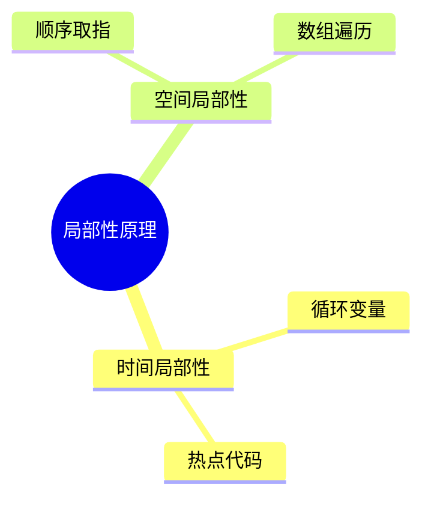

# 多级存储体系结构与局部性原理（时间局部性与空间局部性）

## 为什么需要多级存储

先想一个问题：如果只买一种存储器，我们能不能同时得到"又快又便宜又大"？

答案是不能。存储器的**速度**、**容量**、**单位价格**三者天然矛盾：寄存器和 Cache 用 SRAM 工艺，纳秒级访问但价格昂贵；内存用 DRAM，速度稍慢但容量能做大；外存（磁盘、SSD）容量巨大且便宜，但访问要毫秒级。任何单一存储器都无法兼顾三者。

于是计算机采用**多级存储体系**：把不同速度、容量、价格的存储器按层次组织起来，让 CPU 优先访问最快的小容量层，缺失时再逐层向下找。

从上往下，速度递减、容量递增、单位价格递减。CPU 访存时先查寄存器，再查 Cache，再查主存，最后才访问外存。

> [!IMPORTANT]
> 多级存储体系的核心目标：让整个存储系统的**速度接近 Cache**，而**容量和成本接近外存**。这是简答题的标准答案。

## 理论依据：局部性原理

为什么多级体系能奏效？因为程序访问内存并不是均匀随机的，而是呈现明显的聚集规律，即**程序（数据）局部性原理**。它分为两种：

| 局部性类型 | 含义 | 典型例子 |
|---|---|---|
| **时间局部性** | 刚被访问过的数据，很可能在不久的将来再次被访问 | 循环中的计数器 `i`、热点函数代码 |
| **空间局部性** | 刚访问过某个单元，其**邻近单元**很可能很快被访问 | 顺序执行的指令流、数组的连续遍历 |

正因为程序具有局部性，CPU 在一段时间内实际只频繁访问一小部分数据。把这"热数据"放在高速层，其余放在低速大容量层，就能让绝大多数访问落在高速层，系统整体速度自然接近 Cache。

> [!TIP]
> 记忆口诀：**"时间看重复，空间看邻居"**。时间局部性关注"刚用过还会用"，空间局部性关注"用过的地方附近也会用"。

## Cache—主存与主存—辅存的区别

多级体系中两个层次的**管理方式和目的不同**，这是常考辨析点：

| 层次 | 管理手段 | 目的 | 对程序员是否透明 |
|---|---|---|---|
| Cache—主存 | **纯硬件**（Cache 控制器） | 解决速度矛盾 | 完全透明 |
| 主存—辅存 | **软件**（操作系统，或带硬件支持的软件，如虚拟存储管理） | 解决容量矛盾 | 对应用程序透明 |

> [!WARNING]
> 易错点：主存/辅存层次**不是纯硬件管理**，而是由操作系统通过虚拟存储机制（请求分页、请求分段等）实现。考试选项里若出现"纯硬件"，那是错的。

## 典型考题解析

**例 1**　下列存储器层次中速度最快的是（同一时期）（　A　）

- A. Cache　B. 内存　C. 外存

解析：同一工艺时期，越靠近 CPU 的层次速度越快。寄存器 > Cache > 内存 > 外存。

**例 2**　下列存储器层次中容量最大的是（同一时期）（　C　）

解析：越远离 CPU 的层次容量越大，外存（TB 级）远大于内存（GB 级）和 Cache（MB 级）。

**例 3**　多级存储系统存在的理论依据是什么？

参考答案：==程序（数据）局部性原理==。程序执行时对存储器的访问在时间上和空间上均呈现局部聚集倾向，因此可将近期将频繁访问的数据置于高速小容量层，其余置于低速大容量层，从而以较低成本获得接近高速层的整体访问速度。

> [!CAUTION]
> 常见误区：有同学答"为了解决速度和容量的矛盾"。这描述的是多级体系的**目的**，而非**理论依据**。题目问"依据"，必须落到"局部性原理"上——没有局部性，多级体系就失效了。
