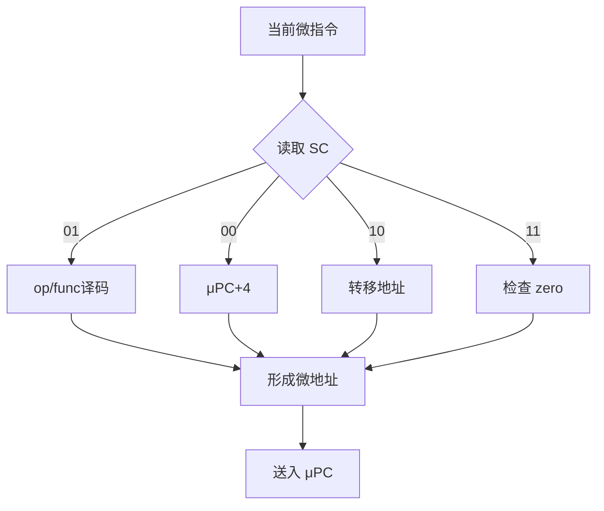

# 微地址形成电路（受哪些信号影响、基于微地址存储的方案、指令op/func译码器）

## 是什么

微地址形成电路负责确定**下一条微指令的地址**。取出当前微指令后，控制器必须根据指令信息、时序信号以及执行状态，判断下一条微指令应从哪里来，并把形成的地址送入 $\mu PC$。

它解决的不是“下一条机器指令在哪里”，而是“**当前微程序下一步执行哪条微指令**”。

## 为什么需要

微程序控制器通常按“取微指令—执行微指令—形成后继微地址”的周期工作。形成后继地址时，既可能顺序执行，也可能因条件转移、无条件转移或指令类型不同而改变路径。

因此，微地址形成电路需要综合：

- 当前微指令中的顺序控制字段 $SC$；
- 指令的 $op/func$ 字段；
- 机器周期或时序信号；
- ALU 反馈的 $zero$ 标志等状态信息。

> [!IMPORTANT]
> ==核心结论==：下一条微地址不是只由 $\mu PC+4$ 决定，而是由微地址形成电路综合各种条件产生。

## 怎么做

课件给出的 $SC$ 字段含义如下：

| $SC$ | 转移条件 | 下一条微指令地址 |
|---|---|---|
| `00` | 顺序执行 | $\mu PC+4$ |
| `01` | 指令译码分支 | 由指令 $op/func$ 译码结果决定 |
| `10` | 无条件转移 | 由转移地址字段指定 |
| `11` | 条件转移 | 根据 ALU 的 $zero$ 标志确定 |

其中，指令 $op/func$ 译码器把机器指令中的操作码或功能码转换成微程序需要的分支选择信号。例如，不同机器指令对应不同的微程序入口，译码结果可选择不同的微地址。

### 基于微地址存储的方案

在基于微地址存储的微地址形成方案中，控制存储器中除存放微指令，还设置微地址形成所需的存储内容或映射关系。控制器根据当前 $SC$、指令译码结果及状态条件，查得对应的下一微地址，再送入 $\mu PC$。

其特点是：**把部分地址形成规则预先存好，运行时按条件选取**，逻辑清晰，也便于修改微程序。

## 相近概念的区别

| 概念 | 作用 |
|---|---|
| PC | 保存下一条机器指令地址 |
| $\mu PC$ | 保存当前或下一条微指令地址 |
| $op/func$ 译码器 | 识别机器指令类型，给出微程序入口或分支信号 |
| 微地址形成电路 | 综合条件，产生下一条微指令地址 |

> [!WARNING]
> `$op/func$ 译码器`只提供分支依据；它本身通常不能独立完成下一微地址的形成。

## 常见坑

1. 把 `$SC=01$` 理解成直接按机器指令地址转移；它实际是按指令 $op/func$ 的译码结果选择微地址。
2. 把 `$SC=11$` 理解为无条件转移；它要检查 ALU 的 `$zero$` 标志。
3. 忽略机器周期和时序信号，导致同一微程序在不同阶段的分支条件混淆。
4. 将“断定方式”误认为只使用 $\mu PC+4$。题目所说的断定方式，是由**设计者指定的顺序控制字段或判别字段**控制后继微地址。

> [!TIP]
> 记忆口诀：**零一按指令，一零直接转，一一看 zero；地址最后送 μPC。**

## 算对的例子

某微指令的 $SC=01$，机器指令的 $op/func$ 译码结果选中微地址 `1010B`；当前微指令长度为 4 字节。若该方案不采用简单顺序地址，则下一条微指令地址为：

$$
\mu PC_{\text{next}}=\text{1010B}
$$

若 $SC$ 改为 `00`，才按顺序执行：

$$
\mu PC_{\text{next}}=\mu PC+4
$$
