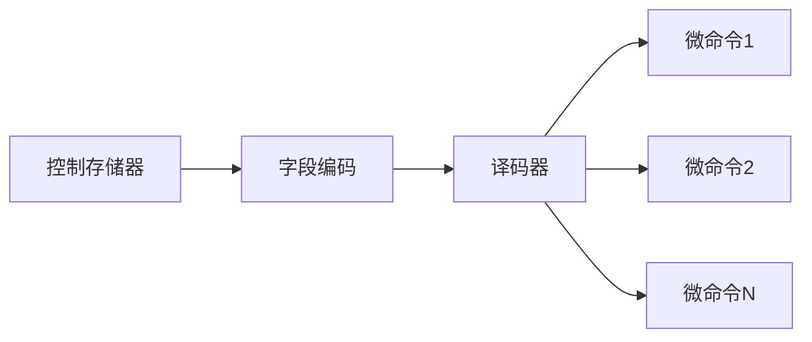

# 微指令按功能字段分类与微命令译码电路

## 微指令编码：从“一一对应”到“字段译码”

如果控制存储器（CM）的每一位都直接对应一个微命令，当微命令数量庞大时，微指令字长会变得极长。如何在保证功能的前提下缩短微指令长度？这就引出了==按功能字段分类编码==的核心思想：将互斥的微命令归为一组，用二进制代码表示，再通过译码电路还原为具体微命令。

> [!IMPORTANT]
> 核心结论：字段译码的本质是==用时间/硬件换空间==，通过增加译码器复杂度来显著缩短微指令字长。

## 三种典型编码方式对比

南邮《计算机组成与结构》课程中，微指令编码主要考察以下三种方式的辨析：

| 编码方式 | 原理 | 优点 | 缺点 |
| :--- | :--- | :--- | :--- |
| 直接编码 | 1位=1个微命令 | 无需译码，并行性好 | 字长过长，CM容量大 |
| 字段直接编码 | 互斥微命令分组编码 | 大幅缩短字长 | 需译码电路，并行性下降 |
| 字段间接编码 | 字段含义依赖其他字段 | 字长最短 | 译码复杂，速度慢 |

> [!TIP]
> 简答题高频考点：题目问“写出三种编码方式名称”时，标准答案为==直接编码、字段直接编码、字段间接编码==。切勿写成“水平型/垂直型”，那是微指令格式分类，不是编码方式。

## 微命令译码电路的工作机制

字段直接编码下，CM输出的不再是微命令本身，而是字段编码值。译码电路负责将其“翻译”回物理控制信号。

例如，某字段有8个互斥微命令，直接编码需8位；采用字段直接编码仅需 $\lceil \log_2 8 \rceil = 3$ 位，经3-8译码器即可还原。==节省的5位就是编码收益==。

> [!WARNING]
> 易错坑：字段划分的前提是==微命令互斥==。若两个微命令可能在同一节拍内同时有效，绝不能划入同一字段，否则译码后只能激活其中一个，导致控制逻辑错误。

## 真题示例与计算验证

回顾课件中的简答题：“微指令包括五种编码方式，写出其中三种。”除了上述三种，另外两种为==常数源编码==和==混合编码==。但答题时优先写前三种最核心的。

再看一个计算场景：若某CPU有64个微命令，其中32个互斥分为一组，其余32个各自独立。采用字段直接编码+直接编码混合方式，微指令操作控制字段至少需要多少位？

- 互斥组：$\lceil \log_2 32 \rceil = 5$ 位
- 独立组：32位（直接编码）
- 总计：$5 + 32 = 37$ 位

而纯直接编码需64位，==节省了27位==。这就是字段分类在实际设计中的量化价值。

> [!NOTE]
> 延伸辨析：字段间接编码虽更省位数，但因字段间存在依赖关系，译码需多级串联，增加了控制延迟。现代高性能CPU多采用字段直接编码配合流水线，在字长与速度间取平衡。
