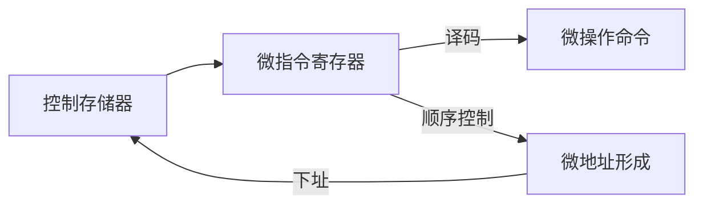

# 微程序控制系统的组成与优点
如果让你设计控制器，面对几十条机器指令、上百个微操作信号，是用一堆门电路硬连出来，还是把控制逻辑“存”起来？后者正是==微程序设计==的核心思想：将控制器的硬件逻辑转化为存储在控制存储器（CM）中的软件化微代码。

### 系统核心组成

微程序控制器主要由三部分组成：

- **控制存储器（CM）**：存放所有微程序，是控制器的“知识库”。
- **微指令寄存器（μIR）**：暂存当前正在执行的微指令。
- **微地址形成电路**：根据当前状态和判别字段，==确定下一条微指令地址==。

> [!IMPORTANT]
> 机器指令与微指令是==一对多==关系：一条机器指令对应一段微程序，而一段微程序由若干条微指令组成。切勿混淆两者层级。

### 为什么选择微程序？

对比组合逻辑（硬布线）设计，微程序的优势在于：

| 对比维度 | 组合逻辑设计 | 微程序设计 |
| :--- | :--- | :--- |
| 设计方法 | 列时间表→写表达式→画逻辑图 | 安排节拍→定格式→编微码 |
| 修改难度 | 需重新布线，极难修改 | ==只需改CM内容==，灵活可扩展 |
| 规整性 | 随指令增加复杂度剧增 | 结构规整，易于自动化设计 |
| 速度 | 快（纯硬件） | 较慢（需读CM） |

> [!TIP]
> 记忆口诀：“==硬快软活==”——组合逻辑速度快但僵化，微程序灵活但稍慢。填空题常考这两种方法的名称。

### 关键考点辨析

关于后继微指令地址的生成，考试高频考查==断定方式==：它不是简单依赖 μPC 自增，而是通过微指令中的==顺序控制字段==或==判别字段==，由设计者指定下一地址的产生逻辑。这使微程序能实现条件分支与循环。

> [!WARNING]
> 课件中“只有预测失败时才会阻塞”属于流水线冒险处理机制，==并非微程序控制的优点==。复习时务必区分控制器设计与流水线性能优化两个知识模块，避免张冠李戴。

### 真题应用示例

以简答题“写出三种微指令编码方式”为例，正确作答需明确区分操作控制字段的编码策略：

- **直接表示法**：每位代表一个微命令，无需译码，并行度高但字长长。
- **字段直接编码法**：将互斥微命令分组编码，缩短字长，最常用。
- **字段间接编码法**：字段含义依赖其他字段解释，进一步压缩字长但译码复杂。

答题时写出上述任意三种即可得满分。注意不要将“编码方式”与“地址生成方式”混为一谈，后者如计数器方式、断定方式等属于不同知识点。
