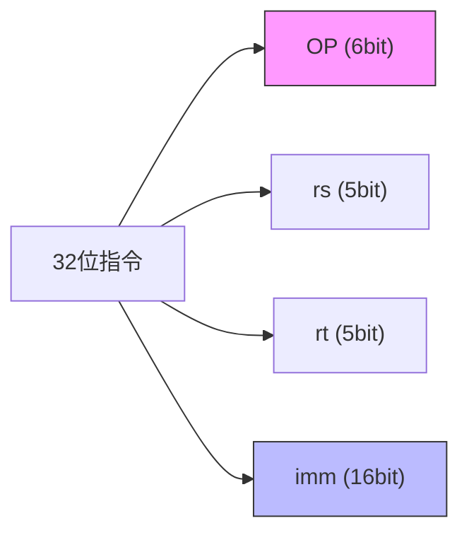

# MIPS32 I型指令格式与功能（面向运算、访存、条件转移分支等类型）

# MIPS32 I型指令格式与功能

MIPS32 架构中，所有指令长度固定为 32 位。当指令需要包含**立即数**（Immediate）或进行**内存访问**、**条件分支**时，R 型指令的寄存器字段不足以容纳操作数，因此引入了 ==I 型（Immediate）指令格式==。

## 指令结构解析

I 型指令由三个字段组成，共 32 位：

| 字段 | OP (Opcode) | rs | rt | immediate |
| :--- | :---: | :---: | :---: | :---: |
| **位数** | 6 bit | 5 bit | 5 bit | 16 bit |
| **含义** | 操作码 | 源寄存器 | 目标/基址寄存器 | 立即数/偏移量 |

- **OP**：6 位操作码，决定指令类型。若 `OP=0` 则为 R 型，其余通常为 I 型或 J 型。
- **rs**：第一个源操作数寄存器。
- **rt**：在运算指令中为目标寄存器；在访存指令中为数据寄存器；在分支指令中为比较寄存器。
- **immediate**：16 位立即数，常需符号扩展至 32 位参与运算。

## 主要功能分类

I 型指令主要覆盖以下三类操作：

1.  **算术/逻辑运算**：如 `ADDI` (加立即数)、`ANDI`。
    *   执行：$R[rt] \leftarrow R[rs] + \text{SignExt}(immediate)$
2.  **数据传送（访存）**：如 `LW` (加载字)、`SW` (存储字)。
    *   采用 ==基址寻址==：有效地址 $EA = R[rs] + \text{SignExt}(immediate)$。
    *   `LW` 将内存数据读入 `rt`，`SW` 将 `rt` 数据写入内存。
3.  **条件转移分支**：如 `BEQ` (相等则跳转)、`BNE`。
    *   采用 ==PC 相对寻址==：目标地址 $PC_{new} = PC + 4 + (\text{SignExt}(immediate) \ll 2)$。
    *   注意：MIPS 中 PC 已预取下一条指令，故基准为 $PC+4$。

> [!IMPORTANT]
> I 型指令的核心特征是包含 **16位立即数字段**。凡是需要“小常数”参与运算、计算内存地址或短距离跳转的指令，均属此类。

## 常见误区与辨析

| 特性 | R 型指令 | I 型指令 | J 型指令 |
| :--- | :--- | :--- | :--- |
| **操作码位置** | OP=0, 功能由 func 定 | OP $\neq$ 0 | OP $\neq$ 0 |
| **立即数** | 无 | 有 (16位) | 无 (26位地址) |
| **典型用途** | 寄存器间运算 | 访存、分支、加减常数 | 长距离无条件跳转 |

> [!WARNING]
> **易错点 1**：`LW` 和 `SW` 是 I 型指令，不是 R 型！因为它们需要立即数作为偏移量来计算内存地址。
> **易错点 2**：分支指令的目标地址计算中，立即数代表的是**字偏移**还是**字节偏移**？MIPS 中 immediate 左移 2 位（$\ll 2$），说明它表示的是**字（Word）的个数**，因为 MIPS 按字节编址但指令对齐到 4 字节边界。

## 典型例题解析

**题目**：MIPS32 CPU 下 PC 相对寻址属于哪种类型指令？基址寻址属于哪种？

**解析**：
1.  **PC 相对寻址**：用于 `BEQ`、`BNE` 等分支指令。指令格式中包含 16 位偏移量 immediate，用于计算相对于当前 PC 的目标地址。因此属于 **I 型**。
2.  **基址寻址**：用于 `LW`、`SW`。有效地址由寄存器内容加上 16 位偏移量构成。同样依赖 immediate 字段，属于 **I 型**。

**结论**：两者均选 **A (I 型)**。

> [!TIP]
> 记忆口诀：**“R 型纯寄存，J 型跳得远，I 型带常数（含访存分支）”**。只要看到指令里有“立即数”、“偏移量”或“内存地址计算”，大概率是 I 型。
