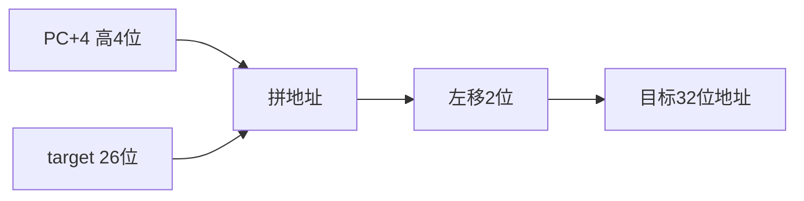

# MIPS32 J型指令格式与功能（Jump跳转指令）

## 它是什么

MIPS32 的指令长度固定为 32 位。J 型（Jump）指令是专门用于**无条件跳转**的格式。课件图中给出了三种格式，其中 J 型只有两个字段：

| 字段 | OP（6 位） | target（26 位） |
|---|---|---|
| 含义 | 操作码 | 跳转目标地址 |

- 6 位 `OP` 区分 R / I / J：`OP=000000` 为 R 型，其余 63 个码点分给 I 和 J 型，所以真题里选 ==R 型最多 64 条靠 func，I+J 共 63 个 OP==（选择 6 答案 B）。
- J 型没有 `rs/rt/rd`，也没有 `func`，因此它的操作码只由 ==OP== 构成（不是 OP+FUNC）。

## 为什么需要

程序里要跳到很远的地方执行，比如函数调用、循环结束跳回。若只用 I 型分支（如 `beq`）做 PC 相对寻址，偏移范围只有 16 位有符号，跳不远。J 型用 26 位地址码，配合 PC 高位拼成 32 位目标地址，可跳到 256MB 对齐边界范围内，这就是课件说的**伪直接寻址**，且真题确认它属于 ==J 型==（选择 8 答案 B）。

## 怎么做（目标地址计算）

先问一句：26 位能直接覆盖 32 位地址空间吗？不能，缺了高位和低位怎么办？

MIPS 的做法是把当前 `PC+4` 的**高 4 位**取来，拼上 26 位 `target`，再左移 2 位补低位 0（因为指令按字对齐）：

$$
\text{跳转地址} = \{ (PC+4)[31:28],\ \text{target},\ 00 \}
$$

> [!TIP]
> 口诀：==高4取自PC+4，低2补零，中间26位来自指令==。

## 相近概念区别

| 类型 | 寻址方式 | 地址来源 | 范围 |
|---|---|---|---|
| J 型 | 伪直接寻址 | PC+4 高4位 + target + 00 | 256MB 段内 |
| I 型分支 | PC 相对寻址 | PC+4 + 16位偏移×4 | ±128KB 附近 |
| R 型 jr | 寄存器寻址 | 寄存器值 | 全 32 位空间 |

> [!WARNING]
> 常见坑：J 型的 target **不是**完整地址；别和 I 型 PC 相对寻址混淆，也别以为 J 型操作码含 func。

## 算对了的例子（来自真题逻辑）

假设某 J 型指令 `OP=000010`（即 `j`），26 位 target 全为 1（即 `0x3FFFFFF`），当前 `PC+4` 高 4 位为 `0011`：

$$
\{0011,\ 26\text{个}1,\ 00\}=0011\underbrace{11\cdots1}_{26}00_2
$$

即目标地址 = `0x3FFFFFF` 左移 2 位得 `0xFFFFFFC`，再拼高 4 位 `0011` 得 `0x3FFFFFFC`。计算正确。填空 128 也提醒：指令格式由 ==操作码字段和地址码字段==组成，J 型正是“OP+地址码”的典型。
