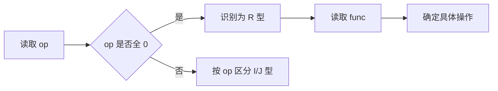

# MIPS32 R型指令格式与功能（Register，由op配合func字段确定操作）

## 为什么需要 R 型指令

MIPS32 属于 RISC 架构，指令长度固定为 **32 位**，存储器按字节编址，CPU 中有 32 个可用的 32 位通用寄存器。若一条指令要描述“两个寄存器相加，结果写入另一个寄存器”，就需要同时给出操作类型、源寄存器和目的寄存器。R 型指令正是用于这类以寄存器为主要操作对象的指令。

## R 型指令的格式

| 位段 | 31～26 | 25～21 | 20～16 | 15～11 | 10～6 | 5～0 |
|---|---|---|---|---|---|---|
| 字段 | op | rs | rt | rd | shamt | func |
| 位数 | 6 | 5 | 5 | 5 | 5 | 6 |
| 作用 | 指令大类 | 源寄存器 | 源寄存器 | 目的寄存器 | 移位位数 | 具体操作 |

寄存器字段均为 5 位，因为要从 32 个寄存器中选中一个：

$$
\log_2 32=5
$$

例如，寄存器型加法可概括为：

$$
R[rd]\leftarrow R[rs]+R[rt]
$$

其中，`rs`、`rt` 给出源操作数所在寄存器，`rd` 给出结果写入的寄存器。`shamt` 主要用于移位指令；不移位时通常取 0。

> [!IMPORTANT]
> R 型指令的具体操作由 ==op 配合 func 字段== 确定。典型情况下，`op=000000` 表示 R 型，再由 6 位 `func` 区分加法、减法等操作。

## 与 I 型、J 型的区别

| 类型 | 主要字段 | 操作码判断 | 典型用途 |
|---|---|---|---|
| R 型 | op、rs、rt、rd、shamt、func | op 配合 func | 寄存器间运算、移位 |
| I 型 | op、rs、rt、imm | op | 立即数运算、访存、条件转移 |
| J 型 | op、address | op | 无条件跳转 |

三种指令都占 32 位，但字段划分不同。I 型用 16 位 `imm` 表示立即数或偏移量，J 型用 26 位 `address` 提供跳转地址信息；它们都没有 R 型的 `rd`、`shamt`、`func` 字段。

## 一个算对了的例子

问：R 型指令最多能设计多少条？I 型和 J 型一共最多能使用多少个 `op` 编码？

`op` 有 6 位，共有 $2^6=64$ 种编码。其中一个编码 `000000` 用于标识 R 型，因此留给 I 型和 J 型的 `op` 编码最多为：

$$
2^6-1=63
$$

R 型内部再由 6 位 `func` 区分具体操作，最多可表示：

$$
2^6=64
$$

所以正确结论是：**R 型最多 64 条，同时 I 型和 J 型一共最多 63 个 op 编码。**

> [!WARNING]
> 不要把 64 种 `func` 编码与 63 个非 R 型 `op` 编码混为一谈，也不要把“最多可编码的操作数”直接等同于实际 MIPS32 已实现的指令条数。

> [!TIP]
> 记忆：**R 型看“op＋func”，I/J 型看 op；寄存器编号 5 位，整条指令 32 位。**
