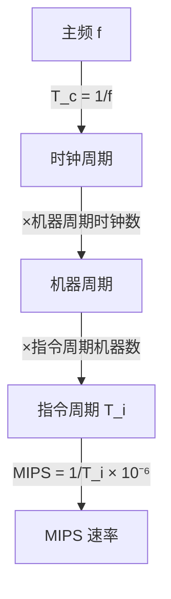

# MIPS速率与有效CPI计算

## 从一道题说起

先看一个关键问题：**如果 CPU 主频很高，指令执行速度就一定快吗？**

不完全是。主频只决定“时钟打多快”，但一条指令从取出到执行完，要消耗若干个时钟周期。真正决定速度的是——**平均执行一条指令要花多少时间**。这就引出了两个核心概念：**CPI** 和 **MIPS**。

---

## 核心概念

### CPI：执行一条指令平均需要多少个时钟周期

CPI（Cycles Per Instruction）是衡量指令执行效率的关键指标：

$$
\text{CPI} = \frac{\text{程序总时钟周期数}}{\text{程序总指令数}}
$$

对于有 $n$ 类指令的程序，若第 $i$ 类指令的 CPI 为 $\text{CPI}_i$、占比为 $F_i$，则：

$$
\text{CPI} = \sum_{i=1}^{n} \text{CPI}_i \times F_i
$$

### 指令周期与机器周期

一条指令从取指到执行完成的时间叫**指令周期**。早期 CPU 常把指令周期分成若干个**机器周期**（如取指周期、间址周期、执行周期），每个机器周期又包含若干**时钟周期**。三者关系：

### MIPS：每秒执行多少百万条指令

$$
\text{MIPS} = \frac{\text{指令条数}}{\text{执行时间} \times 10^6}
= \frac{f}{\text{CPI} \times 10^6}
$$

其中 $f$ 为主频（Hz）。核心链条：

> [!IMPORTANT]
> ==当主频降低一半，若 CPI 也降低一半，MIPS 反而可能不变或更高==——评价 CPU 不能只看主频，要结合 CPI。

---

## 与其他指标的区别

| 指标 | 衡量什么 | 公式 | 关注点 |
|------|----------|------|--------|
| **主频** | 时钟快不快 | $f = 1/T_c$ | 硬件工艺 |
| **CPI** | 指令多费钟 | $\text{CPI} = T_i / T_c$ | 指令效率 |
| **MIPS** | 每秒多少百万条指令 | $f / (\text{CPI} \times 10^6)$ | 执行速度 |
| **FLOPS** | 每秒浮点运算次数 | — | 科学计算 |

==MIPS 受指令集和程序类型影响，不同机器的 MIPS 不可直接比较==。

---

## 典型例题精解

**题目**：CPU 主频 10 MHz，每个机器周期含 4 个时钟周期，平均指令执行速度 1 MIPS。求平均指令周期及每个指令周期含几个机器周期？

**第一步**：从主频推出时钟周期。

$$
T_c = \frac{1}{10 \times 10^6} = 0.1\ \mu s
$$

**第二步**：计算机器周期。

$$
T_m = 4 \times 0.1 = 0.4\ \mu s
$$

**第三步**：从 MIPS 推平均指令周期。

$$
T_i = \frac{1}{1 \times 10^6} = 1\ \mu s
$$

**第四步**：求每个指令周期含几个机器周期。

$$
\frac{T_i}{T_m} = \frac{1}{0.4} = 2.5
$$

> [!TIP]
> 这类题不需要背公式，只需抓住一条线：==时钟周期 → 机器周期 → 指令周期 → 速度==，按单位层层换算即可。

---

## 常见陷阱

> [!WARNING]
> **陷阱一**：把“平均指令执行速度 1 MIPS”理解为“每秒执行 1 条指令”。
> 正确的是 1 MIPS = $10^6$ 条/秒。

> [!CAUTION]
> **陷阱二**：改时钟周期后，默认“每个指令周期含的机器周期数”不变。题目中若无特别说明通常可沿用，但要警惕题目问的是“若 CPI 不变”还是“若机器周期数不变”。

> [!NOTE]
> **陷阱三**：求新主频时，按目标 MIPS 反推即可，不用再回到原机器。

**练习检验**：若时钟周期改为 $0.4\ \mu s$，每个指令周期仍含 2.5 个机器周期，求新 MIPS。

$$
T_m' = 4 \times 0.4 = 1.6\ \mu s,\quad T_i' = 2.5 \times 1.6 = 4\ \mu s
$$

$$
\text{MIPS}' = \frac{1}{4 \times 10^{-6}} \times 10^{-6} = 0.25
$$

---

## 汇总公式表

| 已知 | 求 | 公式 |
|------|-----|------|
| 主频 $f$ | 时钟周期 $T_c$ | $T_c = 1/f$ |
| $T_c$、每机器周期时钟数 $k$ | 机器周期 $T_m$ | $T_m = k \cdot T_c$ |
| $T_m$、每指令周期机器数 $m$ | 指令周期 $T_i$ | $T_i = m \cdot T_m$ |
| $T_i$ | MIPS | $\text{MIPS} = \frac{1}{T_i} \times 10^{-6}$ |
| $f$、CPI | MIPS | $\text{MIPS} = \frac{f}{\text{CPI}} \times 10^{-6}$ |
