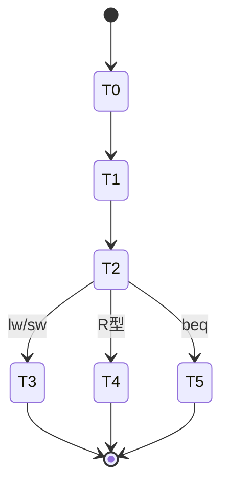
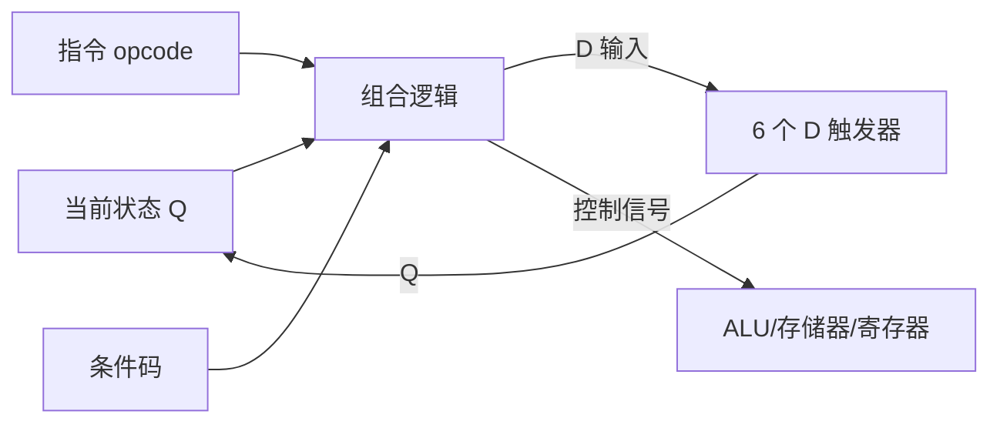

# 多周期CPU控制信号产生与时序状态触发器

## 多周期 CPU 的控制信号怎么产生

你已经知道：一条指令在单周期 CPU 中必须在一个时钟周期内全部做完，时钟周期只好取最慢指令（如 `lw`）的延迟。多周期 CPU 换了个思路——==把一条指令拆成若干步骤，每步只花一个时钟周期==，不同的步骤在不同的周期里完成，于是时钟周期可以按最慢的“一步”而不是最慢的“一条指令”来定。

问题随之而来：拆分之后，每一步该发出哪些控制信号？谁来决定“现在到哪一步了”？这就是多周期 CPU 控制信号与时序状态触发器要解决的事。

### 先看“节奏”从哪来：6 个时序状态触发器

南邮课件里的**时序主处理单元**用 6 个触发器维护当前处于哪个状态，常见状态（视具体设计可能记为 $T_0\sim T_5$ 或 FETCH/DECODE/EXEC 等）：

| 状态 | 主要任务 | 典型控制信号 |
|------|----------|--------------|
| $T_0$ | 取指 | `PCWrite`, `MemRead`, `IRWrite` |
| $T_1$ | 译码/读寄存器 | `RegRead` |
| $T_2\sim T_3$ | 执行/访存/回写（按指令类型分流） | `ALUOp`, `MemWrite`, `RegWrite` 等 |

状态一旦多起来，光靠“计数器++”就不够了。因为不同指令在 $T_2$ 之后可能走完全不同的路径：`lw` 要访存再回写，`beq` 要判断后可能写 PC，`R` 型指令直接回写。所以必须根据**当前指令 + 当前状态**共同决定下一个状态，这就是**反馈型时序信号连接**。

### 反馈型连接：为什么不能“顺着一路走”

如果把时序触发器接成一个简单环形计数器，那所有指令都只能按同一个顺序路过每个状态，这显然不是我们要的。实际结构是：

> 状态触发器的输入 $D_i$ 不是来自前一级触发器的 $Q_{i-1}$，而是由当前状态 $Q$、当前指令操作码等组合逻辑产生的**反馈信号**。

写成式子大致是：

$$
D_i = f_i(Q_0,\dots,Q_5,\ \text{opcode},\ \text{条件码})
$$

也就是说，下一状态是“当前状态 + 指令类型 + 分支条件”的函数。这正是**有限状态机（FSM）**的典型实现：组合逻辑负责产生下一状态 $D$ 与控制信号，时序触发器负责把 $D$ 在时钟沿打入 $Q$。

### 控制信号的两种产生方式

> [!IMPORTANT]
> 多周期 CPU 的控制信号不再是每个周期固定的一组，而是**由当前状态决定的一组**。实现时有两种主流方式：

| 方式 | 思路 | 优点 | 缺点 |
|------|------|------|------|
| **硬布线控制（FSM）** | 状态触发器的 $Q$ 经过译码电路直接产生控制信号 | 速度快 | 修改/增加指令困难 |
| **微程序控制** | 状态作为微地址，查 ROM 得到控制字 | 规整、便于修改 | 速度稍慢，多一级 ROM 取数 |

南邮这门课的多周期部分通常以硬布线 FSM 为主线，6 个状态触发器正是硬布线方案的“状态寄存器”。微程序做成的大多是“微程序控制器”，用的是控制存储器，不是这 6 个触发器的样子。

### 动手算一个：`lw` 在不同状态下发什么

以 `lw $t0, 4($s1)` 为例，它需要完成：

1. 取指：`PC` 送到地址线，`MemRead=1`，读出的指令写入 `IR`；
2. 译码并计算地址：读出 `$s1`，与立即数 4 送 ALU，`ALUOp` 为加法；
3. 访存：ALU 结果作地址，`MemRead=1`，读出数据送 `MDR`；
4. 回写：`MDR` 写入 `$t0`，`RegWrite=1`。

对应状态如下表：

| 状态 | 控制信号设置 |
|------|--------------|
| $T_0$ | `PCWrite=1`, `MemRead=1`, `IRWrite=1` |
| $T_1$ | 读 `$s1` 到 A，立即数 4 到 B，`ALUOp=add` |
| $T_2$ | 将 ALU 结果作为存储器地址，`MemRead=1` |
| $T_3$ | `RegWrite=1`，选择 `MDR` 写入 `$t0` |

> [!TIP]
> 判断某状态“该发什么”时，先问三个问题：这个状态写了什么寄存器？（决定写使能）有没有访问存储器？（决定 `MemRead`/`MemWrite`）写入寄存器的数据从哪来？（决定多路选择器选择端）——按这三个问题过一遍，控制信号几乎不会漏。

> [!WARNING]
> 初学者最容易把 `beq` 写成“在 $T_2$ 就回写 PC”，漏了判断条件。正确顺序是：先比较后根据结果决定是否写 `PC`，所以 `beq` 在分支判断状态才发出 `PCWrite=1`，且是**条件写**，不是无条件写。

### 与单周期、流水线的区别

单周期中控制信号是整条指令固定的，不需要时序状态；多周期是按状态分步发放控制信号；流水线则把分步变成多级同时做不同指令，控制信号不再只是“按当前状态发”，而是“当前阶段发当前阶段要的信号”，本质上还是多周期思想的并发化。

核心结论：==多周期 CPU 的控制信号由“当前状态 + 当前指令”决定，状态靠 6 个时序触发器保存，状态转移靠反馈型组合逻辑产生下一状态输入==。看到“反馈型时序信号连接”，就想到：下一状态是当前状态与指令信息的函数，而不是简单顺序循环。
