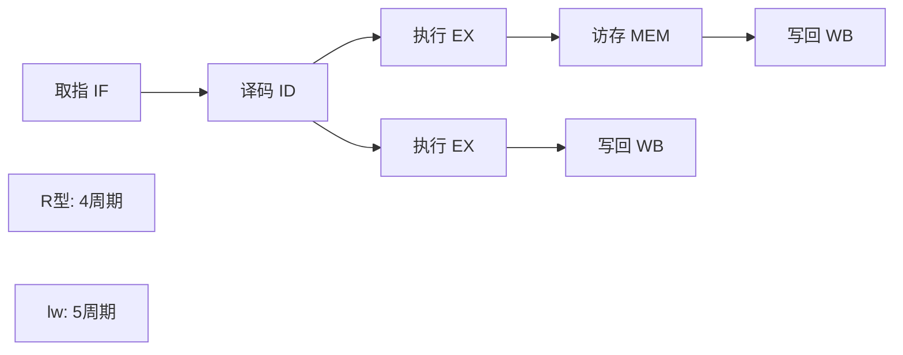

# 多周期MIPS处理器数据通路设计与整合

如果每条指令都在同一个时钟周期内完成，会发生什么？加法指令很快，而访存指令很慢，整个 CPU 的时钟频率只能迁就最慢的那条指令。多周期设计正是为了解决这个“木桶效应”。

## 它是什么与为什么需要

多周期 MIPS 处理器将一个指令的执行拆分为多个步骤，==每个步骤占用一个时钟周期==。不同指令经过的步骤数不同（如 R 型需 4 个周期，`lw` 需 5 个），因此可以按各步骤的实际延迟来设定较短的时钟周期，从而提高整体吞吐率。

> [!IMPORTANT]
> 核心思想：将单周期的长组合逻辑用寄存器打断，分步执行，==允许不同指令占用不同周期数==。

## 怎么做：数据通路的整合

在单周期通路基础上，我们需要做两件事：**插入中间寄存器**和**复用功能部件**。

1. **插入中间寄存器**：在 ALU 输出、存储器输出等关键节点加入临时寄存器（如 `ALUOut`、`MDR`、`IR`），用于保存上一周期的结果供下一周期使用。
2. **复用功能部件**：为了节省硬件，ALU 在不同周期被用于不同任务（PC 更新、地址计算、算术运算）。这就要求引入多路选择器（MUX）来控制输入源。

控制单元根据当前所处的状态（由有限状态机 FSM 决定），发出对应的控制信号，驱动 MUX 选择正确的数据通路。

## 与相近概念的区别

| 对比维度 | 单周期处理器 | 多周期处理器 |
| :--- | :--- | :--- |
| 时钟周期 | 统一，取决于最慢指令 | 较短，取决于最慢步骤 |
| 硬件资源 | 需独立加法器算 PC | ALU 分时复用 |
| 中间存储 | 无额外流水线寄存器 | 需 IR、MDR、ALUOut 等 |
| 控制方式 | 纯组合逻辑 | 有限状态机（FSM） |

> [!NOTE]
> 多周期不等于流水线。多周期中一条指令独占数据通路直到执行完毕；流水线允许多条指令重叠执行。

## 常见的坑

> [!WARNING]
> **PC 更新的时机**：PC 不是在最后才更新！在取指（IF）阶段结束后，必须立刻利用 ALU 计算 $PC + 4$ 并写回 PC，否则下个周期无法取下一条指令。

> [!CAUTION]
> **寄存器堆的写入**：寄存器堆只有在写回（WB）阶段的上升沿才真正写入。读操作是组合逻辑，随时可读。

## 算对了的例子

以 `lw $t0, 8($s0)` 为例，分析其数据通路与周期开销。假设各步骤延迟如下：取指 $2\text{ns}$，译码 $1.5\text{ns}$，ALU 计算 $2\text{ns}$，访存 $3\text{ns}$，写回 $1.5\text{ns}$。

- **单周期时钟周期**：必须容纳整条指令，$T_{single} = 2 + 1.5 + 2 + 3 + 1.5 = 10\text{ns}$。
- **多周期时钟周期**：按最长步骤定，$T_{multi} = \max(2, 1.5, 2, 3, 1.5) = 3\text{ns}$。
- **`lw` 指令总耗时**：共需 5 个周期（IF、ID、EX、MEM、WB），耗时 $5 \times 3\text{ns} = 15\text{ns}$。

> [!TIP]
> 虽然 `lw` 在多周期下耗时 $15\text{ns}$ 大于单周期的 $10\text{ns}$，但对于只需 4 个周期的 R 型指令，多周期仅需 $4 \times 3 = 12\text{ns}$。当程序中短指令占比高时，多周期的平均 CPI 更低，整体性能更优。
