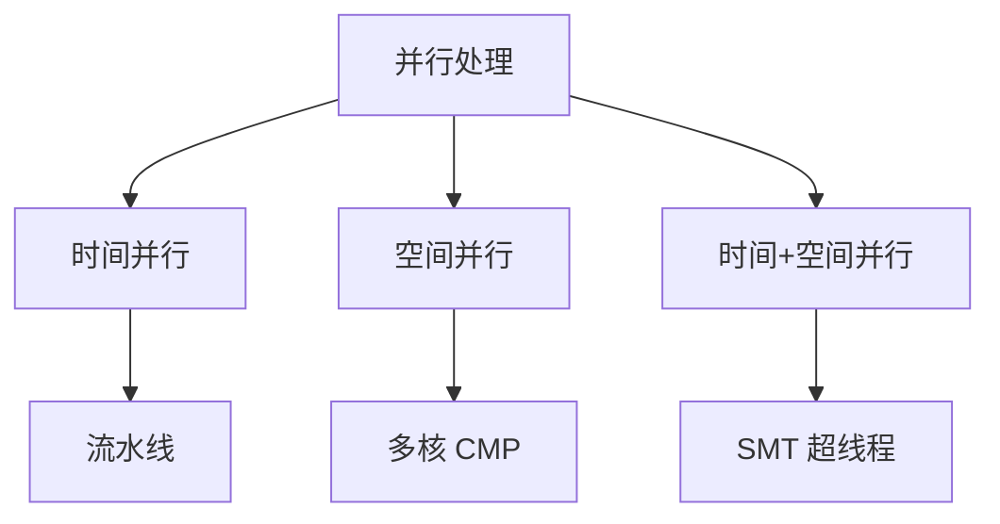

# 多核技术与SMT同步多线程（超线程）

## 这是什么

早期提高 CPU 性能靠"做得更快"（提升主频）或"做得更多"（超标量、乱序执行）。但主频撞上**功耗墙**、ILP 也挖得差不多了，于是业界转向两条新路：

- **多核技术（空间并行）**：一个芯片上集成多个处理核心（CMP，Chip-level Multi-Processing），让多个线程/进程**真正同时**跑在不同物理核心上。
- **SMT 同步多线程（超线程，时间+空间并行）**：一个物理核心内部只复制少量资源（寄存器组、PC），共享取指/译码/执行单元与 Cache，让一个核心在**同一个时钟周期**发射多个线程的指令。Intel 称之为 Hyper-Threading，通常 1 核 2 线程。

> [!IMPORTANT]
> 用课件的三分类对号入座：**时间并行 = 流水线**；**空间并行 = 多核 / 多处理机**；**时间+空间并行 = SMT 超线程**。==填空题最爱考这个三分法==。

## 为什么需要

流水线一个未解的死结是 **冒险（Hazard）**：遇到数据冒险、分支冒险就要**停顿（stall）或清空（flush）**，功能部件白白空转。SMT 的动机就一句话：==用另一个线程的指令填进这些气泡==。多核则是把"线程级并行 TLP"扩展到芯片级，绕开单核频率和 ILP 的天花板。

## 怎么做

| 维度 | 资源复制程度 | 并行粒度 | 典型加速 |
|---|---|---|---|
| 超标量 | 共享一套，多发射 | 指令级 ILP | 2～5 倍 |
| SMT 超线程 | 复制寄存器/PC，共享执行单元 | 线程级 TLP | 1.2～1.3 倍 |
| 多核 CMP | 每核一套完整资源 | 线程级 TLP | 接近线性 |

SMT 里"同步"的含义：==多个线程的指令在同一拍被取指、译码、发射==，由硬件调度器把指令混着送给各功能单元。

> [!WARNING]
> 常见的坑：
> - 超线程 ≠ 两个核。任务管理器显示 8 线程不等于 8 个物理核心，浮点/密集计算加速远低于 2 倍。
> - 多核共享 Cache 会引入**Cache 一致性**问题（MESI 等协议），访问共享变量还有**伪共享**陷阱。
> - SMT 线程太多反而争抢资源，可能比关掉还慢。

## 例子（对应填空题）

"并行处理……主要有三种形式 A. 时间并行；B. 空间并行；C. 时间+空间并行。"判断归属：

- 流水线靠"时间上重叠"→ A
- 多核/多机靠"空间上复制"→ B
- 超线程一个核内多线程同时推进 → ==C==

> [!TIP]
> 记忆口诀：**"流水在时间，多核在空间，超线程两头占"**。看到"同一流水段反复使用/时空重叠"选时间并行；看到"多个处理单元/多个核心"选空间并行；看到"一核多线程/超线程"选时间+空间并行。
