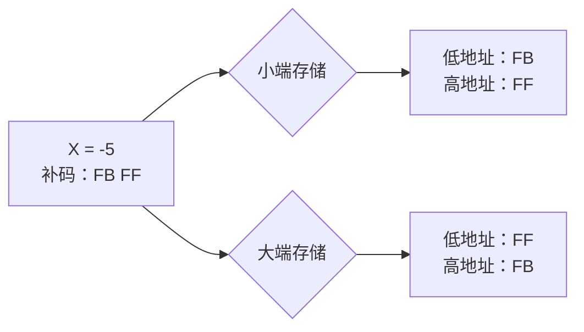

# 数制与码制（原码、反码、补码、移码表示法及相互关系）

## 从“为什么补码能统一加减”说起

先问一个问题：如果让你用电路做一个加法器，你会怎么处理减法？

最直接的想法是：再做一个减法器。但电路越做越多，成本越高。能不能**把减法也变成加法**？这就是补码出现的最核心动机。

在二进制里，一个很自然的想法是利用“模”的循环性。十进制时钟：3 点往前拨 2 小时和往后拨 10 小时，结果一样——因为 $2 + 10 = 12$，时钟的模是 12。

二进制定点数（假设 8 位）的模是 $2^8 = 256$。于是：

$$
A - B = A + (256 - B) \pmod{256}
$$

这就把减法“绕”成了加法。$256 - B$ 就是 $B$ 的补码（对 8 位而言）。

> [!IMPORTANT]
> 补码的核心意义不是“多一种表示负数的办法”，而是**让加法和减法共用同一套电路**。

---

## 原码、反码、补码、移码到底是什么

设机器字长为 $n+1$ 位，最高位是符号位（0 正 1 负），数值位 $n$ 位。以 $X = -0.1011$（真值）为例：

| 表示法 | 规则（负数时） | 例：$-0.1011$（$n=4$） |
|--------|----------------|--------------------------|
| 原码 | 符号位取 1，数值位取绝对值 | $1.1011$ |
| 反码 | 符号位取 1，数值位按位取反 | $1.0100$ |
| 补码 | 反码末位加 1 | $1.0101$ |
| 移码 | 补码符号位取反（或真值加偏置） | $0.0101$ |

正数时，原码、反码、补码完全一样，都是符号位为 0、数值位照抄。

> [!TIP]
> 记忆口诀：**“反码就是翻翻翻，补码就是反码加一，移码就是补码翻符号”**。

这里有个特别容易踩的坑——**零的表示**：

| 表示法 | $+0$ | $-0$ |
|--------|------|------|
| 原码 | $0.0000$ | $1.0000$ |
| 反码 | $0.0000$ | $1.1111$ |
| 补码 | $0.0000$ | $0.0000$（唯一） |
| 移码 | $1.0000$ | $1.0000$（唯一） |

> [!WARNING]
> 原码和反码都有“正零”和“负零”两种形式，补码和移码**零的表示唯一**。这也是补码被广泛采用的原因之一。

---

## 补码与移码：只差一个符号位

课件上有一句话：“补码与移码只差一个符号位”。这句话的严格含义是：

$$
[X]_{\text{移}} = [X]_{\text{补}} \text{ 的符号位取反}
$$

例如 $X = -1$（8 位整数）：

- $[-1]_{\text{补}} = 11111111$
- $[-1]_{\text{移}} = 01111111$

为什么要有移码？因为补码的符号位导致**数值比较时正数恒大于负数**，但补码的二进制编码直接按无符号数比较时，负数反而比正数“大”。移码把符号位取反后，**数值大小与编码大小顺序一致**，方便硬件直接比较大小。这就是 IEEE 754 浮点数中**阶码用移码**的原因。

---

## 补码加减法：模运算的直接应用

补码加法的公式很简单：

$$
[X+Y]_{\text{补}} = [X]_{\text{补}} + [Y]_{\text{补}} \pmod{2^{n+1}}
$$

补码减法呢？也简单：

$$
[X-Y]_{\text{补}} = [X]_{\text{补}} + [-Y]_{\text{补}}
$$

其中 $[-Y]_{\text{补}}$ 就是对 $[Y]_{\text{补}}$ **连同符号位一起按位取反，末位加 1**。

> [!TIP]
> 这正是课件里说的“可以参考 MOD 的算法，实际上就是求相反数的补码”。

**一个算对了的例子**（纯小数，$n=4$，双符号位防溢出）：

$X = -0.1011$，$Y = 0.0101$，求 $X + Y$。

- $[X]_{\text{补}} = 11.0101$（双符号位）
- $[Y]_{\text{补}} = 00.0101$
- $[X+Y]_{\text{补}} = 11.0101 + 00.0101 = 11.1010$

结果双符号位为 `11`，表示负数。还原真值：补码 $11.1010$ → 原码 $11.0110$ → 真值 $-0.0110$。

验证：$-0.1011 + 0.0101 = -0.0110$ ✓

---

## 溢出：什么时候会出错

双符号位法（变形补码）的判据：

| 双符号位 | 含义 |
|----------|------|
| 00 | 正数，无溢出 |
| 11 | 负数，无溢出 |
| 01 | 正溢出（两个正数相加得到正值符号位却变了） |
| 10 | 负溢出（两个负数相加得到负值符号位却变了） |

> [!CAUTION]
> 溢出只会发生在**同号数相加**或**异号数相减**时。异号数相加永远不会溢出。

---

## 码制选择与存放方式

- **指令和数据**在内存中都是一串二进制位，解释方式取决于上下文。
- 负数在内存中以**补码**形式存放。
- 多字节数据有**大端**（高字节低地址）和**小端**（低字节低地址）两种存放方式，x86 是小端。

> [!NOTE]
> IEEE 754 浮点数中，**尾数用原码、阶码用移码**——这是三种码制在实际标准中的分工合作。
