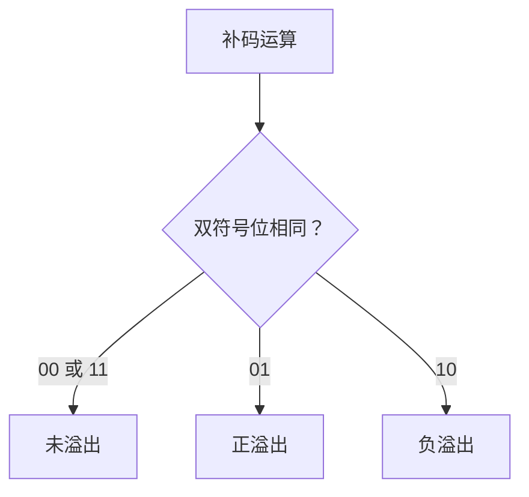
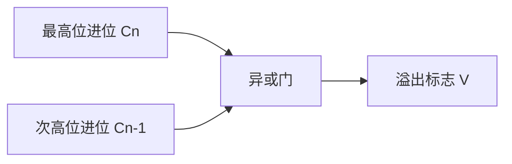

# 溢出及其判定（双符号位法、最高位进位与次高位进位的异或值）

## 溢出的含义

在定点补码运算中，运算结果超出了机器字长所能表示的范围，称为**溢出**。溢出只说明结果“装不下”，并不等于最高位产生了进位。

例如，8 位补码的表示范围为：

- 正数：$0\sim 1-2^{-6}$
- 负数：$-1\sim -2^{-7}$

若运算结果大于 $1-2^{-6}$ 或小于 $-2^{-7}$，就发生溢出。

> [!IMPORTANT]
> ==溢出判断的是补码结果是否超出表示范围，不是判断最高位是否有进位。==

## 双符号位法

双符号位法又称**变形补码法**。在原补码的最高位前再增加一位符号位，使符号位由 1 位变成 2 位：

| 双符号位 | 状态 | 含义 |
|---|---|---|
| `00` | 正常 | 正数，无溢出 |
| `11` | 正常 | 负数，无溢出 |
| `01` | 正溢出 | 正数加上负数，结果为正且超过最大正数 |
| `10` | 负溢出 | 负数加上正数，结果为负且低于最小负数 |

双符号位仍参与加法。两个符号位相同时表示结果未溢出；两个符号位不同时，即为 `01` 或 `10`，表示溢出。

> [!TIP]
> 记忆：符号位“同号正常，异号溢出”；`01` 正溢出，`10` 负溢出。

## 最高位进位法

对于**单符号位补码加减运算**，硬件通常保留最高位产生的进位 $C_n$ 和次高位产生的进位 $C_{n-1}$，并用二者的异或判断溢出：

$$
V=C_n\oplus C_{n-1}
$$

- $V=0$：无溢出；
- $V=1$：发生溢出。

原因是：最高位与次高位的进位不一致时，真实结果所需的符号位无法按固定字长保存。其逻辑结构可表示为：

> [!WARNING]
> 不能只看最高位进位。单独出现最高位进位并不必然表示溢出；必须考察它与次高位进位是否不同。

## 算例

机器字长为 8 位（含 1 位符号位）：

$$
A=0.0010101,\qquad B=0.1101011
$$

求 $A-B$。由于

$$
[-B]_{\text{补}}=1.0010101
$$

所以

$$
\begin{array}{r}
  0.0010101\\
+ 1.0010101\\
\hline
  0.0001010
\end{array}
$$

结果为

$$
A-B=+0.0001010
$$

最高位无进位，次高位也无进位，即 $C_n=C_{n-1}=0$，故

$$
V=C_n\oplus C_{n-1}=0
$$

因此==无溢出==。

## 易错辨析

| 概念 | 判断内容 |
|---|---|
| 最高位进位 $C_n$ | 最高位是否产生进位 |
| 溢出标志 $V$ | 结果是否超范围 |
| 双符号位 `01/10` | 溢出 |
| 双符号位 `00/11` | 未溢出 |

双符号位法直观，但需要额外一位；单符号位法利用进位异或，更适合实际 ALU。两者本质上都通过额外信息判断补码结果是否越界。
