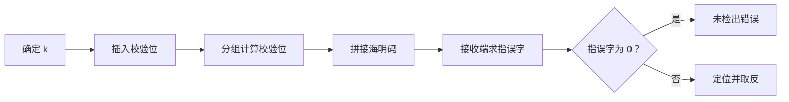

# 奇偶校验码

## 它是什么、为什么需要

数据在存储和传输中可能因干扰发生位翻转。奇偶校验码在原始数据旁增加校验位，用==“1 的个数是奇数还是偶数”==来检查数据是否异常。

- **偶校验**：数据位与校验位合起来，1 的个数为偶数。
- **奇校验**：数据位与校验位合起来，1 的个数为奇数。

例如数据 `0011` 中有 2 个 1，配一位偶校验位时取 0，配一位奇校验位时取 1。接收端重新统计，若奇偶性不符合约定，就说明出现了差错。

> [!IMPORTANT]
> 一位奇偶校验码==只能检错，不能定位并纠错==；它能发现任意奇数位数出错，但不能发现偶数位数同时出错，也不能判断是哪一位出错。

## 海明码怎样实现纠错

南邮试题中的“汉明码”即海明码。它不是只增加一个总校验位，而是把多个校验位插入特定位置，使每组校验结果共同指出出错位置。

设数据位数为 $n$，校验位数为 $k$，应满足：

$$2^k\geq n+k+1$$

校验位 $C_1,C_2,C_4,\ldots$ 放在编号为 $1,2,4,\ldots$ 的位置，其余位置依次放数据位。位置编号从 **1** 开始，而不是从 0 开始。

每个数据位参加哪些校验组，看其位置编号的二进制分解。例如：

| 位置 | 二进制 | 参加的校验组 |
|---|---|---|
| 3 | $011$ | $C_1,C_2$ |
| 5 | $101$ | $C_1,C_4$ |
| 6 | $110$ | $C_2,C_4$ |
| 7 | $111$ | $C_1,C_2,C_4$ |

因此，$C_1$ 检查位置 $1,3,5,7$，$C_2$ 检查位置 $1$ 除外的 $2,3,6,7$，$C_4$ 检查位置 $4,5,6,7$。计算时通常先对相应数据位异或，再按奇偶校验要求确定校验位。

## 计算示例：1100 的奇校验海明码

已知 $n=4$，由 $2^k\geq n+k+1$ 得 $k=3$，所以码字共 7 位。数据 `1100` 依次放入位置 $3,5,6,7$：

| 位置 | 1 | 2 | 3 | 4 | 5 | 6 | 7 |
|---|---|---|---|---|---|---|---|
| 名称 | $C_1$ | $C_2$ | 1 | $C_4$ | 1 | 0 | 0 |

按奇校验计算：

$$C_1:\quad 3\oplus5\oplus7=1\oplus1\oplus0=0$$

数据位异或结果为 0，其中有偶数个 1，所以 $C_1=1$。

$$C_2:\quad 3\oplus6\oplus7=1\oplus0\oplus0=1$$

其中有奇数个 1，所以 $C_2=0$。

$$C_4:\quad 5\oplus6\oplus7=1\oplus0\oplus0=1$$

同理，$C_4=0$。

按位置 $1\sim7$ 排列，得到：

$$\boxed{1100\text{ 的奇校验海明码为 }1010100}$$

接收端重新计算三组校验，得到指误字。若指误字为 0，表示未检出错误；若非 0，其数值就是出错位置，将该位取反即可纠正一位错误。

> [!TIP]
> 求校验位可用“==数 1 的个数，奇校验补成奇数，偶校验补成偶数==”。不要只背“异或后取反”：数据位异或结果为 0 时，奇校验位取 1、偶校验位取 0；异或结果为 1 时，奇校验位取 0、偶校验位取 1。

## 常见坑与相近概念

> [!WARNING]
> - 数据位要按原顺序填入 $3,5,6,7$，不能把 `1100` 直接放在码字最左侧。
> - 奇、偶校验只影响校验位取值，不改变分组位置。
> - 最后必须按位置 $1,2,3,4,5,6,7$ 写出完整码字，不要只写 $C_1C_2C_4$。
> - 基本海明码按一位错误设计；多位出错时不能简单套用“指误字就是出错位”。

| 编码 | 主要能力 | 基本思路 |
|---|---|---|
| 奇偶校验码 | 检错，不能纠错 | 检查整体奇偶性 |
| 海明码 | 可定位并纠正一位错误 | 多组奇偶校验形成指误字 |
| 循环纠错码（CRC） | 强大的差错检测能力 | 二进制多项式除法求余数 |

CRC 常用于帧或数据块的差错检测；它本身不直接给出出错位置，不应与海明码的一位纠错能力混淆。
