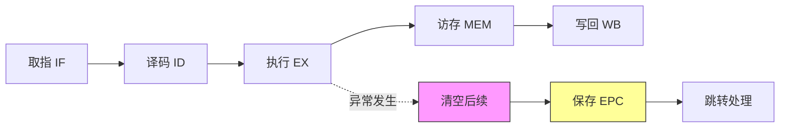

# 流水线中的异常和中断处理（精确异常与非精确异常）

# 流水线中的异常和中断处理

在流水线 CPU 中，多条指令同时处于不同执行阶段。当发生异常或中断时，如何保证程序状态的“一致性”是核心难点。

## 什么是精确异常？

==精确异常（Precise Exception）==是指：当异常发生时，所有在该异常指令**之前**的指令都已正确完成并更新状态，而该异常指令及其**之后**的所有指令都未对体系结构状态产生任何影响。

> [!IMPORTANT]
> 核心要求：异常点必须像顺序执行一样，有一个明确的“断点”，使得现场保护后能准确返回或重试。

为什么需要它？如果异常是非精确的（即后续指令可能已经修改了寄存器或内存），操作系统将无法确定哪些数据是合法的，导致调试极其困难，甚至无法恢复程序运行。

## 流水线如何处理中断？

传统非流水线 CPU 在中断周期由硬件自动保存 PC，主要是为了==能进入中断处理程序，并能正确返回源程序==（参考选择题 60）。但在流水线中，PC 指向的不再是当前正在执行的指令，而是预取指令的地址。

处理流程通常涉及：
1. **检测**：在流水线的特定级（如执行级或写回级）检测异常。
2. **冻结/清空**：一旦检测到高优先级异常，立即冻结前端取指，清空流水线中位于异常指令之后的所有指令。
3. **保存现场**：将异常指令前的最后一条已完成指令的地址保存到 EPC（异常程序计数器）。

## 精确 vs 非精确异常

| 特性 | 精确异常 | 非精确异常 |
| :--- | :--- | :--- |
| **状态一致性** | 严格顺序一致 | 可能包含后续指令结果 |
| **实现难度** | 高（需复杂硬件支持） | 低 |
| **可恢复性** | 可重试/恢复 | 通常只能终止程序 |
| **应用场景** | 通用 CPU（如 x86, ARM） | 高性能科学计算（部分允许丢失） |

> [!WARNING]
> 常见坑：认为“硬件保存 PC”就是精确异常的全部。实际上，流水线中必须配合**指令重排序缓冲（ROB）**或**历史缓冲区**来确保只有确已提交的指令才生效，才能实现精确异常。

## 中断响应次序实例分析

结合复习提纲中的中断屏蔽技术，中断响应不仅取决于到达时间，更取决于==屏蔽字设定的优先级==。

**题目回顾**：
若中断源 5、6、7 同时到达，8 随后到达，2 最后到达。根据给定的屏蔽表：
- 中断 6 的屏蔽字显示它只屏蔽自身和更高优先级的（假设表中 1 为屏蔽）。
- 关键在于动态优先级：当 CPU 正在处理某个中断时，新的中断请求能否打断，取决于新中断的优先级是否高于当前被屏蔽的级别。

**解题逻辑**：
1. **5, 6, 7 同时到**：查屏蔽表或硬件排队器，确定初始响应顺序。通常硬件有固定优先级（如 1>2>...>8），但屏蔽字可以改变实际处理次序。
2. **嵌套处理**：若在 servicing 6 时，8 到达。检查 8 的优先级是否高于 6 的屏蔽位。若 8 能中断 6，则转去处理 8。
3. **返回机制**：处理完高优先级中断后，返回被中断的低优先级中断继续执行。

> [!TIP]
> 记忆技巧：画时间轴。横轴为时间，纵轴为中断服务程序。遇到新中断，对比“新中断优先级”与“当前中断屏蔽字”。若能中断，则压栈当前上下文，跳转新服务；否则等待。

通过硬件自动保存 PC 和状态字，配合软件的中断服务程序，系统才能在复杂的流水线并行中维持逻辑上的串行正确性。
