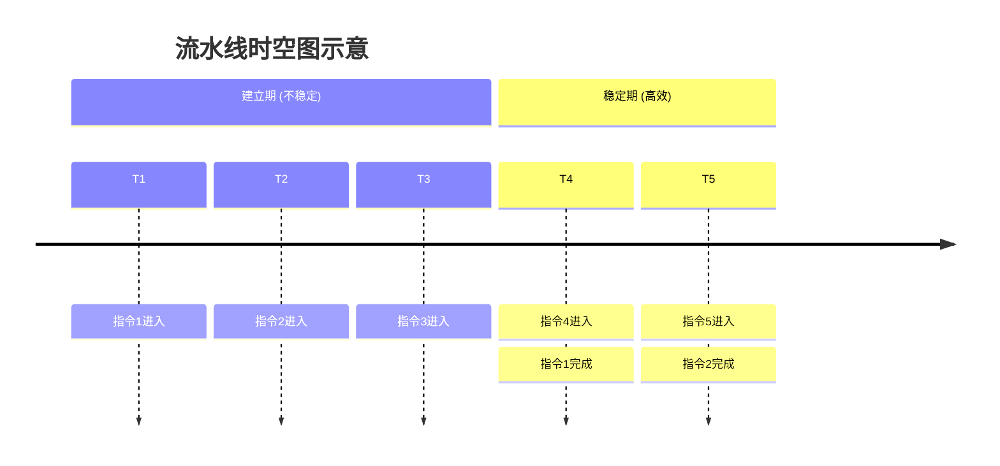

# 流水线性能指标（吞吐率、加速比、通过时间与稳定时间）

## 流水线性能指标

流水 CPU 是以 ==时间并行性== 为原理构造的处理器。想象一下洗衣房：如果只有一台洗衣机，洗完再烘干是串行的；但如果有多台机器同时工作，虽然单件衣服处理时间没变，但单位时间内完成的衣服数量（吞吐率）大大增加了。

### 核心指标定义

评价流水线效率主要看三个指标：

1.  **吞吐率 (Throughput, $TP$)**：单位时间内流水线完成的任务数量。
    $$ TP = \frac{n}{T_k} $$
    其中 $n$ 为任务数，$T_k$ 为完成 $n$ 个任务的总时间。
2.  **加速比 (Speedup, $S$)**：不使用流水线的时间与使用流水线的时间之比。
    $$ S = \frac{T_{serial}}{T_{pipeline}} $$
3.  **通过时间与稳定时间**：
    *   **建立时间**：流水线填满所需的时间（通常为 $k \times \Delta t$，$k$ 为段数）。
    *   **稳定时间**：流水线满载后，每 $\Delta t$ 输出一个结果的状态。

> [!IMPORTANT]
> 核心结论：当任务数 $n$ 远大于流水线段数 $k$ 时，加速比 $S$ 趋近于 $k$（理论最大值）。此时效率最高，接近 100% 的潜在性能。

### 为什么需要关注这些指标？

非流水线处理器执行 $n$ 条指令需 $n \times k \times \Delta t$。而 $k$ 段流水线执行 $n$ 条指令仅需 $(k + n - 1) \times \Delta t$。
*   若 $n$ 很小，建立流水线的开销占比大，加速比低。
*   若 $n$ 很大，分摊到每条指令的建立开销忽略不计，加速比高。

### 常见误区与计算陷阱

很多同学在计算加速比时，容易混淆“理论最大加速比”和“实际加速比”。

| 概念 | 公式/含义 | 注意事项 |
| :--- | :--- | :--- |
| **理论最大加速比** | $S_{max} = k$ | 假设各段时长相等，无冲突 |
| **实际加速比** | $S = \frac{n \cdot k \cdot \Delta t}{(k+n-1)\Delta t}$ | 需考虑具体 $n$ 和 $k$ |
| **效率 (Efficiency)** | $E = S / k$ | 反映设备利用率 |

> [!WARNING]
> 易错坑：题目中给出的“potential”（潜在性能）通常指理论最大加速比 $k$。计算百分比时，分母应为 $k$，而非其他数值。例如课件中 $99\%$ of potential 意味着实际加速比非常接近段数 $k$。

### 典型例题解析

参考课件数据：假设某流水线有 $k=10$ 段，每段耗时 $\Delta t$。
若执行 $n=1000$ 条指令：
*   串行时间：$T_{serial} = 1000 \times 10 \times \Delta t = 10000 \Delta t$
*   流水时间：$T_{pipe} = (10 + 1000 - 1) \Delta t = 1009 \Delta t$
*   加速比：$S = \frac{10000}{1009} \approx 9.91$

这与课件中 `加速比 = 10010 / 1010 = 9.9 (99% of potential)` 的逻辑一致（此处分子分母可能因具体题目参数微调，但逻辑相同：$n$ 很大时，$S \approx k$）。

> [!TIP]
> 解题技巧：看到“高性能微处理器”、“大量任务”，直接联想 ==高加速比== 和 ==高吞吐率==。填空题中，流水 CPU 是非常 ==经济而实用== 的并行技术。
