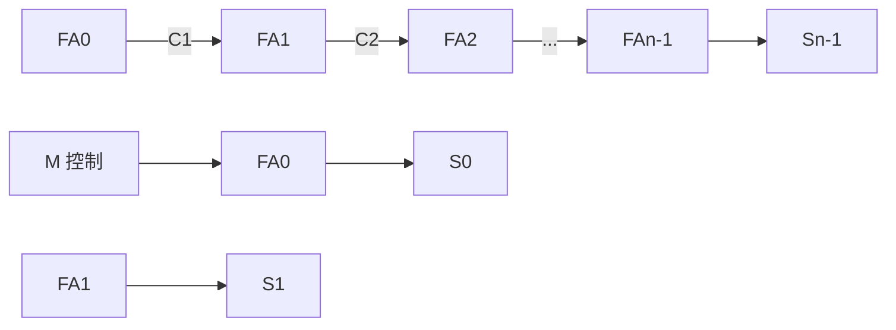

# n位的行波进位加减器

## n 位行波进位加减器

### 它是什么

把 n 个 1 位全加器（FA）级联起来，就得到 n 位行波进位加减器。每个 FA 负责 1 位运算，低位的进位输出接到高位的进位输入，像波浪一样逐位“传导”进位，所以叫**行波进位**。

1 位全加器的逻辑：

$$
S_i = A_i \oplus B_i \oplus C_i, \quad C_{i+1} = A_iB_i + C_i(A_i \oplus B_i)
$$

对 n 位加法 $A + B$，最低位进位 $C_0 = 0$，最高位进位 $C_n$ 可作为溢出判断标志（无符号数时即进位）。

做减法时，利用补码原理：$A - B = A + (-B) = A + \overline{B} + 1$。只需在 B 的每位前加一个异或门，由控制信号 $M$ 决定加还是减：

- $M=0$：做加法，$Y_i = B_i$
- $M=1$：做减法，$Y_i = \overline{B_i}$，同时最低位 $C_0 = 1$（实现“+1”）

> [!NOTE]
> 单个 FA 的延迟约为 2 级门延迟（产生进位），n 位行波进位最坏情况延迟为 $2n$ 级门延迟。位数越多，加法越慢。

### 为什么需要

计算机中所有算术运算最终都归结为加法，而加法器是 CPU 运算器的核心部件。1 位 FA 只能算 1 位，实际数据是 8 位、16 位、32 位甚至 64 位，所以必须把多个 FA 级联起来。行波进位加减器是最直观的 n 位加减法实现方案，也是后续学习**先行进位（CLA）**等优化方案的对照基础。

### 怎么做

**加法过程**（以 4 位为例，$A=0101_2=5$，$B=0011_2=3$）：

| 位 i | $A_i$ | $B_i$ | $C_i$ | $S_i$ | $C_{i+1}$ |
|:---:|:---:|:---:|:---:|:---:|:---:|
| 0 | 1 | 1 | 0 | 0 | 1 |
| 1 | 0 | 1 | 1 | 0 | 1 |
| 2 | 1 | 0 | 1 | 0 | 1 |
| 3 | 0 | 0 | 1 | 1 | 0 |

结果：$S=1000_2=8$，$5+3=8$ ✓

**减法过程**（$A=0101_2=5$，$B=0011_2=3$）：

- $M=1$，$Y=\overline{B}=1100_2$，$C_0=1$
- 按加法算：$0101 + 1100 + 1 = 10010$，低 4 位 $S=0010_2=2$ ✓
- 最高位进位 $C_4=1$，对于有符号数（补码运算）这不算溢出

> [!IMPORTANT]
> ==溢出判断==：对补码加减法，仅当两个操作数符号相同且结果符号相反时溢出。可表示为 $OVR = C_{n-1} \oplus C_n$。上例减法中 $C_3=1$，$C_4=1$，$OVR = 1 \oplus 1 = 0$，不溢出。

### 和相近概念的区别

| 项目 | 行波进位加减器 | 先行进位加法器（CLA） |
|:---:|:---|:---|
| 进位传递 | 逐位串行等待 | 并行计算所有进位 |
| 延迟 | $O(n)$ | $O(\log n)$ 或更小 |
| 硬件复杂度 | 简单，成本低 | 复杂，门数多 |
| 适用场景 | 短字长、速度要求不高 | 长字长、高速 CPU |

另一相近概念是**串行加法器**：只用一个 FA，用移位寄存器逐位送入，速度更慢但更省硬件。行波进位是“并行输入、串行进位”，介于全并行与纯串行之间。

### 常见的坑

> [!WARNING]
> 1. **减法时忘记 $C_0=1$**：$A-B = A+\overline{B}+1$，少了最末的 +1 结果会差 1。  
> 2. **把最高位进位误当溢出**：无符号数看 $C_n$，有符号数（补码）看 $C_{n-1} \oplus C_n$，两者判断条件不同。  
> 3. **忽略延迟**：行波进位的最坏情况路径是从最低位 FA 的输入到最高位 FA 的输出，约 $2n$ 级门延迟，n 很大时频率上不去。

> [!CAUTION]
> 有符号数运算中，最高位进位 $C_n$ 本身可能是正常的（补码“模”特性），千万不能见到 $C_n=1$ 就判溢出。例如 $-1 + 1 = 0$，过程中 $C_n$ 可能为 1，但结果完全正确。

### 一个算对了的例子

**题目**：用 4 位行波进位加减器计算 $A - B$，其中 $A=1101_2$（补码表示，值为 $-3$），$B=0010_2$（值为 $2$）。

**解答**：

减法模式：$M=1$，$C_0=1$，$Y=\overline{B}=1101_2$。

按位运算（FA 级联）：

| 位 i | $A_i$ | $Y_i$ | $C_i$ | $S_i$ | $C_{i+1}$ |
|:---:|:---:|:---:|:---:|:---:|:---:|
| 0 | 1 | 1 | 1 | 1 | 1 |
| 1 | 0 | 0 | 1 | 1 | 0 |
| 2 | 1 | 1 | 0 | 0 | 1 |
| 3 | 1 | 1 | 1 | 1 | 1 |

结果：$S=1011_2$，补码值为 $-5$，即 $-3 - 2 = -5$ ✓

溢出检查：$C_3=1$，$C_4=1$，$OVR = 1 \oplus 1 = 0$，无溢出。

> [!TIP]
> 验算小技巧：把减法转成补码加法后，直接做普通二进制加法，最后只保留低 n 位。补码运算天然“截断高位”，这也是 $C_n$ 不一定是溢出标志的原因。
