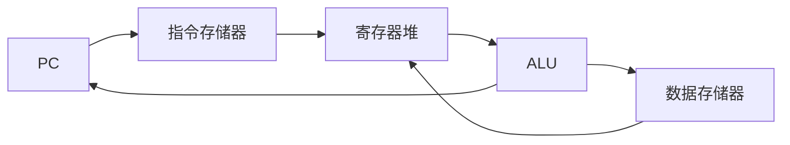

# 单周期MIPS32处理器目标指令集与基本数据通路综合

## 单周期 MIPS32 目标指令集与数据通路

单周期处理器是指**每条指令都在一个时钟周期内完成取指、译码、执行、访存、写回全部阶段**，CPI=1，时钟周期由最慢指令（通常是 `lw`）决定。本章先限定一个"最小可用"的指令集，再围绕它搭一条能跑通的数据通路。

## 目标指令集

课件选取的核心子集只有 8 条，覆盖 R 型、I 型与访存：

| 类型 | 指令 | 功能 | 说明 |
|---|---|---|---|
| 算术 | `add/sub/and/or/slt` | `rd ← rs op rt` | R 型，写寄存器堆 |
| 立即数 | `addi` | `rt ← rs + imm` | I 型，imm 需符号扩展 |
| 访存 | `lw` | `rt ← M[rs+imm]` | 需要数据存储器 |
| 访存 | `sw` | `M[rs+imm] ← rt` | 需要数据存储器 |
| 分支 | `beq` | 相等则 `PC ← PC+4+imm×4` | 需要加法器与多路选择器 |

> [!IMPORTANT]
> 单周期设计的前提是"==所有指令共用一条通路，靠多路选择器切换=="，因此指令集必须小而精，任何新增指令都要先问：现有通路能不能支持？

## 基本数据通路

围绕这 8 条指令，通路被划分为五个功能段：

各段承担的任务：

- **取指**：`PC → 指令存储器`，PC 每周期自动 `+4`；
- **译码/读寄存器**：指令的 `rs/rt` 字段送入寄存器堆，读出两个操作数；
- **执行**：ALU 完成运算或地址计算 `rs + SignExt(imm)`；
- **访存**：`lw/sw` 访问数据存储器，其余指令旁路；
- **写回**：结果经多路选择器写回寄存器堆的 `rd` 或 `rt`。

> [!TIP]
> 判断通路是否正确的口诀："==数据从哪来，经谁加工，到哪去=="，三步走一遍，漏掉的部件立刻现形。

## 两个经典考题精讲

**例 1（指令存储器读取信号）**：指令存储器在每个周期都要被读取，与 `mem_read`、`mem_write` 无关，因为它只受 `Clock` 驱动。

> [!WARNING]
> 易错点：把指令存储器当成"可读可写"的数据存储器去加 `mem_read`。实际上 ==指令存储器只读，且每个周期必读==，信号就是 `Clock`，选 A。

**例 2（R0 保存到 R1）**：要把 `R0` 的数据写入 `R1`，数据应走 `R0 → A → ALU → 移位器 → R1`，选 A。`IR` 是指令寄存器，存放的是指令编码而非数据；`PC` 存放的是地址，二者都不能作为数据源。

## 常见误区

> [!CAUTION]
> - 误以为"单周期"等于"一个时钟沿完成所有操作"，实际上一个周期内电信号沿组合逻辑逐级传播，周期长度必须 ≥ 最长通路延迟；
> - 忘记 `lw` 要先后经过 ALU（算地址）和数据存储器（读数据），是延迟最长的指令，时钟周期由它决定；
> - 把 `beq` 的目标地址算成 `PC + imm`，正确应为 `PC+4 + (SignExt(imm) << 2)`。
