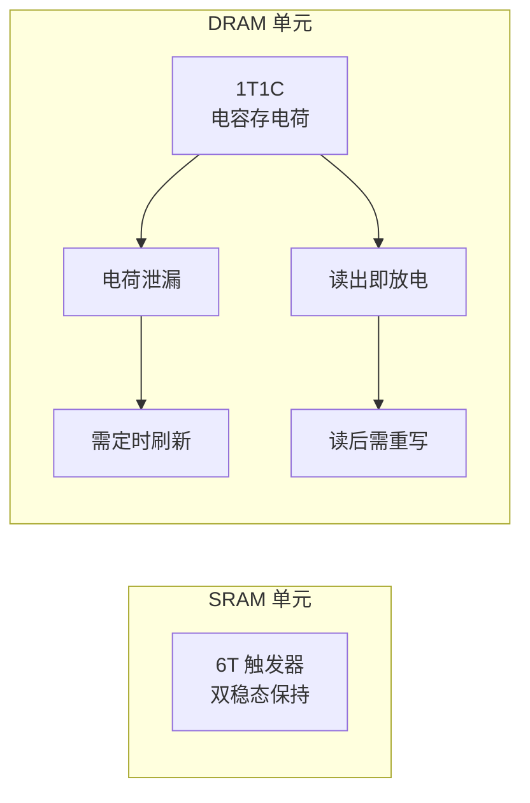
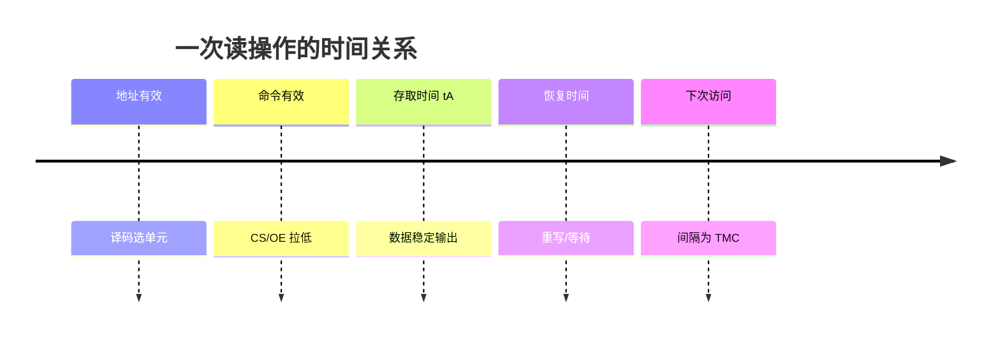

# SRAM与DRAM的比较（工作原理、读写周期、时序信号）

## 为什么需要两类 RAM

想一想：CPU 里的寄存器、Cache 和主板上的主存，对"速度"和"容量/成本"的要求一样吗？

- **寄存器、Cache**：要极快，容量小一点、贵一点没关系。
- **主存**：要容量大、便宜，速度可以稍慢。

一种存储单元结构很难同时满足这两点，于是有了两条技术路线：**SRAM**（静态随机存取存储器）与 **DRAM**（动态随机存取存储器）。它们都是"随机存取"——按地址直接访问任意单元，但内部工作原理完全不同。

> [!IMPORTANT]
> ==SRAM 用触发器（双稳态电路）存 1 位信息，只要不断电就一直保持；DRAM 用电容存电荷表示信息，电荷会泄漏，必须定期"刷新"（Refresh）。==

## 工作原理对比

**SRAM 存储单元**：典型是 6 个晶体管（6T）构成的触发器，两个稳定状态分别表示 0 和 1。读出时把触发器的状态引到数据线上，属于**非破坏性读出**，读完后不需要恢复。

**DRAM 存储单元**：通常只用 1 个晶体管 + 1 个电容（1T1C）。电容有电荷为 1，无电荷为 0。问题是：

1. **漏电**：电荷只能维持几毫秒到几十毫秒，因此每隔一定时间（如 2 ms）必须逐行刷新一次，否则信息丢失。
2. **破坏性读出**：读出时电容电荷被放掉，需要在读后立刻**重写（恢复）**。

## 读写周期与时序信号

**读周期**的一般过程：地址线上给出地址 → 片选信号 $\overline{CS}$ 有效 → 读命令 $\overline{OE}$（或 $\overline{WE}=1$）有效 → 经过**存取时间 $t_A$**，数据稳定出现在数据线上。

**写周期**：地址有效 → $\overline{CS}$ 有效 → 写命令 $\overline{WE}=0$ 有效，同时数据线上放好待写数据 → 数据写入单元。

> [!IMPORTANT]
> ==存取时间 $t_A$：从存储器收到读写命令，到完成读出（写入）所需的时间。==
> ==存取周期 $T_{MC}$：连续两次独立存储器操作（如两次读）之间的最小间隔时间。==
> 二者关系：$T_{MC} = t_A + t_{恢复}$，其中恢复时间包括 DRAM 的刷新/重写开销，所以 $T_{MC} > t_A$。

## SRAM 与 DRAM 全面比较

| 对比项 | SRAM | DRAM |
|---|---|---|
| 存储元件 | 触发器（6T） | 电容（1T1C） |
| 是否易失 | 断电即失 | 断电即失，且需刷新 |
| 读出方式 | 非破坏性读出 | 破坏性读出，需重写 |
| 刷新电路 | 不需要 | 需要，控制复杂 |
| 速度（同时期同工艺） | ==快== | 慢 |
| 集成度/成本 | 低、贵 | 高、便宜 |
| 典型用途 | Cache、寄存器堆 | 主存 |

> [!TIP]
> 记用途看"谁快谁贵"：SRAM 快而贵 → 用在容量小、速度要求极高的 **Cache**；DRAM 慢而便宜 → 做容量大的 **主存**。寄存器一般不由 SRAM 芯片充当，但 CPU 内部的寄存器堆在电路结构上属于 SRAM 类。

> [!WARNING]
> 易错点：DRAM 的"刷新"和"重写"不是一回事。刷新是对所有行周期性地补充电荷以保鲜；重写是读出后立刻把被破坏的数据写回。二者都源于电容存储，但触发时机不同。

## 算例：地址线与数据线数目

某 SRAM 芯片容量为 $64K \times 16$ 位，求地址线和数据线数目。

- 地址线：$64K = 64 \times 1024 = 2^{16}$，故需 **16 根地址线**。
- 数据线：字长 16 位，故需 **16 根数据线**。

答案选 D（16，16）。注意别把 $64K$ 当成 64 根地址线——$K$ 表示 $2^{10}$，要先化成 2 的幂。
