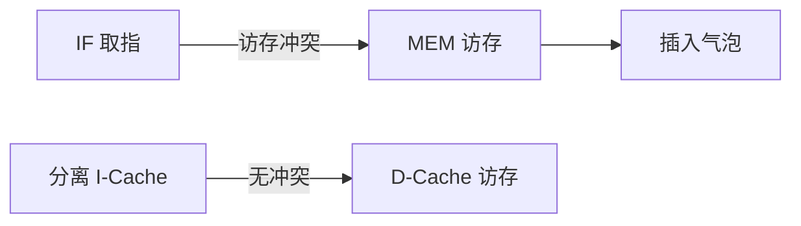

# 结构冒险及其解决

## 它是什么

一条指令的执行通常分为多个阶段。在理想的流水线中，每个时钟周期都有一条新指令进入流水线，不同指令的不同阶段在时间上重叠执行。

先想一个问题：如果两条指令在**同一个时钟周期**都要使用同一个硬件部件（比如都要访问存储器），会发生什么？

这就是**结构冒险（Structural Hazard）**：==硬件资源冲突导致后续指令无法在预定周期进入流水线==。课件中又称其为**资源相关**，与数据相关、控制相关并列。

> [!IMPORTANT]
> 填空题标准答案：影响流水线性能的因素主要反映在 `结构` 相关、`数据` 相关和 `控制` 相关三个方面。

## 为什么需要解决

如果不缓解结构冒险，流水线就会被迫**停顿（Stall / 气泡）**。停顿期间部分功能部件空闲，实际吞吐率下降，加速比达不到理想值 $k$（$k$ 为流水线段数）。

## 怎么做

常见办法有两种，核心思路都是让冲突不再发生：

- **资源重复（增加部件）**：把单一部件拆成多份，典型应用是**指令存储器与数据存储器分离**（哈佛结构）。
- **流水线停顿**：插入气泡推迟冲突指令，牺牲性能换正确性。

> [!TIP]
> 记忆技巧：结构冒险的本质是"==资源不够用=="；解决思路只有"加资源"或"等资源"两条路。

## 和相近概念的区别

结构冒险容易和数据冒险混淆，关键判断标准是看冲突发生在**资源**还是**数据**上。

| 对比项 | 结构冒险 | 数据冒险 |
| --- | --- | --- |
| 冲突来源 | 同一周期争用==同一硬件部件== | 指令间存在==数据依赖== |
| 典型表现 | 单存储器被 IF 与 MEM 同时使用 | 后一条指令需要前一条指令的运算结果 |
| 解决手段 | 资源重复、停顿 | 转发（旁路）、停顿、编译器调度 |

> [!WARNING]
> 常见坑：看到两条指令都要"访存"就判定为数据冒险。若两者访问的是不同地址且无数据依赖，仍然只是==结构冒险==。

## 一个算对了的例子

填空题完整作答：

> 影响流水线性能的因素主要反映在 **结构** 相关、**数据** 相关和 **控制** 相关三个方面。

- "结构"对应本知识点（资源冲突）
- "数据"对应 RAW / WAR / WAW 相关
- "控制"对应分支指令引起的冒险

三者共同构成了流水线冒险的完整分类体系，==缺一不可==。
