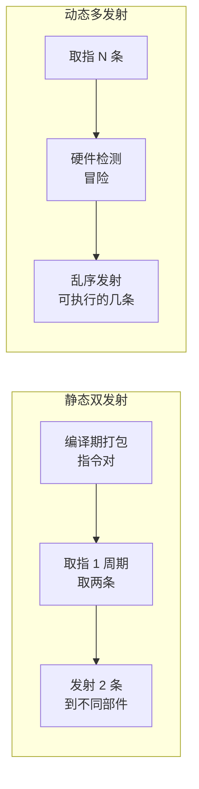

# 超标量流水线与超流水线技术（静态双发射、动态多发射、指令级并行ILP）

## 超标量与超流水线：让 CPU 同时"多干"与"快干"

普通指令流水线已经能把一条指令的执行拆成几段、让多条指令**时间上重叠**，但每个时钟周期最多只发射（Issue）一条指令。想再提速，只有两条路：**超流水线**——把段切得更细，让时钟更快；**超标量**——复制功能部件，一个周期发射多条指令。二者都属于**指令级并行（ILP）**技术。

> [!IMPORTANT]
> **ILP 的核心**：在同一时钟周期内让多条指令并行推进。超流水线靠"时间并行"（细分流水段），超标量靠"空间并行"（多套硬件），二者可叠加。

## 两种超标量实现方式

| 方式 | 发射决策 | 冲突处理 | 硬件复杂度 |
|------|---------|---------|-----------|
| **静态多发射**（静态双发射） | 编译期由编译器**静态**打包、排好 | 遇到冒险由编译器插入 NOP 或调整顺序 | 低 |
| **动态多发射** | 运行期由硬件**动态**调度 | 用记分牌、Tomasulo 等硬件机制乱序发射 | 高 |

以**静态双发射**为例：编译器把一条整数/访存指令和一条浮点指令配成一对，打包进一个"长指令字"（类似 VLIW 思路）；运行时 CPU 每周期取这一对、发射两条到不同功能部件。若配对失败（例如两条都要用 ALU），编译器必须插入空操作，浪费发射槽。

## 与超流水线的区别与联系

- **超流水线**：流水段数更多、段长更短，时钟周期缩短，但 CPI 不变（仍是 1 左右），靠**提高主频**提速。
- **超标量**：每周期发射 $m$ 条，理想 CPI $=1/m$，靠**增加每周期指令数**提速。
- 现代 CPU（如 Pentium、Core 系列）通常**二者结合**：既深流水又高发射。

> [!WARNING]
> 易错点：不要写"超标量 = 更多流水段"。==超标量的本质是"多套功能部件、每周期多发射"，超流水线才是"段数更多"==。答题时点明"空间并行 vs 时间并行"可得分。

## 真题应用：提高整机速度的措施

简答题常考"从各子系统写出 N 种措施"，其中**控制器方面**两条必背：

- 采用**指令流水线**，使取指、译码、执行重叠，提高吞吐率；
- 采用**超标量（多发射）技术**，每周期发射多条指令，实现 ILP。

配合存储器（Cache、多体并行）、运算器（快速进位链、两位乘）、I/O（DMA）等措施即可凑满分数。

> [!TIP]
> 记忆口诀：**"流水重叠段，超标多套件；Cache 提速度，DMA 省时间。"** 答题时按"存储器 / 控制器 / 运算器 / I/O / 总线"分类罗列，条理清晰、踩点给分。
