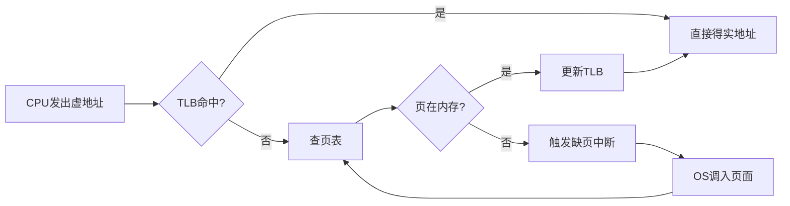

# 虚拟存储器基本概念（虚地址与实地址、页表、TLB快速转换、页面错误处理）

## 虚拟存储器基本概念

如果主存容量有限，如何运行比物理内存更大的程序？虚拟存储器正是为了解决这一矛盾而生。它由==主存—辅存==两级存储体系组成（对应选择98），其核心目的并非提速，而是==扩大主存存储空间并实现自动管理调度==（对应选择104）。与纯硬件管理的 Cache/主存系统不同，主存/辅存系统依赖==软件或带硬件支持的软件==进行管理（对应简述6、选择75）。

### 虚地址与实地址的映射机制

程序使用的是虚拟地址（逻辑地址），而实际访问的是物理地址（实地址）。两者之间的转换是虚拟存储器的核心操作。

> [!IMPORTANT]
> 地址映射由==操作系统==在运行时动态完成，而非程序员、编译器或装入程序静态决定。这是虚拟存储器区别于早期固定分区管理的关键特征。

### 页表与TLB快速转换

页表记录了虚页号到实页号的映射关系。但每次访存都查页表开销太大，因此引入==TLB（快表）==作为页表的Cache。TLB采用全相联或组相联结构，利用局部性原理加速地址转换。当TLB未命中时，才需访问主存中的页表；若页表显示该页不在内存，则产生==页面错误（缺页异常）==，交由OS处理。

> [!TIP]
> TLB只缓存“当前活跃”的页表项，其命中率通常 >95%。计算有效访问时间时，务必区分TLB命中与未命中两种路径的代价。

### 页面错误处理流程

当发生缺页时，硬件暂停当前指令，转入OS的缺页处理程序：① 查找所需页在外存的位置；② 在主存中分配空闲页框（若无则执行置换算法）；③ 从辅存读入数据；④ 更新页表和TLB；⑤ 重新执行被中断的指令。整个过程对用户完全透明。

### 与Cache/主存系统的区别

| 对比维度 | Cache/主存 | 主存/辅存（虚拟存储器） |
| :--- | :--- | :--- |
| 管理方式 | 纯硬件 | 软件+硬件支持 |
| 对用户透明度 | 完全透明 | 对应用员透明，对OS不透明 |
| 主要目标 | 提高访问速度 | 扩大可用存储空间 |
| 缺失代价 | 数十纳秒级 | 毫秒级（磁盘I/O） |

> [!WARNING]
> 常见误区：认为虚拟存储器能“提高主存存取速度”。实际上它可能因频繁缺页导致性能下降，其核心价值在于==空间扩展与管理自动化==，而非速度提升。

### 典型例题解析

**题目**：采用虚拟存储器的主要目的是______。（选择104）  
**解析**：选项A、C涉及“提速”，属于Cache的功能范畴；选项D“扩大外存空间”不符合事实，外存容量本身不受虚拟存储器影响。正确答案为B，准确概括了虚拟存储器“扩容+自动管理”的双重本质。此题考察对虚拟存储器设计初衷的精准理解，避免与Cache功能混淆。
