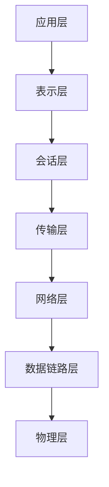

# 网络体系结构与协议（OSI/RM与TCP/IP模型、协议三要素）

## 协议与协议三要素

计算机之间要交换信息，彼此必须有约定和规则。**网络协议**就是通信双方必须遵循的、控制信息交换的规则集合，它规定了数据与控制信息的格式、含义、发送顺序、定时方式以及检错方法。

> [!IMPORTANT]
> 网络协议由 ==语法、语义、同步== 三要素组成。同步也常称为“时序”。

| 要素 | 含义 | 回答的问题 | 例子 |
|---|---|---|---|
| 语法 | 数据与控制信息的结构或格式 | 怎么讲 | 报文首部有哪些字段、各字段长度和编码 |
| 语义 | 协议元素含义及相应动作 | 讲什么 | 收到确认号后，发送方确认哪些数据已收到 |
| 同步 | 事件实现的先后顺序和定时关系 | 何时讲 | 先建立连接，再传数据，最后释放连接 |

例如，TCP通信不能任意发送一段字节就结束：双方先按规定的报文格式交换控制信息，理解各标志位和序号的含义，并遵循连接建立、数据传输、连接释放的时序。这三个方面缺一不可。

## 网络体系结构与分层

**网络体系结构**是计算机网络各层及其协议的集合，是对网络及其部件应完成功能的精确定义。分层后，第 $N$ 层利用第 $N-1$ 层提供的服务，并向第 $N+1$ 层提供服务；相邻层通过接口交互，OSI中称为服务访问点（SAP）。

分层能把复杂问题分解为较小、相对独立的问题，便于设计、实现、维护和标准化。但层数并非越多越好：太少会使每层协议过于复杂，太多则会增加描述和综合各层功能的困难。

> [!WARNING]
> 体系结构描述网络层次、每层功能和所用协议，==不规定协议内部实现细节==。协议是不同系统同层实体之间的规则，常说是“水平”的；服务是相邻层之间下层向上层提供的能力，常说是“垂直”的。

## OSI/RM与TCP/IP模型

ISO于1984年公布ISO 7498，即OSI/RM。七层由低到高依次为：**物理层、数据链路层、网络层、传输层、会话层、表示层、应用层**。低层偏重数据通信，高层偏重信息处理。

| 层次 | 主要功能 | 典型数据单位或考点 |
|---|---|---|
| 物理层 | 建立、维护和释放物理连接，透明传输比特流 | 比特 |
| 数据链路层 | 建立数据链路，成帧、差错控制等，使有差错的物理线路成为较可靠的数据链路 | 帧 |
| 网络层 | 为分组选择路由，并涉及拥塞控制、网络互连 | 分组 |
| 传输层 | 为两端进程提供端到端通信服务 | 报文段或用户数据报 |
| 会话层 | 建立、管理和终止会话 | 高层功能 |
| 表示层 | 处理数据表示、编码、加密等 | 高层功能 |
| 应用层 | 为应用程序提供网络服务 | 用户数据 |

> [!TIP]
> 记住：==传输层是OSI中自下而上第一个提供端到端服务的层次==；物理层传比特，数据链路层传帧，不要混淆。

TCP/IP通常分为**网络接口层、网际层（互连网络层）、传输层、应用层**。其应用层一般涵盖OSI的会话层、表示层和应用层功能。网际层以IP为核心，还包括ICMP、IGMP、ARP等；传输层主要有TCP和UDP。整个协议族呈漏斗状，IP位于最窄处，使不同应用和不同网络技术能够通过IP互连。

| 对比项 | OSI/RM | TCP/IP |
|---|---|---|
| 层次 | 七层 | 通常四层 |
| 层次关系 | 较严格 | 可跨层 |
| 服务考虑 | 最初偏重面向连接 | 同时考虑面向连接与无连接 |
| 地位 | 法律上的国际标准，较复杂 | 事实上的国际标准，应用广泛 |

## 例题

**问：在OSI参考模型中，传输基本单位是帧的是哪一层？最高层是哪一层？**

答：数据链路层以帧为单位传输数据，因此第一空填“数据链路层”；七层模型最高层为“应用层”。

**问：TCP和IP分别位于TCP/IP体系结构的哪一层？**

答：TCP位于传输层，提供面向连接的可靠传输；IP位于网际层，是网络互连的核心协议。
