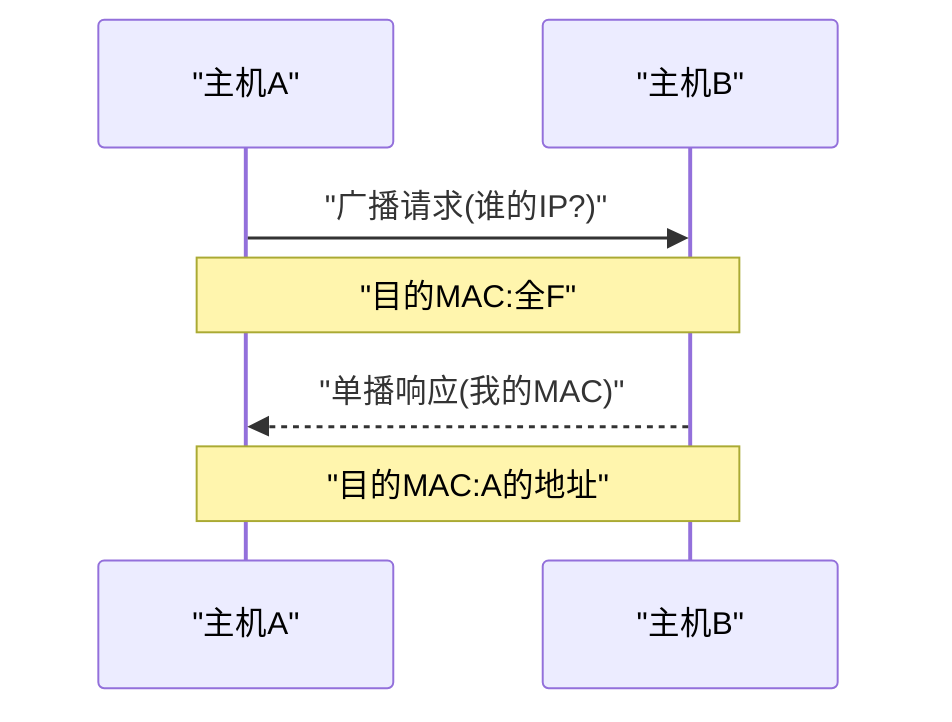
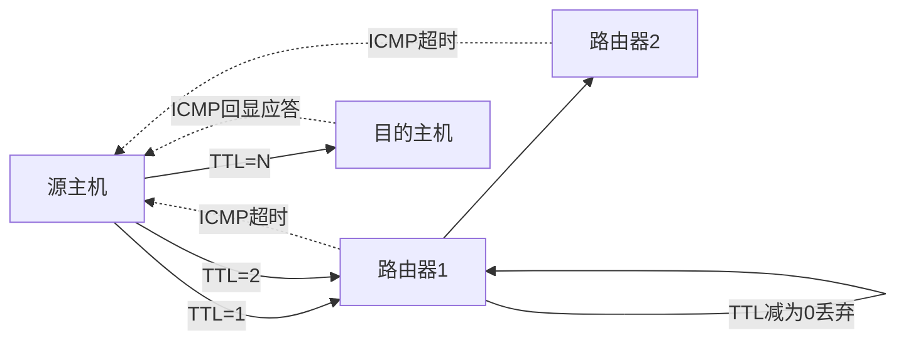

# ARP地址解析协议与ICMP控制报文

IP 数据报在网络层使用 IP 地址寻址，但到了数据链路层，帧在物理链路上实际传输时靠什么找到下一跳？答案是 MAC 地址。这就引出了网络层两个重要的辅助协议：解决地址映射的 ARP，以及负责差错与控制反馈的 ICMP。

## ARP 地址解析协议

> [!IMPORTANT]
> ARP（Address Resolution Protocol）的功能是==实现从 IP 地址到 MAC 地址的映射==。

当主机 A 要向同局域网的主机 B 发送 IP 数据报时，A 知道 B 的 IP 地址，却不知道 B 的 MAC 地址，无法封装以太网帧。ARP 的工作流程如下：

1. **广播请求**：A 构造 ARP 请求报文，将其封装在以太帧中发送，帧的目的 MAC 地址为全 1 广播地址 `FF FF FF FF FF FF`。
2. **单播响应**：B 收到后识别出自己的 IP，便向 A 单播发送 ARP 响应报文，告知自己的 MAC 地址。

> [!WARNING]
> 简答题常考易错点：**ARP 请求是广播，ARP 响应是单播**。不要写成“响应也是广播”。另外，ARP 属于网络层协议，但它直接为数据链路层服务，其报文封装在 MAC 帧中传输，而不是封装在 IP 数据报中。

与相近概念的区别：RARP（逆地址解析协议）用于无盘工作站根据已知 MAC 地址求 IP 地址，方向相反。

## ICMP 控制报文协议

IP 协议本身是无连接、尽最大努力交付的，不提供差错纠正机制。如果路由器发现分组出错或拥塞，如何通知源主机？这就需要 ICMP（Internet Control Message Protocol）。

ICMP 报文作为 IP 数据报的数据部分进行封装。按功能分为两类：==差错报告报文==和==信息报文（提供信息报文）==。

| 类别 | 典型报文 | 触发场景 |
| :--- | :--- | :--- |
| 差错报告 | 目的不可达 | 找不到目标网络/主机/端口 |
| 差错报告 | 超时 | TTL 减为 0 |
| 差错报告 | 源站抑制 | 路由器因拥塞丢弃分组 |
| 信息报文 | 回送请求与应答 | `ping` 探测可达性 |

> [!TIP]
> 记忆口诀：“ping 送回声，拥塞发抑制”。常用的 `ping` 程序使用的是 ICMP 的**回送请求与应答**报文。若路由器 R 因拥塞丢弃了 IP 分组，R 会向源主机发送**源站抑制**类型的 ICMP 报文。

## 路由跟踪实现原理

`traceroute`（路由跟踪）巧妙结合了 IP 头部的 TTL（生存时间，意义在于跳数限制）字段与 ICMP 的超时差错报告报文。

具体做法：源主机依次发送 TTL = 1, 2, 3, … 的探测分组（通常使用 ICMP echo request 或 UDP）。
- 第 1 个路由器收到 TTL=1 的分组，转发前将 TTL 减 1 变为 0，于是丢弃该分组，并向源主机返回一个 ==ICMP 超时差错报告报文==。源主机由此得知第 1 跳路由器的地址。
- 同理，TTL=2 的分组在第 2 个路由器处超时并返回 ICMP 报文。
- 直到探测分组到达最终目的主机，目的主机不再返回超时报文，而是返回 ==ICMP echo reply（回送应答）==，路由跟踪结束。

> [!NOTE]
> 填空题曾考查 CIDR 地址块计算（如 $128.10.64.0/20$ 包含 $2^{12}$ 个地址，掩码为 $255.255.240.0$），虽然不直接属于 ARP/ICMP，但在网络互连中，ARP 正是基于这些子网划分后的本地链路进行地址解析的。理解网络层各协议的配合关系是关键。
