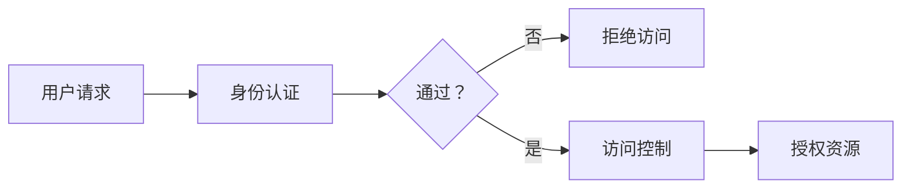
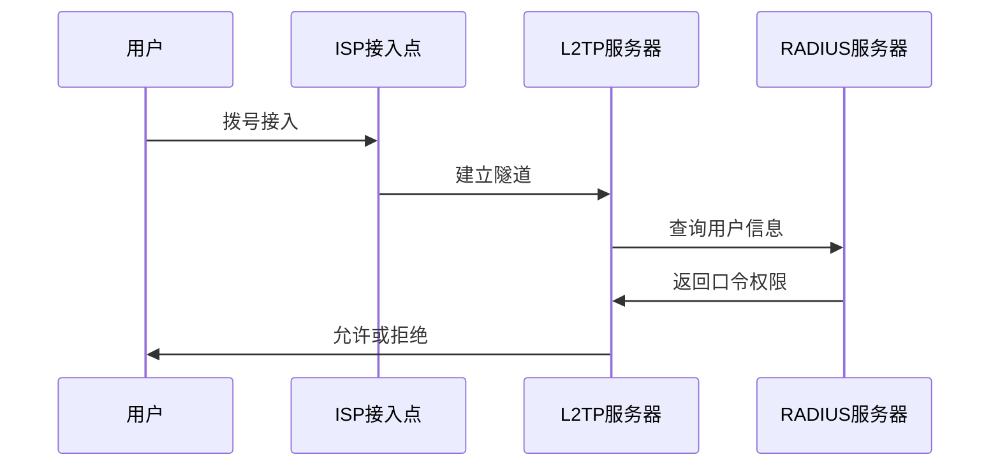

# 身份认证与访问控制（防火墙、RADIUS）

## 它是什么：为什么光有加密还不够？

数据加密解决的是"别人看不懂"的问题。但如果对面根本是个冒充者，加密得再好也白搭——你只是把秘密安全地送到了骗子手里。所以在通信前，必须先回答两个问题：**你是谁？你能碰什么？** 前者是 ==用户身份认证==（Authentication），后者是 ==访问控制==（Access Control）。

> [!IMPORTANT]
> 身份认证是建立安全通信的前提条件，访问控制则在认证通过后限定用户的操作权限。二者合起来构成"身份识别—确认—访问控制"的完整链条。

## 身份认证怎么做？

身份认证协议定义了参与方交换消息的格式、语义和次序，常采用加密机制保证完整性与保密性。典型手段是 ==数字签名==：用公开密钥法对收发信息进行确认，防止伪造和欺骗，其基本功能包括身份鉴别、数据完整性与不可否认。

认证按"你有什么、你知道什么、你是谁"分为三类：口令（所知）、令牌/证书（所有）、生物特征（所是）。

## 访问控制的两种模型与 ACL

| 类型 | 全称 | 特点 |
| --- | --- | --- |
| DAC | 自主访问控制 | ==客体属主自行决定授权==，灵活但易失控 |
| MAC | 强制访问控制 | 由系统/管理员强制指定密级，严格但僵硬 |

具体实现中最常见的是 ==访问控制表（ACL）==：以客体为索引，每个客体对应一个 ACL，列出各主体可对其执行的操作。

> [!WARNING]
> ACL 用稀疏矩阵表示，便于对"某个客体"做控制，但不利于对"某个主体"的权限维护——要改一个用户的权限，得去==每个==客体的 ACL 里翻找，代价高、易遗漏。

## 防火墙：网络边界的守门员

防火墙是软件+硬件构成的系统，在两个网络之间实施**接入控制策略**。防火墙内侧称 ==可信赖网络==，外侧因特网称 ==不可信赖网络==。功能就两个字：**阻止**与**允许**，其中以"阻止"为主。

| 类别 | 工作层次 | 原理 |
| --- | --- | --- |
| IP 级防火墙 | 网络层 | 分组过滤 + 授权服务器 |
| 应用级防火墙 | 应用层 | ==代理（Proxy）==分别连接内外网 |
| 链路级防火墙 | 传输层 | 通用 TCP/UDP 连接中继 |

> [!NOTE]
> 应用级防火墙针对专门应用协议，链路级防火墙不针对具体应用协议，只是通用的 TCP/UDP 连接中继——这是两者关键区别。

## RADIUS 与远程接入

远程用户拨号时，数据经 ISP 的 L2TP 接入集中器，通过 IP 网的 L2TP 隧道送到 L2TP 网络服务器，再由 ==RADIUS 服务器==完成认证。

RADIUS 是维护用户配置文件（口令、访问优先权）的数据库，代理 RADIUS 允许 ISP 接入点接入客户的 RADIUS 服务器获取必要信息。

> [!TIP]
> 记忆口诀：**防火墙守边界，RADIUS 守拨号**；防火墙看"包能不能过"，RADIUS 看"人能不能进"。

## 常见坑

- ==混淆 DAC 与 MAC==：DAC 是"属主自己定"，MAC 是"系统强制定"，别写反。
- ACL 的弱点是**主体侧**维护难，不是客体侧。
- 防火墙主要功能是"阻止"，不是"允许"。
- 被动攻击如截获不改变数据；主动攻击如中断、篡改、伪造则会。

> [!TIP]
> 习题 8.13：衡量网络安全的指标是可靠性、可用性、保密性、完整性、不可抵赖性（P284），与认证/控制直接相关的是后三者。
