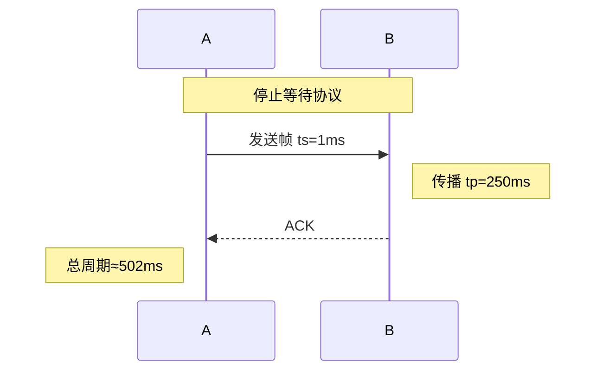

# 数据通信系统模型与传输媒体

## 传输媒体与物理层基础

数据要从源点到达终点，必须依赖物理通路。如果把协议比作交通规则，那么==传输媒体就是承载车辆的道路本身==。物理层的核心任务并非“传数据”，而是确定与传输媒体接口的机械、电气、功能和过程特性，实现比特流的透明传输。

### 有线与无线媒体辨析

南邮教材将常用传输媒体归纳为7种（3有线+4无线）。面对不同场景，如何选择？

| 媒体类型 | 典型代表 | 核心特点 | 适用场景 |
| :--- | :--- | :--- | :--- |
| 双绞线 | 100BASE-T | 成本低、易安装 | 局域网接入 |
| 同轴电缆 | 宽带/基带 | 抗干扰强于双绞线 | 早期LAN/有线电视 |
| 光纤 | 单模/多模 | 带宽高、损耗低 | 骨干网/长距离 |
| 无线电波 | Wi-Fi/蜂窝 | 移动性好、易受扰 | 移动通信/WLAN |
| 微波 | 地面/卫星 | 视距传播、延迟大 | 偏远地区/备份链路 |
| 红外线 | 遥控器 | 方向性强、不穿墙 | 短距点对点 |
| 激光 | 大气激光 | 带宽极高、受天气影响 | 特殊科研/临时链路 |

> [!IMPORTANT]
> “100BASE-T”命名是高频考点：**100** = 速率100Mb/s；**BASE** = 基带传输；**T** = 双绞线（Twisted Pair）。若为F则代表光纤，X代表同轴电缆。

### 信号转换与时延计算

数字数据为何有时要转为模拟信号？因为部分传统信道（如电话线）仅支持模拟传输，需通过调制解调器进行数模转换。三种基本数字调制方法为：==调幅(ASK)、调频(FSK)、调相(PSK)==。

在评估传输效率时，务必区分两种时延：

-   **发送时延** $t_s$：数据块从结点进入传输媒体的时间，$t_s = \frac{\text{数据帧长度(bit)}}{\text{数据率(b/s)}}$。
-   **传播时延** $t_p$：电磁波在信道上传播的时间，$t_p = \frac{\text{信道长度(m)}}{\text{传播速率(m/s)}}$。

> [!WARNING]
> 发送时延取决于==数据率和帧长==，与传播距离无关；传播时延取决于==介质和距离==，与数据率无关。混淆二者是计算题最大失分点。

以真题为例：卫星信道数据率 $R=1\text{Mb/s}$，单程 $t_p=250\text{ms}$，帧长 $L=1000\text{bit}$。
$$t_s = \frac{1000}{1\times10^6} = 1\text{ms}, \quad RTT = 2 \times 250 = 500\text{ms}$$

对于停止-等待协议，信道利用率：
$$U = \frac{t_s}{t_s + RTT} = \frac{1}{1+500} \approx 0.2\%$$
可见在长时延链路上，若不采用滑动窗口（如连续ARQ），媒体资源浪费极其严重。这正是引入==信道复用技术==（如STDM统计时分复用）和流量控制机制的根本动因。

> [!TIP]
> CDMA码片序列题中，发送比特“0”对应码片的==反码==，发送“1”对应==原码==。这是物理层编码与链路层协议的交叉考点，切勿记反。
