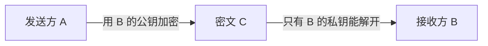
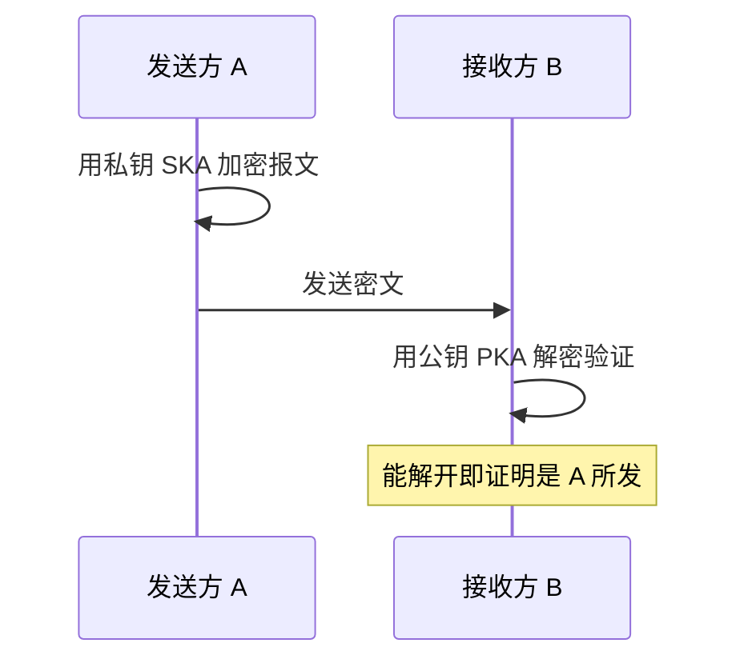

# 密码学与数据加密技术（对称与非对称密钥、数字签名、报文摘要）

## 为什么需要加密

网络是公开的信道，任何人都能截获你发的报文。如果只传输明文，账号密码、交易记录就全部暴露。数据加密技术就是把明文 $P$ 变成密文 $C$，让窃听者看不懂；同时配合数字签名、报文摘要，让接收方能确认"这条消息确实来自对方，且中途没被改过"。

## 对称密钥密码系统

> [!IMPORTANT]
> 对称密钥系统：==加密密钥与解密密钥相同==的密码体制，又称常规密钥系统。

设加密算法为 $E$、解密算法为 $D$、密钥为 $K$，则

$$C = E_K(P), \qquad P = D_K(C)$$

通信双方必须事先通过安全渠道共享同一个密钥，这带来两个典型问题：

- **密钥分配难**：如何把密钥安全地送到对方手里？
- **密钥数量爆炸**：$n$ 个用户两两通信需要 $\frac{n(n-1)}{2}$ 个密钥。

代表算法：DES、3DES、AES。特点是==算法简单、加解密速度快==，适合加密大量数据。

## 非对称密钥密码系统

> [!IMPORTANT]
> 非对称密钥系统：每个用户持有一对密钥——==公钥 $PK$ 公开，私钥 $SK$ 保密==。用公钥加密、私钥解密，或反过来。

产生原因正是对称体制的两大痛点：密钥分配问题和对数字签名的需求。

RSA 算法是其典型代表，理论基础是**大数分解的困难性**：找两个大素数相乘很容易，但把乘积分解回素数极其困难。

非对称体制解决了密钥分发问题（公钥可以随便公布），但加解密速度慢，一般只用于加密少量数据或交换密钥。

## 数字签名

> [!IMPORTANT]
> 数字签名：通信双方在网上交换信息时，采用公开密钥法对所收发的信息进行确认，防止伪造和欺骗的一种身份认证方法。

数字签名必须满足：

- **可验证**：能确认签名者身份；
- **不可伪造**：别人无法冒充签名；
- **不可抵赖**：签名者事后不能否认；
- **报文完整性**：签名与报文内容绑定，改一个字节签名就失效。

使用公钥算法做签名时，加密和解密算法除了满足 $D[E(P)] = P$，还必须满足

$$E[D(P)] = P$$

即加密过程和解密过程可逆，RSA 就具有这种特性。签名时用**私钥加密**（只有本人能做），验证时用**公钥解密**（任何人都能验）。

## 报文摘要

直接用私钥加密整段报文做签名，速度太慢。改进思路：先用单向哈希函数对任意长度的明文算出一个**固定长度**的比特串，再只对这个比特串加密，这就是报文摘要（MD）。

常用算法：MD5、SHA。

> [!WARNING]
> 报文摘要必须满足三个条件：
> - 任何人不可能产生出具有相同报文摘要的两个不同报文（抗碰撞）；
> - 给定报文摘要，无法反推出原报文（单向性）；
> - 对原报文做任何改动，摘要都会完全不同（雪崩效应）。

完整签名流程：A 对明文 $P$ 计算 $MD(P)$，用私钥加密得到 $D_{SK_A}[MD(P)]$，连同 $P$ 一起发给 B；B 收到后用 A 的公钥解开，得到 $MD(P)$，再自己对 $P$ 算一遍摘要，==两者一致则报文完整且来源可信==。

## 对称与非对称的对比

| 维度 | 对称密钥 | 非对称密钥 |
|---|---|---|
| 密钥 | 加密密钥 = 解密密钥 | 公钥公开，私钥保密 |
| 速度 | 快 | 慢 |
| 密钥分发 | 困难 | 公钥可公开，容易 |
| 典型算法 | DES、3DES、AES | RSA |
| 适用场景 | 大量数据加密 | 密钥交换、数字签名 |

> [!TIP]
> 实际系统（如 SSL）通常把两者结合：用非对称算法交换对称密钥，再用对称算法加密大量数据，兼顾安全与效率。
