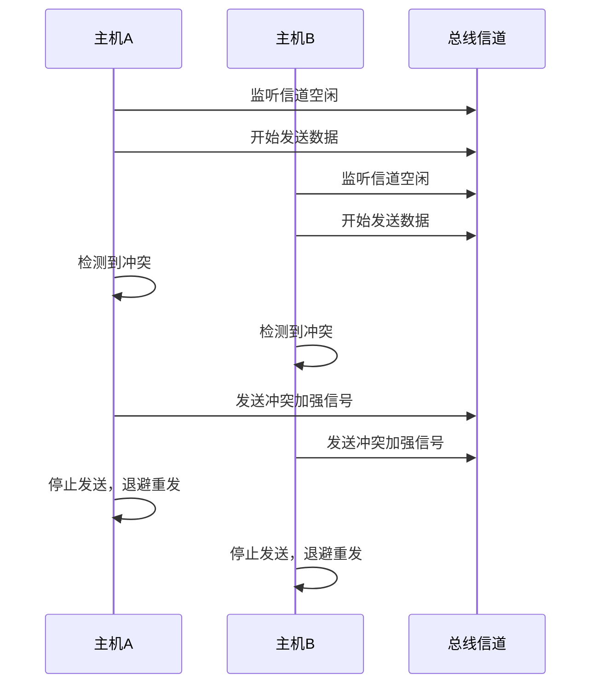

# CSMA/CD协议与以太网（争用期、最短帧长、MAC帧格式）

## CSMA/CD 协议与以太网

以太网是目前应用最广泛的局域网技术，其核心是 **CSMA/CD**（载波监听多点接入/冲突检测）协议。它解决的核心问题是：多台主机共享一条总线时，如何协调发送、避免冲突。

## 为什么需要 CSMA/CD

总线型局域网中，所有主机共享同一信道。如果两台主机同时发送数据，信号会相互干扰，导致数据损坏。CSMA/CD 通过"先听后发、边发边听"的机制来减少冲突的影响。

## CSMA/CD 工作原理

CSMA/CD 的工作过程可以概括为四句话：

1. **载波监听**：发送前监听信道，若空闲则发送，若忙则等待
2. **多点接入**：多个站点共享同一信道
3. **冲突检测**：发送过程中持续检测，若发现冲突立即停止发送
4. **随机退避**：冲突后等待随机时间再重发

> [!IMPORTANT]
> **争用期（冲突窗口）**是 CSMA/CD 的关键概念。一台主机从开始发送数据起，最多经过端到端往返时延 $2\tau$ 就能确知是否发生冲突。这个 $2\tau$ 就是争用期。

## 最短帧长

为什么要规定最短帧长？想象一个极端情况：主机 A 发送的帧很短，在冲突信号返回之前就已经发完了。这样 A 无法检测到冲突，会误认为发送成功。

因此，==帧的发送时延必须不小于争用期==，即：

$$\frac{L_{min}}{C} \geq 2\tau$$

所以最短帧长为：

$$L_{min} = 2\tau \times C$$

> [!TIP]
> 对于 10 Mbit/s 以太网，争用期取 51.2 μs，可发送 512 bit = 64 字节。因此**最短有效帧长为 64 字节**，小于 64 字节的帧都是因冲突而异常中止的无效帧。

## MAC 帧格式

以太网 V2（DIX v2）的 MAC 帧格式如下：

| 字段 | 长度（字节） | 作用 |
|------|-------------|------|
| 目的地址 | 6 | 接收方 MAC 地址 |
| 源地址 | 6 | 发送方 MAC 地址 |
| 类型 | 2 | 标识上层协议（如 0x0800 表示 IP） |
| 数据 | 46~1500 | 上层数据，不足 46 字节需填充 |
| FCS | 4 | 帧检验序列（CRC 校验） |

> [!WARNING]
> 数据字段长度必须在 46~1500 字节之间。若数据不足 46 字节，必须填充，以保证 MAC 帧总长不小于 64 字节（6+6+2+46+4=64）。

## 计算示例

**题目**：构造一个电缆总长度为 1000 m 的 CSMA/CD 网络，数据传输速率为 100 Mbps，通过一个中继器连接，信号经过中继器产生 2 μs 时延，信号在电缆中传播速度为 $2 \times 10^8$ m/s。求允许传送的最短帧长。

**解答**：

单程传播时延：

$$\tau = \frac{1000}{2 \times 10^8} = 5 \mu s$$

考虑中继器时延，端到端单程时延：

$$\tau_{total} = 5 + 2 = 7 \mu s$$

争用期：

$$2\tau_{total} = 14 \mu s$$

最短帧长：

$$L_{min} = 14 \mu s \times 100 \text{ Mbps} = 1400 \text{ bit}$$

> [!NOTE]
> 实际以太网中，考虑到端到端传播时延、转发器增加时延、冲突加强信号持续时间等因素，实际争用期值往往大于理论端到端传播时延。例如 10 Mbit/s 以太网实际取 51.2 μs 而非理论计算值。
