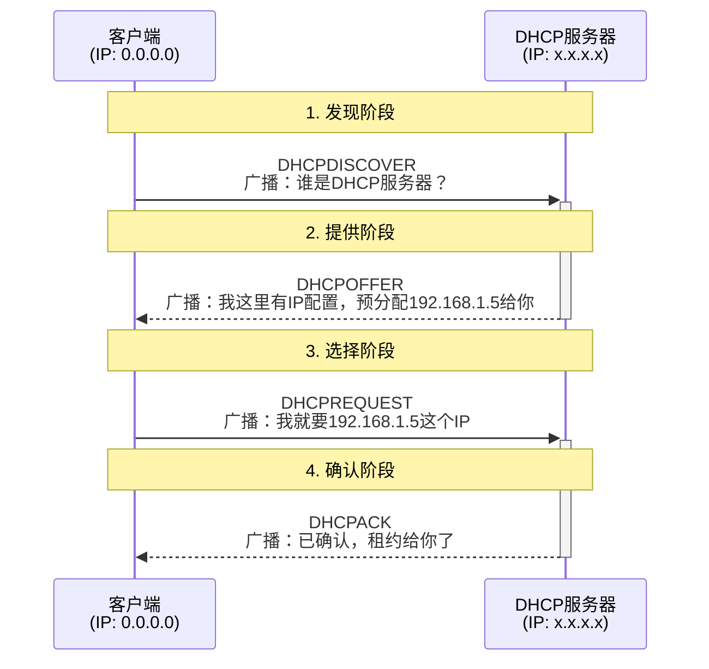
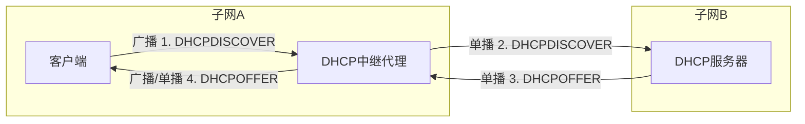

# 动态主机配置协议DHCP（工作原理、中继代理）

好的，我们来为南京邮电大学《计算机通信与网络》课程编写关于动态主机配置协议 DHCP 的知识点正文。

```markdown
---
title: 动态主机配置协议 DHCP
requires: [计算机网络/应用层概述, 计算机网络/UDP协议]
---

## 为什么需要 DHCP？

想象一下，每次连上校园网或家里 Wi-Fi，你都要手动输入一长串 IP 地址、子网掩码、默认网关，还得记住学校 DNS 服务器的地址，这不仅麻烦，而且容易因为 IP 冲突导致无法上网。为了解决这个问题，==动态主机配置协议（DHCP）== 应运而生。

> [!IMPORTANT]
> **DHCP 是什么？**
> DHCP（Dynamic Host Configuration Protocol）是一种应用层协议，它能让你计算机==即插即用==，通过自动化的流程获取上网所需的全部网络配置参数，大大简化了网络管理工作。它使用 **UDP** 作为传输层协议，服务器端口号为 `67`，客户端端口号为 `68`。

## DHCP 是如何工作的？

你可能会好奇，刚开机时计算机连 IP 地址都没有，它怎么和 DHCP 服务器通信呢？DHCP 采用了一套巧妙的四次“一问一答”机制来解决这个问题。



整个过程保证客户端在没有 IP 地址的情况下也能完成通信。这四个阶段分别是：

1.  **发现阶段**：客户端在网络上发出 `DHCPDISCOVER` 报文。此时它还不知道服务器的地址，所以会以 `0.0.0.0` 为源地址、`255.255.255.255` 为目的地址进行广播。
2.  **提供阶段**：服务器收到请求后，会从地址池中拿出一个可用的 IP 地址，通过 `DHCPOFFER` 报文以广播方式“提供给”客户端。
3.  **选择阶段**：客户端可能会收到多个服务器的提供报文，它会选择一个，并通过广播 `DHCPREQUEST` 报文告知所有服务器自己的决定。
4.  **确认阶段**：被选中的服务器回复 `DHCPACK` 报文进行最终确认，并附上 IP 地址的 ==租用期==。客户端在收到此报文后，才算真正可以开始使用这个 IP 地址。

> [!TIP]
> **记忆口诀**：DHCP 四步走，**找、给、选、确认**（Discover, Offer, Request, Ack）。

## 上网所需的四项配置

通过 DHCP，一台计算机接入因特网会自动配置好以下四个关键项目：

| 关键项目 | 作用 |
| :--- | :--- |
| **本机 IP 地址** | 计算机在网络中的唯一标识，如 `192.168.1.5` |
| **子网掩码** | 用来区分 IP 地址中的网络号和主机号，判断目标是否同网段 |
| **默认网关 IP 地址** | 通往其他网络的“大门”，发送到非本网段的数据包都交给它 |
| **域名服务器(DNS) IP 地址** | 完成域名（如 `www.njupt.edu.cn`）到 IP 地址的转换 |

## DHCP 中继代理

然而，DHCP 依靠广播的机制会导致一个问题：路由器会隔离广播域。如果每个局域网都要放一台专门的 DHCP 服务器，那成本就太高了。

这时就需要 ==**DHCP 中继代理**==。它解决了跨网段获取 IP 地址的难题。



> [!NOTE]
> **中继代理的工作原理：**
> 1. 每个网络上至少配置一个中继代理，它知晓 DHCP 服务器的确切 IP 地址。
> 2. 中继代理收到客户端广播的 `DHCPDISCOVER` 报文后，会将其 **单播** 转发给远端的 DHCP 服务器。
> 3. 服务器收到单播请求后，同样单播回复 `DHCPOFFER` 给中继代理。
> 4. 中继代理再将这个回复发送给客户端。

这样，一个 DHCP 服务器就能同时为多个不同网段的计算机自动分配配置了。

## 常见考题与误区

> [!WARNING]
> **易错点：DHCP 使用什么传输层协议？**
> 牢记，DHCP 是基于 **UDP** 协议的，而非 TCP。从它的广播发现机制就可以理解，无连接的 UDP 是唯一选择。因此，考试中问到“下列哪个应用层协议使用无连接传输服务？”，答案通常是 **DHCP**。

**一个算对了的例子**
> **题目**：DHCP 地址池为 `192.168.1.0/24`，其中 `192.168.1.1` 到 `192.168.1.10` 被预留给服务器和打印机。一台新主机通过 DHCP 自动获取配置，请问它可能获得的 IP 地址、子网掩码和默认网关是什么？
> 
> **分析**：
> *   **可分配范围**：地址池减去预留地址，即 `192.168.1.11` 到 `192.168.1.254`。
> *   **参数推导**：`/24` 对应的子网掩码是 `255.255.255.0`。默认网关通常使用地址池中的第一个可用主机地址，这里 `192.168.1.1` 已被预留，则网关极大可能就是 `.1`。
> 
> **结果**：新主机可能获得的四项配置为：
> *   IP 地址：`192.168.1.100`（可为范围内的任意值）
> *   子网掩码：`255.255.255.0`
> *   默认网关：`192.168.1.1`
> *   DNS 服务器地址：网络管理员统一配置的值（此题未给出）
