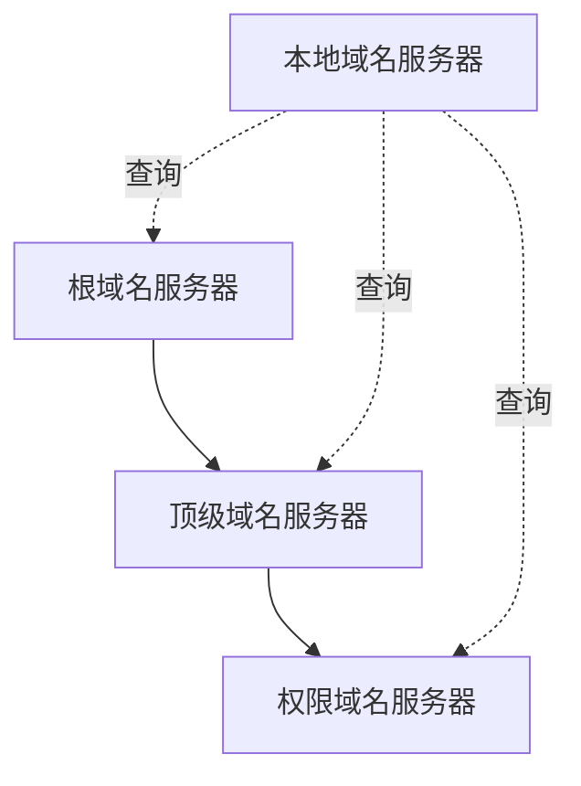
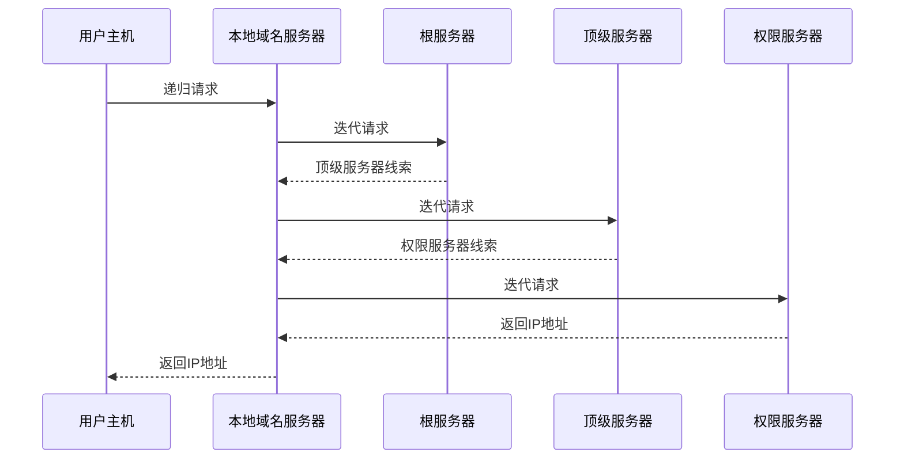

# 域名系统DNS（层次名字空间、递归与迭代查询解析）

## 为什么需要 DNS

IP 地址便于路由器处理，却不便于人记忆。==域名系统 DNS 的核心功能，是把域名解析为 IP 地址==。例如，浏览器访问 `www.njupt.edu.cn` 时，通常先获得其 IP 地址，再建立后续通信。

DNS 采用**分布式、层次化**的名字空间，避免由单台服务器保存全球全部域名。

## 层次名字空间

域名从右向左逐级细化：

```text
www.njupt.edu.cn
 │    │    │  └─ 顶级域：cn
 │    │    └──── 二级域：edu
 │    └───────── 单位域：njupt
 └────────────── 主机名：www
```

对应地，DNS 服务器也形成层次结构：



- **根域名服务器**：通常不直接给出最终地址，而是指出下一步应询问的顶级域名服务器。
- **顶级域名服务器**：管理如 `com`、`cn` 等顶级域相关信息。
- **权限域名服务器**：保存所负责区域的权威资源记录，能给出最终解析结果。
- **本地域名服务器**：靠近用户，代替主机查询并缓存结果；它不一定属于上述域名授权层次。

> [!NOTE]
> DNS 不仅能进行域名到 IP 地址的解析，还支持别名、邮件服务器等记录；但本课程填空题通常答：**域名；IP 地址**。

## 递归查询与迭代查询

两者区别的关键不是“查了几次”，而是：**收到请求的服务器，是负责查到最终结果，还是只提供下一步线索？**

| 对比项 | 递归查询 | 迭代查询 |
|---|---|---|
| 被查询者的任务 | 替请求者继续查询 | 返回结果或下一步服务器信息 |
| 请求者得到什么 | 最终答案或失败信息 | 可能是“去问另一台服务器” |
| 后续查询由谁发起 | 被委托的服务器 | 原查询者 |
| 典型位置 | 主机向本地域名服务器查询 | 本地域名服务器向根、顶级等服务器查询 |

实际解析常采用**递归与迭代相结合**的方式：



因此，主机只向本地域名服务器发一次请求；本地域名服务器可能依次访问多台服务器，并把结果缓存，减少后续查询。

## 例题：请求条数怎么数

**题目**：本地域名服务器无缓存，采用递归方法解析另一网络某主机域名时，用户主机、本地域名服务器发送的域名请求条数分别为多少？

- 用户主机只向本地域名服务器发送 **1 条**请求，之后等待最终答案。
- 本地域名服务器为完成解析，需要向其他域名服务器发送请求，通常为**多条**。

所以应选 **B：1 条，多条**。

> [!WARNING]
> 题目所给答案“A：1 条，1 条”与上述过程不符。只有在本地域名服务器已有缓存等特殊情况下，它才可能不再向外查询；但题干明确说明“无缓存”。也不要把“主机递归查询”误解为“本地域名服务器只发一条请求”。

> [!TIP]
> 解题口诀：**主机递归只发一次，本地迭代可能多次；无缓存要外出，有缓存可直答。** 若考试必须严格服从指定答案，应先核对题目是否漏写了“递归与迭代相结合”等条件。
