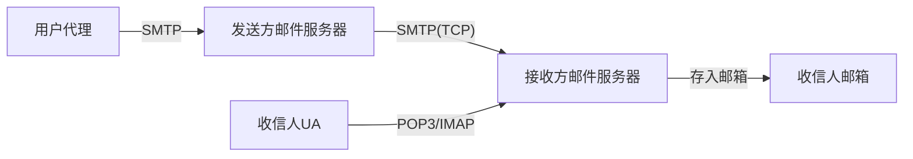

# 电子邮件系统（SMTP、POP3、IMAP、MIME）

## 它是什么

电子邮件系统由 ==用户代理 UA、邮件服务器、SMTP、POP3/IMAP、MIME== 组成。UA 是你写/读邮件的接口；SMTP 负责“发/传”邮件；POP3、IMAP 负责“读”邮件；MIME 扩展 SMTP 以支持非文本数据。

## 为什么需要

SMTP 在 1982 年制定，只能传 7 位 ASCII 文本；而今天的邮件要带中文、附件、图像。因此 1993 年提出 ==MIME==，它在不改变 SMTP 的前提下增加主体结构与编码规则，使邮件可含多种类型。

## 怎么做：发送与读取过程

1. 发信人用 UA 编辑邮件，UA 用 SMTP 传给发送端邮件服务器。
2. 发送端服务器发现缓存中有待发邮件，作为 ==SMTP 客户== 向接收端 ==SMTP 服务器== 发起 TCP 连接。
3. 连接建立后发送邮件；发完关闭 TCP。
4. 接收端把邮件放入收信人邮箱。
5. 收信人用 UA，通过 ==POP3 或 IMAP== 取回邮件。

> [!IMPORTANT]
> 记住三段协议分工：**UA→发送服务器是 SMTP；服务器→服务器是 SMTP；UA 读信是 POP3/IMAP**，别混。

## SMTP、POP3、IMAP、MIME 的区别

| 协议 | 方向 | 作用 | 特点 |
|---|---|---|---|
| SMTP | 发/传 | 传送邮件 | 14 命令、21 应答；三阶段：连接建立、邮件传送、连接释放 |
| POP3 | 读 | 下载邮件 | 简单、功能有限 |
| IMAP | 读 | 联机操作 | 先看首部，可只取某部分；邮件留服务器 |
| MIME | 辅助 SMTP | 扩展数据类型 | 不取代 SMTP，定义非 ASCII 编码 |

> [!NOTE]
> IMAP 允许你在不同电脑随时处理邮件，还能先读正文、后下大附件；代价是必须常连服务器。

## 常见的坑

- ==不要把 POP3/IMAP 和 SMTP 弄混==：发信全程用 SMTP，读信才用 POP3/IMAP。
- SMTP 不使用中间邮件服务器，是在两端 SMTP 进程间直接建 TCP。
- MIME 没有改动或取代 SMTP，只是“继续使用 RFC 822 格式并增加结构”。

## 算对了的例子

题：POP3 是 Internet 中（ ）服务中所使用的协议。A.WWW B.电子邮件 C.BBS D.FTP。

因为 POP3 是“邮件读取协议”，属于电子邮件系统；UA 读信才用它，不属于 WWW、BBS、FTP。==答案：B（电子邮件）==。

> [!TIP]
> 解题口诀：**看题眼“读邮件”→ POP3/IMAP；“传邮件”→ SMTP；“带附件”→ MIME**。
