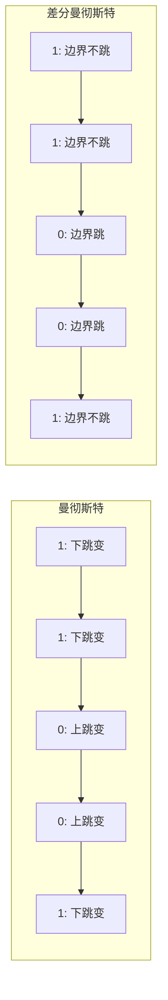

# 数据编码与调制技术（曼彻斯特编码、PCM、基带与频带传输）

## 基带传输与频带传输

计算机里的二进制数据本质上是一串矩形脉冲，频率从 0 附近开始，称为**基带信号**。直接把这种信号送入信道传输，就是**基带传输**。局域网常用 50 Ω 同轴电缆来传基带信号。

但基带信号频率低，很多实际信道（如无线、电话线）无法直接传输。于是先把基带信号"搬"到较高频率的载波上，变成**频带信号**再传输，这就是**频带传输**（也叫调制传输）。

> [!IMPORTANT]
> 基带传输：数字信道，传矩形脉冲本身；频带传输：模拟信道，先调制再传。判断依据是==信道类型==，不是"有没有调制"。

三种基本数字调制方法，本质上都是用基带信号去控制载波的某个参数：

| 调制方式 | 控制参数 | 直观理解 |
|---------|---------|---------|
| 幅移键控 ASK | 载波幅度 | 大振幅代表 1，小振幅代表 0 |
| 频移键控 FSK | 载波频率 | 频率 $f_1$ 代表 1，$f_2$ 代表 0 |
| 相移键控 PSK | 载波相位 | 相位 0 代表 1，相位 π 代表 0 |

## 曼彻斯特编码与差分曼彻斯特编码

基带传输中，直接传二进制矩形脉冲有一个问题：连续多个 0 或 1 时，信号长时间不变，接收方难以提取时钟同步信号。**曼彻斯特编码**为每个比特强制加入一次跳变，用跳变方向表示数据。

**曼彻斯特编码规则**：每个比特周期的中间必然跳变一次——0 用**上跳变**（低→高）表示，1 用**下跳变**（高→低）表示。

**差分曼彻斯特编码**不是直接看电平高低，而是看**比特边界处是否跳变**：边界处跳变代表 0，不跳变代表 1；中间跳变依然保留，仅作同步用。可以理解为"先做差分，再做曼彻斯特"。

以比特序列 `11001` 为例（假设初始电平为高）：

> [!TIP]
> 记忆口诀：曼彻斯特看**中间**"上 0 下 1"；差分看**边界**"跳 0 不跳 1"。

> [!WARNING]
> 初学者最容易搞混差分曼彻斯特的"跳"与"不跳"对应关系。注意：==曼彻斯特中 0 是上跳变，但差分曼彻斯特中 0 是边界跳变==，两者完全不同。

曼彻斯特编码的代价是**编码效率为 50%**：每个比特至少两次电平变化，需要的带宽比原始基带信号大一倍。但它的自同步能力极强，因此以太网早期采用它。

## 脉冲编码调制（PCM）

电话等模拟信号要被计算机处理，必须先数字化。PCM 是标准方法，分三步：

- **采样**：按固定频率取信号瞬时值。根据奈奎斯特采样定理，采样频率 $\geq 2$ 倍信号最高频率才能不失真还原。
- **量化**：把采样得到的连续幅度值归到有限个离散等级。
- **编码**：给每个量化等级分配二进制码。

> [!IMPORTANT]
> PCM 数据率计算公式：$R = 2f_m \times n$（$f_m$ 为信号带宽，$n$ 为每次采样编码位数）。

**例题**：带宽 4 kHz 的信号，每次采样用 8 位编码，求所需通信能力。

$$R = 2 \times 4\times 10^3 \times 8 = 64 \text{ kbps}$$

采样频率取 $2 \times 4 = 8$ kHz，每秒采样 8000 次，每次 8 bit，合计 ==64 kbps==。
