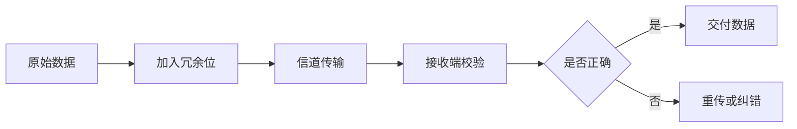

# 差错控制与检测编码（汉明码、CRC循环冗余校验）

## 差错控制是什么

差错控制是指在数据传输过程中发现或纠正传输差错，以保证接收端得到正确数据的技术。实际信道会受到噪声、干扰、衰减和串扰影响，发送端发出的码字到达接收端后可能发生错误。

差错控制通常以**增加冗余信息、降低传输效率**为代价，提高数据传输的可靠性。其基本过程是：

常见差错控制方式包括：

- **检错**：只能判断数据是否出错，如奇偶校验、CRC；
- **纠错**：发现错误位置后直接纠正，如汉明码；
- **差错重传**：检测到错误后请求发送端重传，常与 ARQ 技术结合。

> [!IMPORTANT]  
> 差错控制的根本思想是：在数据中加入按照一定规则产生的冗余信息，接收端利用相同规则判断传输是否发生错误。

## 汉明距离与检错、纠错能力

两个等长码组对应位置不同的位数称为它们的**汉明距离**，记为 $d(x,y)$。

若码的最小汉明距离为 $d_{\min}$，则：

| 能力 | 条件 |
|---|---|
| 检测 $t$ 位错误 | $d_{\min}\ge t+1$ |
| 纠正 $t$ 位错误 | $d_{\min}\ge 2t+1$ |
| 同时检测 $t_1$ 位、纠正 $t_2$ 位错误 | $d_{\min}\ge t_1+t_2+1$，其中 $t_1\ge t_2$ |

原因是：若接收到的错误码字同时接近两个合法码字，就可能无法确定应该纠正为哪一个。

> [!TIP]  
> 记法：检错多留一层余量，纠错需要“两倍距离”。

## 汉明码

汉明码是一类能够纠正 **1 位差错**的线性分组码。设信息位数为 $k$，监督位数为 $r$，码长为 $n=k+r$。为了区分 $n$ 个可能出错的位置以及无错状态，需要：

$$
2^r\ge n+1=k+r+1
$$

因此，监督位应取满足上述条件的最小整数。编码效率为：

$$
\eta=\frac{k}{n}=\frac{k}{k+r}
$$

例如，$k=10$ 时：

- $r=3$：$2^3=8<10+3+1=14$，不成立；
- $r=4$：$2^4=16\ge10+4+1=15$，成立。

所以至少需要 **4 位监督位**，码长为 14 位，效率为 $10/14$。

### 编码与校验

将码字各位置从 1 开始编号。监督位放在编号为 $2$ 的幂的位置，即第 $1,2,4,8,\ldots$ 位，其余位置放信息位。

若采用偶校验，则每一位都应满足“该位为 1 的个数为偶数”。第 $i$ 个监督位负责检查编号二进制中第 $i$ 位为 1 的位置：

$$
\begin{aligned}
p_1&\rightarrow d_1,d_3,d_5,d_7,\ldots\\
p_2&\rightarrow d_2,d_3,d_6,d_7,\ldots\\
p_4&\rightarrow d_4,d_5,d_6,d_7,\ldots
\end{aligned}
$$

接收端重新计算各组校验结果。若采用奇校验，则结果为 1 表示该组正常，为 0 表示出错；采用偶校验时判断相反。将各组结果组成二进制数，其数值就是出错位置对应的位编号；若结果为 0，则表示没有错误。

> [!WARNING]  
> 汉明码的标准汉明码主要用于纠正 1 位错误。若发生 2 位及以上错误，某些情况下会被误判为无错或错误位置不正确。

## CRC循环冗余校验

CRC即**循环冗余校验**，本质上是用二进制多项式进行模 2 除法产生校验码。它主要负责**检错**，而不是确定错误位置。

基本步骤：

1. 将原始数据表示为多项式 $M(x)$；
2. 在末尾补 $r$ 个 0，其中生成多项式 $G(x)$ 的最高次项为 $x^r$；
3. 用模 2 除法计算：

$$
M(x)x^r=G(x)Q(x)+R(x)
$$

4. 将余式 $R(x)$ 作为 CRC 校验位；
5. 接收端用同一生成多项式除以收到的整个码字。若余数为 0，则通常认为传输无误。

模 2 除法的规则是：最高次项相减，不产生借位，加减法都等价于异或。

> [!IMPORTANT]  
> 发送端和接收端必须使用完全相同的生成多项式，否则无法正确判断。

### 计算示例

设信息码为 `10010110`，生成多项式为：

$$
G(x)=x^4+x+1
$$

对应二进制为 `10011`。

发送端用 `10011` 除以 `1001011000`（信息码末尾补 4 个 0），所得余数为 `0011`，因此发送的完整码字为：

$$
10010110\boxed{0011}
$$

接收端收到 `100101100011` 后，再用 `10011` 进行模 2 除法，余数为 0，说明该码字通过 CRC 检测；若信道中某一位发生错误，通常会得到非零余数。

> [!NOTE]  
> CRC能可靠检测大量突发错误，但“检测不出错误”并不等于数学上保证所有错误都能发现。若需要更高可靠性，可使用检错能力更强的生成多项式，并结合确认、重传等机制。

## 常见易错点

- 把汉明码的 $2^r\ge n+1$ 写成 $2^r\ge n$，会漏掉“无错”这一状态。
- 混淆码长 $n$、信息位 $k$ 和监督位 $r$：应满足 $n=k+r$。
- CRC中的除法是**模 2 除法**，只做异或，不进行普通整数除法。
- 汉明码用于纠错，CRC主要用于检错；CRC检测出错后通常需要重传，不能直接确定错误位置。
- 编码效率是 $\frac{k}{k+r}$，不是监督位与信息位之比。
